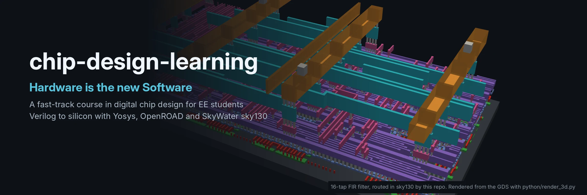

# chip-design-learning

> **Hardware is the new Software.** Chips are written as code, tested like
> code, built by a compiler-like flow and versioned in git. With open-source
> tools you can go from a Verilog file to a real chip layout on a laptop.

A **fast-track course in digital chip design for electronics and electrical
engineering students**. It starts with a counter and finishes with real DSP
hardware (FIR and IIR filters and an FFT), each taken from Verilog through
simulation, synthesis and place & route on the open SkyWater sky130 process.

**Start here: [the course](docs/learning-path.md)** · [tool setup](docs/setup.md) ·
[how the flow works](docs/flow-overview.md) · [fixed-point primer](docs/fixed-point.md) ·
[open-source tool links](docs/tools.md) ·
[slide decks for every module](slides/)

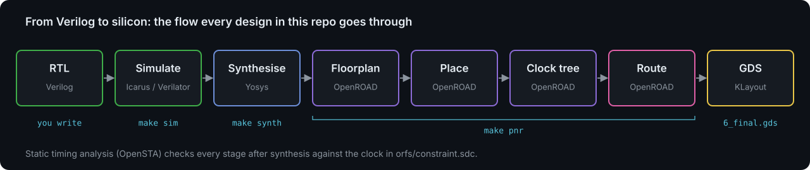

## A chip, from the outside

The first design, `counter`, as it really comes out of `make pnr`: the
transistors and the wiring between them, seen from the corner in a true
isometric view, with the 3 input pins and 9 output pins at their real places
on the die edge. The power straps on the top two metal layers are hidden so
you can see down to the transistors.

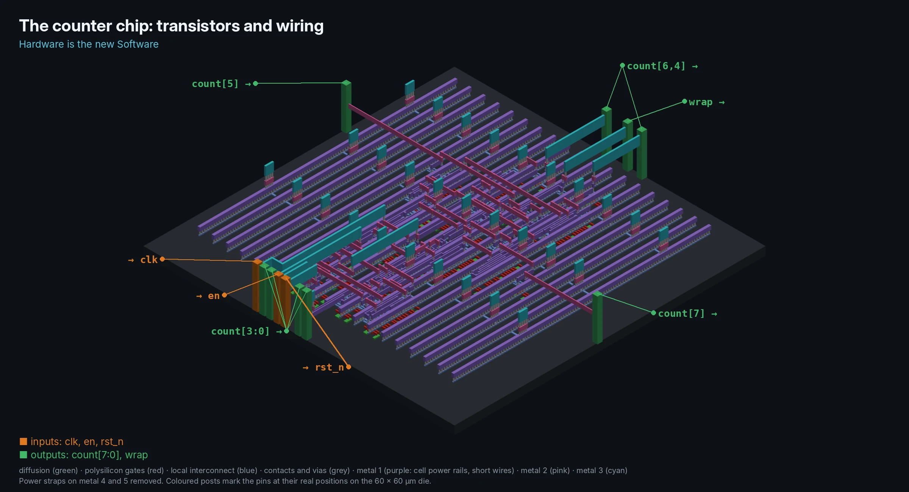

The same chip as a simplified block drawing: what goes in, what comes out,
and the parts synthesis builds inside.

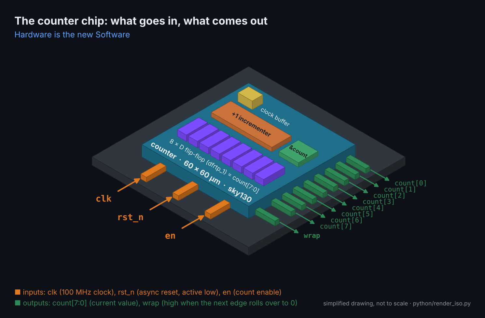

## The examples

Every picture below is rendered straight from the layout file that `make pnr`
produces for that design: the transistors and the wiring on metal 1 to 3 in
an isometric view, with the input pins (orange) and output pins (green)
labelled at their real places on the die edge. Each design's page has more
3D views.

| | Design | What it is | Size in sky130 |
| --- | --- | --- | --- |
|  | **[counter](designs/counter)**<br>Basic | Up-counter with enable: the whole flow in one afternoon | 27 cells, 60 × 60 µm, 100 MHz |
| 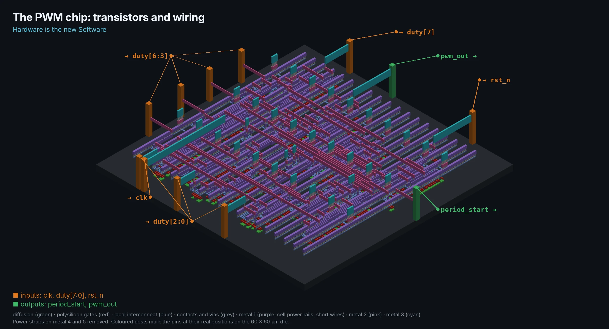 | **[pwm](designs/pwm)**<br>Basic | PWM generator: timer, motor/LED driver, 1-bit DAC | 71 cells, 60 × 60 µm, 100 MHz |
| 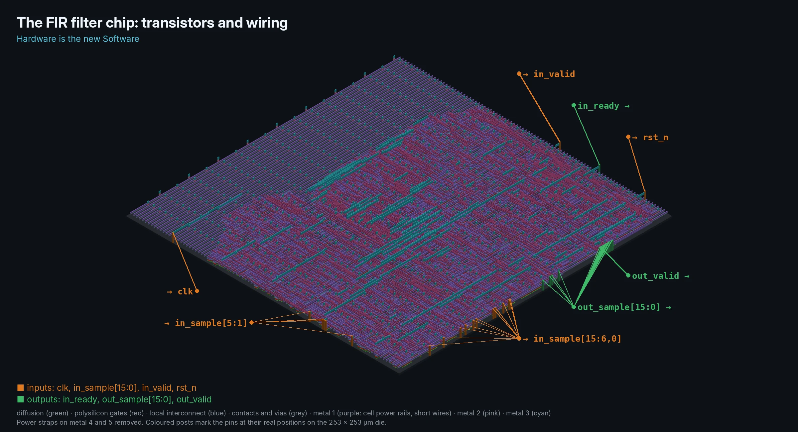 | **[fir](designs/fir)**<br>Advanced | 16-tap low-pass FIR filter with one shared multiplier | 2,100 cells, 253 × 253 µm, 100 MHz |
| 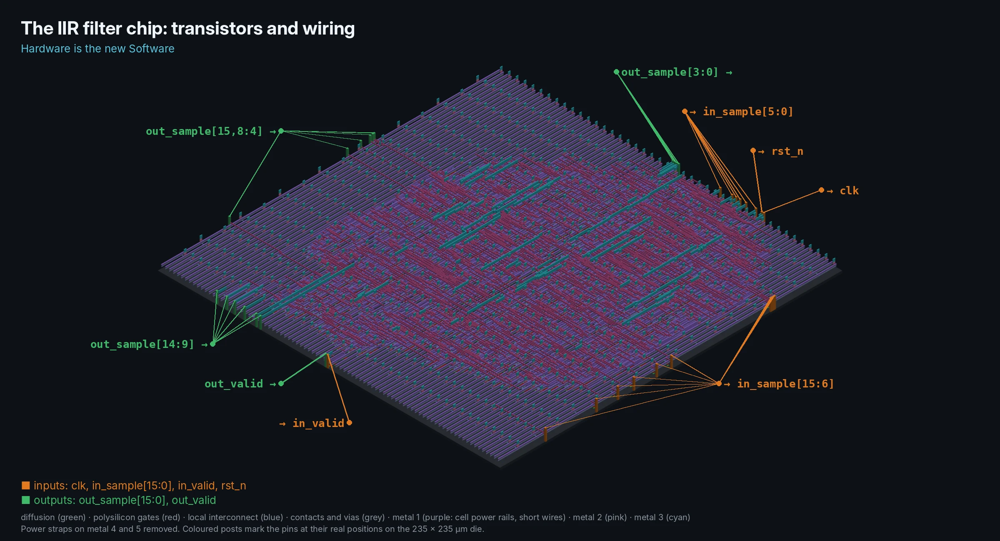 | **[iir](designs/iir)**<br>Advanced | 2nd-order Butterworth IIR biquad, one sample per clock | 1,600 cells, 235 × 235 µm, 50 MHz |
| 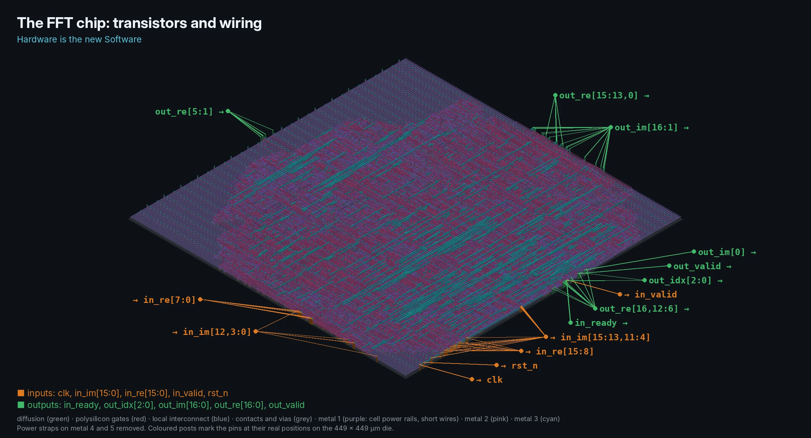 | **[fft](designs/fft)**<br>Advanced | 8-point complex radix-2 FFT | 9,100 cells, 449 × 449 µm, 50 MHz |
| 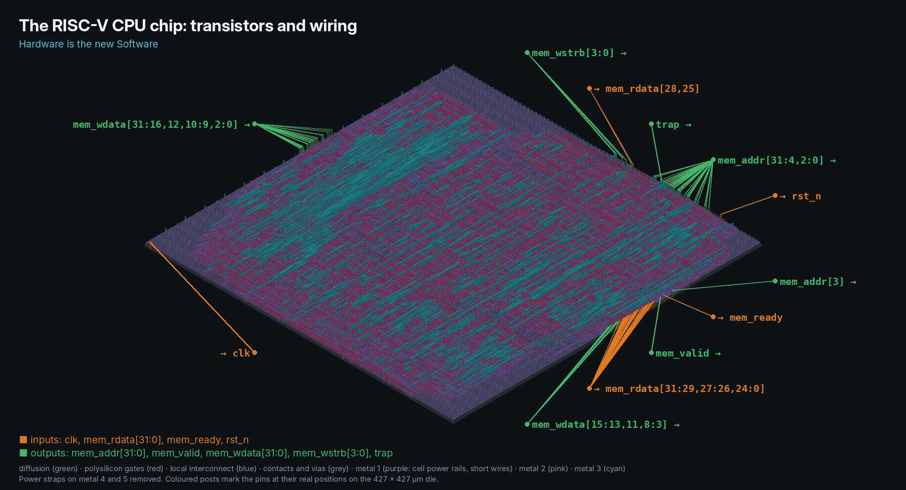 | **[riscv](designs/riscv)**<br>Advanced | RV32I RISC-V CPU that runs C compiled by gcc | 6,200 cells, 427 × 427 µm, 50 MHz |

All six designs pass their testbenches and route with 0 DRC violations and
positive timing slack.

Zoom in far enough and you reach the transistors: green diffusion, red
polysilicon gates, blue local interconnect and grey contacts.

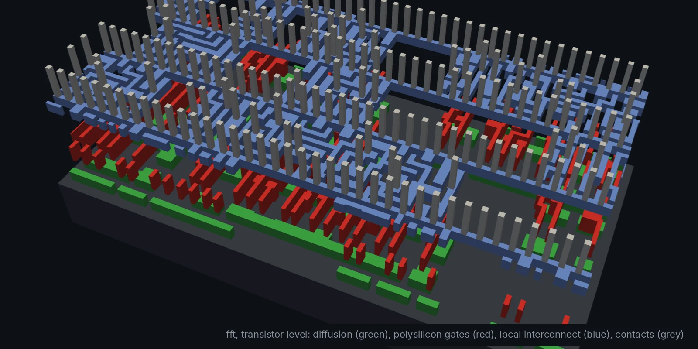

## How every design works

Each design is a small, self-contained project with the same commands:

```sh
cd designs/fir
make sim            # self-checking testbench, prints PASS or FAIL
make plot           # DSP designs: waveforms and the measured frequency response
make lint           # Verilator lint
make synth          # Yosys generic synthesis
make synth-sky130   # Yosys onto real sky130 cells, area in um^2
make pnr            # OpenROAD: RTL to GDS (Docker)
```

From the repo root, `make sim DESIGN=fir` does the same, and `make check`
runs lint, simulation and synthesis for every design (this is what CI runs).

The DSP testbenches check every output bit for bit against a reference model
and measure the frequency response from the hardware itself:

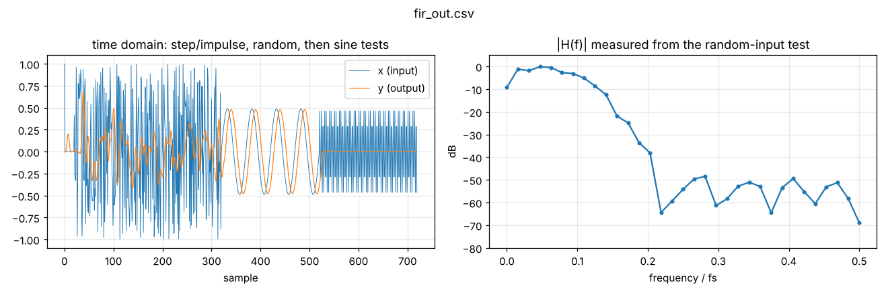

## Tools

| Stage                    | Tool                                                                 |
| ------------------------ | -------------------------------------------------------------------- |
| Simulation               | [Icarus Verilog](https://steveicarus.github.io/iverilog/), [Verilator](https://www.veripool.org/verilator/) |
| Waveforms                | [GTKWave](https://gtkwave.sourceforge.net/) or [Surfer](https://surfer-project.org/) |
| Filter design, plots, 3D renders | Python: numpy, matplotlib, gdstk, pyvista                    |
| Synthesis                | [Yosys](https://yosyshq.net/yosys/)                                   |
| Place & route, STA       | [OpenROAD](https://theopenroadproject.org/) via [OpenROAD-flow-scripts](https://github.com/The-OpenROAD-Project/OpenROAD-flow-scripts) |
| Process design kit (PDK) | [SkyWater sky130](https://github.com/google/skywater-pdk) (`sky130hd` standard cells) |
| Layout viewing           | [KLayout](https://www.klayout.de/), OpenROAD GUI, `python/render_3d.py` |

## Quick start

```sh
# 1. Front-end tools (see docs/setup.md for macOS and OSS CAD Suite)
sudo apt-get install iverilog verilator yosys gtkwave graphviz
pip install -r python/requirements.txt

# 2. Check what you have
make doctor

# 3. Run the first example
make sim
make pnr            # needs Docker; pulls the OpenROAD image once
```

## Repository layout

```
docs/
  learning-path.md   the course: 9 modules with exercises
  fixed-point.md     Q formats, rounding, saturation for DSP hardware
  flow-overview.md   what each RTL-to-GDS stage does and how to read reports
  setup.md           installing the tools (apt, OSS CAD Suite, Docker)
  tools.md           map of open-source chip design tools and where each fits
slides/              one Marp slide deck per module (make slides / slides-pdf)
  images/            renders, plots and diagrams used in the docs
designs/<name>/
  rtl/               synthesisable Verilog
  tb/                self-checking testbench
  orfs/              OpenROAD-flow-scripts config + timing constraints (SDC)
  Makefile           sets TOP/RTL/TB and includes mk/design.mk
designs/riscv/firmware/  C and assembly programs for the RISC-V CPU (make firmware)
mk/design.mk         shared make rules for every design
python/
  dsp_coeffs.py      designs and quantises the FIR/IIR coefficients
  plot_tb.py         plots testbench output (make plot)
  render_3d.py       3D render of a routed GDS
  render_iso.py      isometric block drawing of the counter chip and its pins
  render_transistors_iso.py  isometric transistor + wiring render with labelled pins
  make_diagrams.py   the SVG diagrams in docs/images
scripts/
  synth_*.tcl        Yosys synthesis scripts
  orfs.sh            runs OpenROAD-flow-scripts in Docker
  render_images.sh   regenerates every render and plot in docs/images
```

## Adding a design

Copy any example to `designs/<name>`, rename the module and files, and update
`TOP`/`RTL`/`TB` in its Makefile and `DESIGN_NAME`/`VERILOG_FILES` in
`orfs/config.mk`. `make check` picks it up automatically, and
`python3 python/render_3d.py <your 6_final.gds> -o mychip.webp` renders it.
Module 8 of the course has project ideas.
