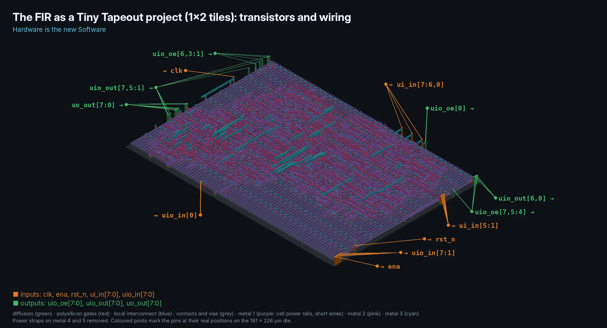
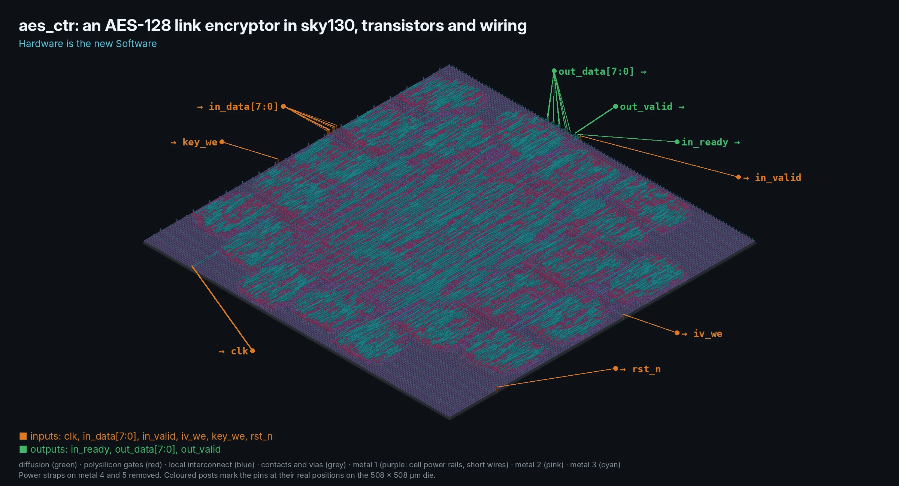
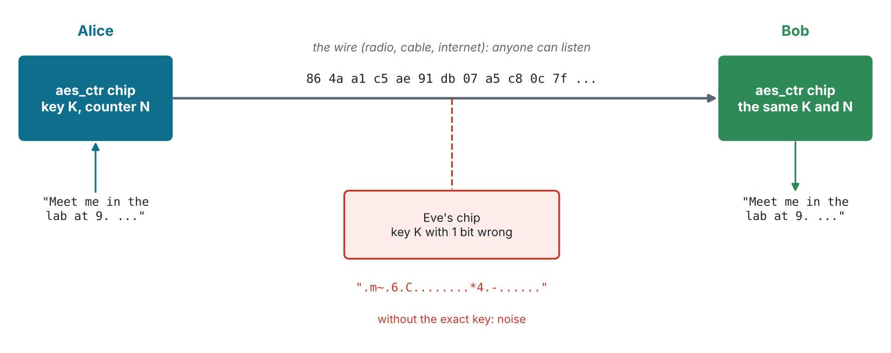
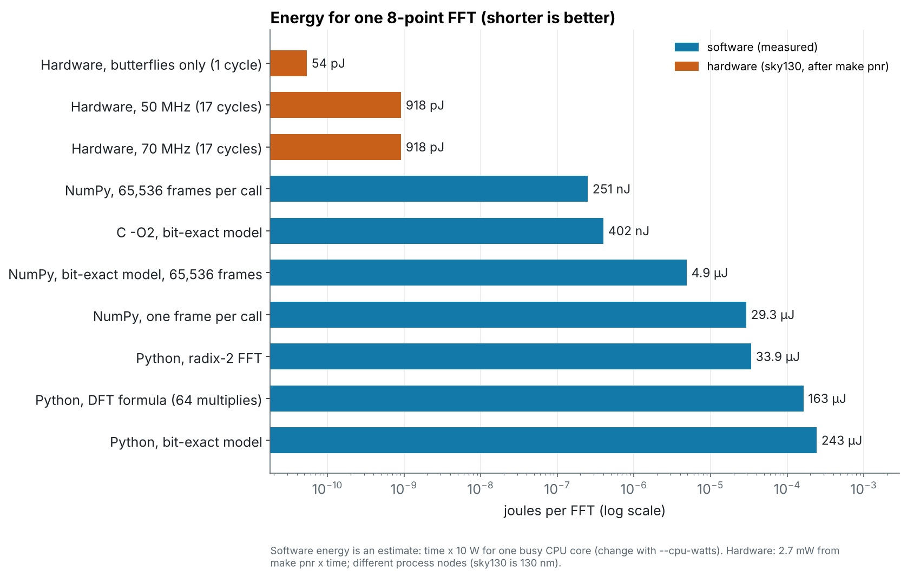
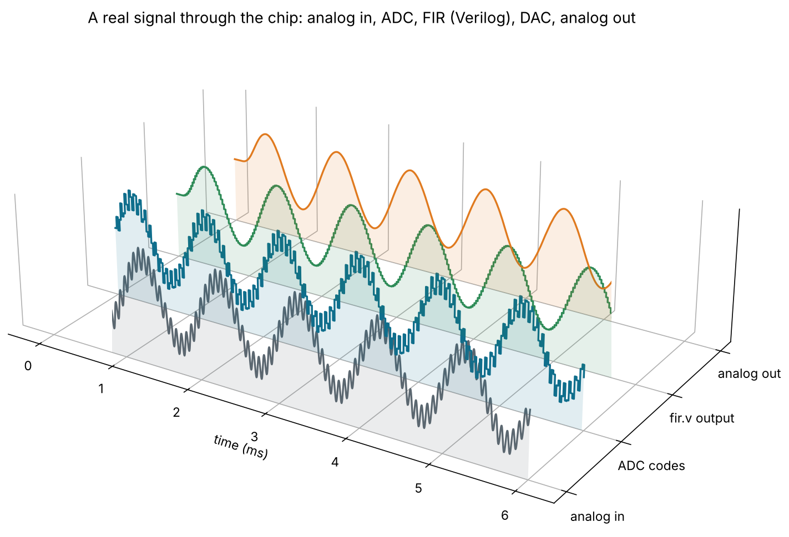

# chip-design-learning

> **Hardware is the new Software.** Chips are written as code, tested like
> code, built by a compiler-like flow and versioned in git. With open-source
> tools you can go from a Verilog file to a real chip layout on a laptop.

A **fast-track course in digital chip design for electronics and electrical
engineering students**. It starts with a counter, builds real DSP hardware
(FIR and IIR filters and an FFT) and a RISC-V CPU that runs C, and finishes
with a design ready for a [Tiny Tapeout](https://tinytapeout.com/) shuttle
and an AES-128 encryption chip for private communication.
Every design is taken from Verilog through simulation, synthesis and place &
route on the open SkyWater sky130 process. Side modules compare the FFT in
software and hardware, connect the chip to real analog signals through an ADC
and a DAC, and teach verification in Python with cocotb.

[](https://codespaces.new/netfirms/chip-design-learning?quickstart=1)

Nothing to install: open the course in your browser with every tool ready,
place & route included ([how it works](docs/codespaces.md)).

**Start here: [the course](docs/learning-path.md)** · [slide decks and quizzes](slides/) · [browser labs](docs/codespaces.md) ·
[tool setup](docs/setup.md) · [how the flow works](docs/flow-overview.md) ·
[fixed-point primer](docs/fixed-point.md) · [verification with cocotb](docs/verification.md) ·
[open-source tool links](docs/tools.md)


## The course

Eleven modules plus three side modules, about six weeks at two modules
a week. Every module has a working design, a self-checking testbench,
exercises, a [slide deck](slides/) and an eight-question quiz at the end of
the deck (answer keys are on the
[`quiz-answers`](https://github.com/netfirms/chip-design-learning/tree/quiz-answers/slides/answers)
branch, so students can try the quiz first).

| #  | Module | Design | Level | Deck |
| -- | ------ | ------ | ----- | ---- |
| 1  | The flow, end to end | [`counter`](designs/counter) | Basic | [01](slides/01-flow.md) |
| 2  | Sequential control and timers | [`pwm`](designs/pwm) | Basic | [02](slides/02-pwm.md) |
| 3  | Fixed-point arithmetic | [primer](docs/fixed-point.md) | Core | [03](slides/03-fixed-point.md) |
| 4  | FIR filters | [`fir`](designs/fir) | Advanced | [04](slides/04-fir.md) |
| 5  | IIR filters | [`iir`](designs/iir) | Advanced | [05](slides/05-iir.md) |
| 6  | The FFT | [`fft`](designs/fft) | Advanced | [06](slides/06-fft.md) |
| 6b | The FFT in software vs in hardware | [`codesign/`](codesign) | Advanced | [06b](slides/06b-codesign.md) |
| 6c | The analog bridge: ADC and DAC | [`analog/`](analog) | Bonus | [06c](slides/06c-analog-bridge.md) |
| 7  | Timing, area and power | all designs | Advanced | [07](slides/07-ppa.md) |
| 8  | Your own design and tapeout | yours | Project | [08](slides/08-tapeout.md) |
| +  | Verification with cocotb (side module, after Module 4) | all designs | Core | [09](slides/09-verification.md) |
| 9  | A RISC-V CPU that runs C | [`riscv`](designs/riscv) | Advanced | [10](slides/10-riscv.md) |
| 10 | Capstone: the FIR on Tiny Tapeout | [`tt_fir`](designs/tt_fir) | Project | [11](slides/11-tinytapeout.md) |
| 11 | An encryption chip for private communication | [`aes`](designs/aes) | Advanced | [12](slides/12-aes.md) |

The module text, with exercises and checkboxes, is in
[docs/learning-path.md](docs/learning-path.md).

## A chip, from the outside

The first design, `counter`, as it really comes out of `make pnr`: the
transistors and the wiring between them, seen from the corner in a true
isometric view, with the 3 input pins and 9 output pins at their real places
on the die edge. The power straps on the top two metal layers are hidden so
you can see down to the transistors.


The same chip as a simplified block drawing: what goes in, what comes out,
and the parts synthesis builds inside.


## The examples

Every picture below is rendered straight from the layout file that `make pnr`
produces for that design: the transistors and the wiring on metal 1 to 3 in
an isometric view, with the input pins (orange) and output pins (green)
labelled at their real places on the die edge. Each design's page has more
3D views.

| | Design | What it is | Size in sky130 |
| --- | --- | --- | --- |
|  | **[counter](designs/counter)**<br>Basic | Up-counter with enable: the whole flow in one afternoon | 27 cells, 60 × 60 µm, 100 MHz |
|  | **[pwm](designs/pwm)**<br>Basic | PWM generator: timer, motor/LED driver, 1-bit DAC | 71 cells, 60 × 60 µm, 100 MHz |
|  | **[fir](designs/fir)**<br>Advanced | 16-tap low-pass FIR filter with one shared multiplier | 2,100 cells, 253 × 253 µm, 100 MHz |
|  | **[iir](designs/iir)**<br>Advanced | 2nd-order Butterworth IIR biquad, one sample per clock | 1,600 cells, 235 × 235 µm, 50 MHz |
|  | **[fft](designs/fft)**<br>Advanced | 8-point complex radix-2 FFT | 9,100 cells, 449 × 449 µm, 50 MHz |
|  | **[riscv](designs/riscv)**<br>Advanced | RV32I RISC-V CPU that runs C compiled by gcc | 6,200 cells, 427 × 427 µm, 50 MHz |
|  | **[tt_fir](designs/tt_fir)**<br>Capstone | The FIR as a [Tiny Tapeout](https://tinytapeout.com/) project: fixed pinout, synchronised inputs, ready for a shuttle | 1,160 cells, 2 tiles (161 × 226 µm), 50 MHz |
|  | **[aes](designs/aes)**<br>Advanced | AES-128 link encryptor in counter mode: two chips with one key make a private wire | 11,095 cells, 508 × 508 µm, 50 MHz |

All eight designs pass their testbenches and route with 0 DRC violations and
positive timing slack.

**A private wire.** The [aes](designs/aes) chip encrypts a byte stream with
AES-128 in counter mode. Alice's chip and Bob's chip share a key; Eve, on the
same wire with one key bit wrong, reads only noise. The test checks it
against the FIPS-197 and NIST SP 800-38A vectors.



**Software or hardware?** [codesign/](codesign/) runs the same 8-point FFT
as Python, NumPy and C and compares it with the `fft` chip on speed, energy
and area: a CPU wins on throughput with big batches, the chip uses hundreds
to tens of thousands of times less energy per FFT.



**Bonus: real signals in and out.** The [analog bridge](analog/) adds an
8-bit ADC and DAC drawn in Xschem and simulated in ngspice, and runs a real
analog signal through the FIR's Verilog: a 1 kHz tone goes through, a 15 kHz
interferer is cut by 58 dB.



Zoom in far enough and you reach the transistors: green diffusion, red
polysilicon gates, blue local interconnect and grey contacts.


## How every design works

Each design is a small, self-contained project with the same commands:

```sh
cd designs/fir
make sim            # self-checking testbench, prints PASS or FAIL
make cocotb         # the same design tested from Python (cocotb)
make plot           # DSP designs: waveforms and the measured frequency response
make lint           # Verilator lint
make synth          # Yosys generic synthesis
make synth-sky130   # Yosys onto real sky130 cells, area in um^2
make pnr            # OpenROAD: RTL to GDS (Docker)
```

From the repo root, `make sim DESIGN=fir` does the same, and `make check`
runs lint, simulation and synthesis for every design (this is what CI runs).
`make check-cocotb` runs every Python testbench; see
[docs/verification.md](docs/verification.md).

The DSP testbenches check every output bit for bit against a reference model
and measure the frequency response from the hardware itself:


## Tools

| Stage                    | Tool                                                                 |
| ------------------------ | -------------------------------------------------------------------- |
| Simulation               | [Icarus Verilog](https://steveicarus.github.io/iverilog/), [Verilator](https://www.veripool.org/verilator/) |
| Verification             | [cocotb](https://www.cocotb.org/) (Python testbenches)               |
| Waveforms                | [GTKWave](https://gtkwave.sourceforge.net/) or [Surfer](https://surfer-project.org/) |
| Filter design, plots, 3D renders | Python: numpy, matplotlib, gdstk, pyvista                    |
| Synthesis                | [Yosys](https://yosyshq.net/yosys/)                                   |
| Place & route, STA       | [OpenROAD](https://theopenroadproject.org/) via [OpenROAD-flow-scripts](https://github.com/The-OpenROAD-Project/OpenROAD-flow-scripts) |
| Process design kit (PDK) | [SkyWater sky130](https://github.com/google/skywater-pdk) (`sky130hd` standard cells) |
| Layout viewing           | [KLayout](https://www.klayout.de/), OpenROAD GUI, `python/render_3d.py` |
| Analog schematics, SPICE | [Xschem](https://xschem.sourceforge.io/), [ngspice](https://ngspice.sourceforge.io/) |
| CPU firmware             | GCC for RISC-V (`riscv64-unknown-elf-gcc`, `-march=rv32i`)            |
| Shuttle                  | [Tiny Tapeout](https://tinytapeout.com/) template (`info.yaml`, cocotb test) |
| Slide decks              | [Marp](https://marp.app/)                                            |

## Quick start

**In the browser (nothing to install):** click **Open in GitHub Codespaces**
above, wait for the terminal to say *Ready*, and run `make sim` then
`make pnr`. GTKWave, KLayout and the OpenROAD GUI open in a Linux desktop in
a browser tab. See [docs/codespaces.md](docs/codespaces.md).

**On your own machine:**

```sh
# 1. Front-end tools (see docs/setup.md for macOS and OSS CAD Suite)
sudo apt-get install iverilog verilator yosys gtkwave graphviz
pip install -r python/requirements.txt
pip install -r python/requirements-verif.txt   # cocotb, for make cocotb

# 2. Check what you have
make doctor

# 3. Run the first example
make sim
make pnr            # needs Docker; pulls the OpenROAD image once

# 4. Compare every design: area, timing and power charts in ppa/index.html
make ppa
```

### Every make target

From the repo root (add `DESIGN=<name>` to pick a design; the default is
`counter`):

| Command | What it does |
| ------- | ------------ |
| `make sim` / `lint` / `synth` / `synth-sky130` / `pnr` / `cocotb` / `plot` | the per-design targets above, for `DESIGN` |
| `make check` | lint, simulation and synthesis for every design (what CI runs) |
| `make check-sky130` | sky130 synthesis for every design |
| `make check-cocotb` | every Python (cocotb) testbench |
| `make ppa` | area, timing and power dashboard for every design, in `ppa/index.html` |
| `make doctor` | lists which tools are installed |
| `make slides` | every deck as HTML, next to the Markdown (needs Node.js) |
| `make slides-pdf` | every deck as PDF in `slides/pdf/` (needs Node.js and Chrome) |
| `make slides-site` | a browsable deck site with a card per module, in `build/slides-site/` |

The side projects have their own Makefiles:

| Command | What it does |
| ------- | ------------ |
| `make -C designs/riscv firmware` | compiles the C and assembly programs for the CPU (riscv gcc) |
| `make -C designs/tt_fir tt-test` | runs the Tiny Tapeout cocotb test in the TT layout |
| `make -C codesign check` / `bench` / `charts` | bit-exact software FFT vs the RTL, benchmark, charts |
| `make -C analog sim` / `plot` / `gui` | ngspice ADC/DAC tests and the analog signal chain, Xschem GUI |

### PPA dashboard

CI places and routes every design and publishes a dashboard of area, cell mix,
setup slack, estimated fmax and power for all of them
(`python/ppa_dashboard.py`, workflow `pnr`). On `main` it goes to the
repository's GitHub Pages site; on a pull request it is the `ppa-dashboard`
artifact of the run, and the job summary shows the same numbers as a table.

### Continuous integration

| Workflow | What it checks |
| -------- | -------------- |
| `ci` | lint, simulation and synthesis of every design, the RISC-V firmware rebuilt from C, sky130 synthesis, the codesign bit-exact check, every cocotb testbench, and the decks as PDF and as a site (`slides-pdf` and `slides-site` artifacts) |
| `pnr` | place and route of every design and the PPA dashboard (GitHub Pages on `main`) |
| `analog` | the Xschem netlists and every ngspice test |

## Repository layout

```
.devcontainer/        Codespaces / Dev Container with every tool preinstalled
docs/
  learning-path.md   the course: 11 modules (a Tiny Tapeout capstone and an AES chip last) and side modules, with exercises
  fixed-point.md     Q formats, rounding, saturation for DSP hardware
  flow-overview.md   what each RTL-to-GDS stage does and how to read reports
  setup.md           installing the tools (apt, OSS CAD Suite, Docker)
  codespaces.md      browser labs: the whole course in GitHub Codespaces
  tools.md           map of open-source chip design tools and where each fits
  verification.md    side module: Python testbenches with cocotb
  images/            renders, plots and diagrams used in the docs
slides/              one Marp slide deck per module, each ending in a quiz
  site/              the deck index page (make slides-site)
  theme/             the course Marp theme
designs/<name>/
  rtl/               synthesisable Verilog
  tb/                self-checking testbench (Verilog)
  cocotb/            the same checks and more, in Python (make cocotb)
  orfs/              OpenROAD-flow-scripts config + timing constraints (SDC)
  Makefile           sets TOP/RTL/TB and includes mk/design.mk
designs/riscv/firmware/  C and assembly programs for the RISC-V CPU (make firmware)
designs/tt_fir/      Tiny Tapeout layout: info.yaml, src/, test/, docs/
codesign/            Module 6b: the FFT in Python, NumPy and C vs the fft chip
analog/              Module 6c: Xschem ADC/DAC schematics, ngspice tests, signal chain
mk/design.mk         shared make rules for every design
mk/cocotb.mk         runs a design's cocotb testbench (called by make cocotb)
python/
  dsp_coeffs.py      designs and quantises the FIR/IIR coefficients
  cocotb_util.py     clock/reset and fixed-point helpers for the cocotb tests
  aes_model.py       AES-128 reference model (cocotb golden model, writes the S-box Verilog)
  plot_tb.py         plots testbench output (make plot)
  ppa_dashboard.py   area/timing/power dashboard for every design (make ppa)
  render_3d.py       3D render of a routed GDS
  render_iso.py      isometric block drawing of the counter chip and its pins
  render_transistors_iso.py  isometric transistor + wiring render with labelled pins
  make_diagrams.py   the SVG diagrams in docs/images
scripts/
  synth_*.tcl        Yosys synthesis scripts
  orfs.sh            runs OpenROAD-flow-scripts in Docker
  render_images.sh   regenerates every render and plot in docs/images
  build_slides_site.py  builds the deck index site (make slides-site)
.github/workflows/   ci, pnr (PnR + PPA dashboard on Pages), analog
```

## Adding a design

Copy any example to `designs/<name>`, rename the module and files, and update
`TOP`/`RTL`/`TB` in its Makefile and `DESIGN_NAME`/`VERILOG_FILES` in
`orfs/config.mk`. Rename `cocotb/test_<old>.py` to `cocotb/test_<name>.py`
(or delete the folder). `make check` picks it up automatically, and
`python3 python/render_3d.py <your 6_final.gds> -o mychip.webp` renders it.
Module 8 of the course has project ideas.
