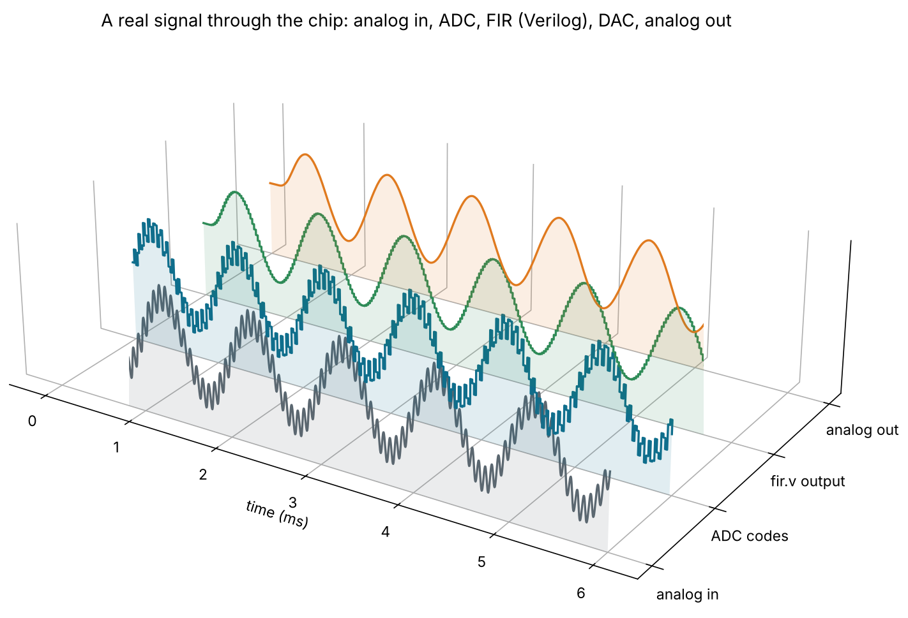
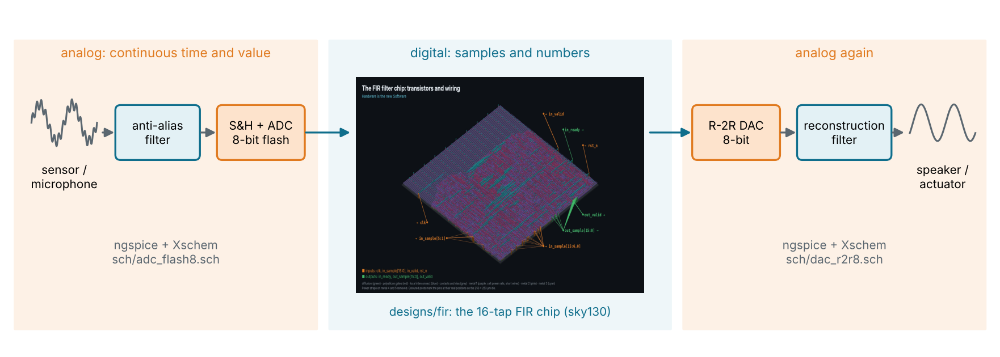
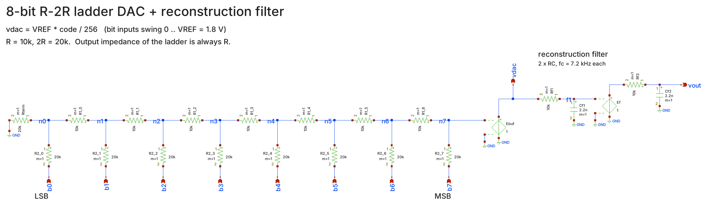
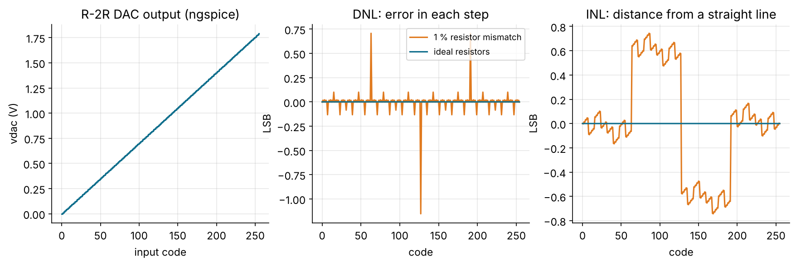
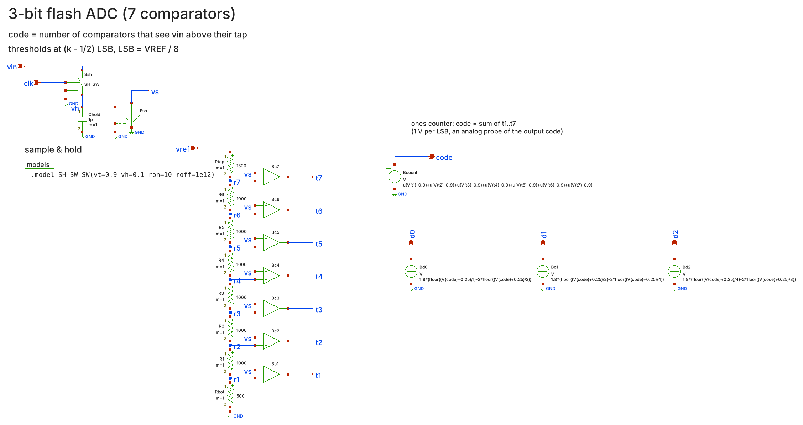
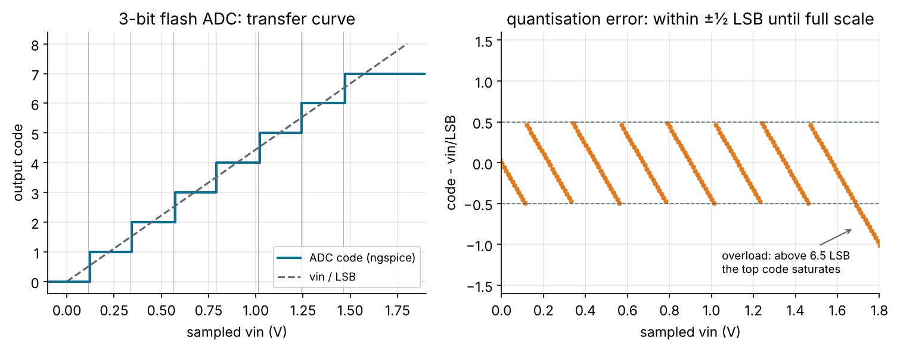
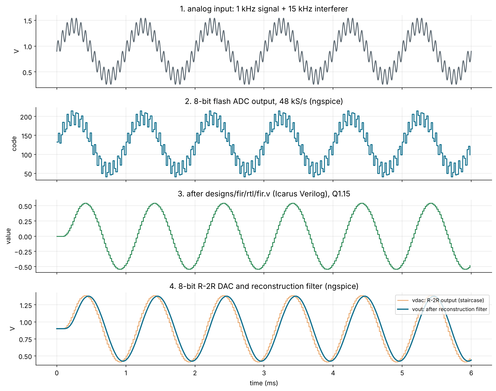
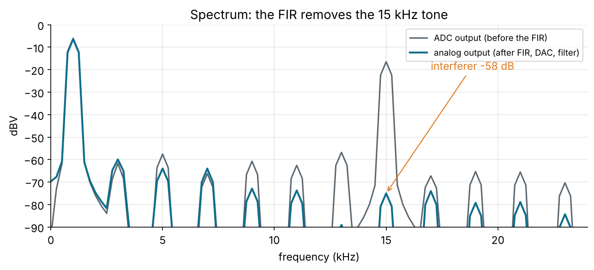

# analog: the bridge between real signals and your DSP chip (bonus module)



The FIR, IIR and FFT designs work on numbers. Real signals (a microphone,
a sensor, a radio) are voltages. This module builds the two converters that
connect them, simulates them with the open-source analog tools **Xschem**
(schematics) and **ngspice** (SPICE simulation), and then runs a real analog
signal through the course's own FIR filter:

```
1 kHz tone + 15 kHz noise  ->  8-bit flash ADC  ->  designs/fir/rtl/fir.v  ->  8-bit R-2R DAC  ->  filter  ->  clean 1 kHz tone
        (ngspice)                 (ngspice)            (Icarus Verilog)          (ngspice)        (ngspice)
```



Level: bonus, after Module 6 (any time after Module 4 works). Time: 3 to 4 hours. Deck:
[slides/06b-analog-bridge.md](../slides/06b-analog-bridge.md).

## Run it

```sh
sudo apt install ngspice xschem iverilog python3-numpy python3-matplotlib
cd analog
make sim          # netlist the schematics, run every test: PASS or FAIL
make plot         # the same, plus the plots on this page
make gui S=dac_r2r8   # open a schematic in Xschem (S=adc_flash3, adc_flash8)
```

`make sim` prints:

```
PASS: dac: 256 codes, vdac = VREF*code/256 within 0.0000 LSB, max |DNL| 0.0000 LSB
      with 1% resistor mismatch: max |DNL| 1.15 LSB (code 127 -> 128), max |INL| 0.74 LSB
PASS: adc: 3-bit flash, 200 samples on a ramp: 0 wrong codes, codes seen [0, 1, 2, 3, 4, 5, 6, 7], monotonic, bits d2..d0 match
PASS: chain: 288 samples through ADC -> fir.v -> DAC: 1 kHz tone -0.38 dB, 15 kHz interferer -58.2 dB relative (-58.5 dB at the FIR output)
PASS: all 3 analog tests
```

CI runs the same tests on every push that touches `analog/` or the FIR
(`.github/workflows/analog.yml`).

## What is here

| File | What it is |
| --- | --- |
| `sch/dac_r2r8.sch` | 8-bit R-2R ladder DAC, buffer, 2-pole RC reconstruction filter |
| `sch/adc_flash3.sch` | 3-bit flash ADC: sample-and-hold, 7 comparators, encoder. Small enough to read |
| `sch/adc_flash8.sch` | The same circuit at 8 bits: 255 comparators. Used by the signal chain |
| `sch/comparator.sym` | An ideal comparator symbol (a behavioural ngspice B-source) |
| `gen_schematics.py` | Writes the schematics: change a value or the bit count here |
| `analog.py` | Netlists with Xschem, runs ngspice and Icarus, checks, plots |
| `tb/fir_chain_tb.v` | Feeds the ADC samples to `designs/fir/rtl/fir.v` |
| `figures.py` | Concept diagrams for the deck |
| `xschemrc` | Points Xschem at its standard library and at `sch/` |

The flow is the same as for the digital designs, just with different tools:

| Digital (the rest of the course) | Analog (this module) |
| --- | --- |
| Verilog RTL | Xschem schematic |
| Icarus Verilog / Verilator | ngspice |
| self-checking testbench | `analog.py`: PASS/FAIL on every code |
| Yosys netlist | Xschem SPICE netlist (`build/*.spice`) |

## 1. The DAC: an R-2R ladder



Each bit drives a 2R resistor into a ladder of R resistors. Looking left from
any node you always see exactly 2R, so every node halves the current that
passes it, and bit *i* adds VREF / 2^(8-i) to the output:

```
vdac = VREF * code / 256          (VREF = 1.8 V, 1 LSB = 7.03 mV)
```

Only two resistor values for any number of bits, which is why the R-2R
ladder is the classic on-chip DAC. A unity-gain buffer stops the next stage
from loading the ladder, and two RC poles (7.2 kHz each) smooth the staircase.

`make dac` steps the DAC through all 256 codes and measures the step sizes.
With ideal resistors every step is exactly 1 LSB. Then it runs again with
every resistor off by a random 1 % (what you get on a real chip without
careful layout):



- **DNL** (differential non-linearity): how far each step is from 1 LSB.
  The worst step is at the MSB change, 127 → 128, where every bit flips:
  −1.15 LSB means the output actually goes *down*. The DAC is no longer
  monotonic, which matters a lot inside a feedback loop.
- **INL** (integral non-linearity): how far the curve bends away from a
  straight line. ±0.74 LSB here.

That is why analog layout uses unit resistors, common-centroid placement and
dummy devices: matching is the whole game.

## 2. The ADC: a flash converter



1. **Sample and hold:** a switch closes while `clk` is high and charges a
   1 pF capacitor; when it opens, the capacitor holds the voltage steady
   while the comparators decide.
2. **Reference ladder:** resistors split VREF into 2^N − 1 thresholds at
   (k − ½) LSB (½R at the bottom, 1½R at the top, R in between).
3. **Comparators:** each one says "is the input above my tap?". Together
   they give a **thermometer code**: 0000111 means 3.
4. **Encoder:** counts the ones and outputs binary bits `d2..d0`.

`make adc` ramps the input slowly across the full range and checks that
every sample gives the right code:



The error stays within ±½ LSB: that is quantisation, the price of turning a
voltage into a number. For a full-scale sine it gives an SNR of
6.02 N + 1.76 dB, 49.9 dB at 8 bits.

A flash ADC is the fastest kind (one clock per sample) but needs 2^N − 1
comparators: 255 at 8 bits, 65,535 at 16. A SAR ADC instead reuses *one*
comparator and *a DAC like ours* for N clock cycles, doing a binary search.
That is exercise 3 below.

## 3. The signal chain: a real signal through `fir.v`

`make chain` does the whole trip:

1. ngspice drives the 8-bit flash ADC with a 1 kHz tone (0.5 V) plus a
   15 kHz interferer (0.15 V), sampled at 48 kS/s for 6 ms (288 samples).
2. The codes (offset binary, 0..255) become Q1.15 numbers,
   `(code − 128) << 8`, the format the FIR expects
   ([fixed-point primer](../docs/fixed-point.md)).
3. **Icarus Verilog runs the course's own `designs/fir/rtl/fir.v`** on them,
   with the same handshake as its testbench.
4. The FIR output is rounded back to 8 bits and drives the R-2R DAC in
   ngspice, and the reconstruction filter smooths it.



The FIR's cut-off is 0.1 × fs = 4.8 kHz, so the 1 kHz tone passes
(−0.38 dB, mostly the two RC poles) and the 15 kHz tone is cut by 58 dB, down
to the 8-bit noise floor. You can also see the FIR's delay: 7.5 samples, the
centre of its 16 symmetric taps.



## Behavioural or transistor-level?

The comparators and buffers here are **ideal behavioural models** (ngspice
B-sources and VCVSs), and the resistors are ideal. That keeps the circuits
readable and the simulations fast, and teaches the architecture. A real chip
needs transistor-level versions with the sky130 device models (from
[open_pdks](https://github.com/RTimothyEdwards/open_pdks), e.g. via
[volare](https://github.com/efabless/volare)). That is where offset, noise,
settling time and power come in, and it is the natural next step after this
module.

## Exercises

1. **Matching.** In `analog.py`, change `sigma` in `mismatched_lib()` to
   0.1 % and 5 %. At what mismatch does the DAC stop being monotonic? Why is
   the MSB step always the worst?
2. **Aliasing.** Move the interferer to 40 kHz (above fs/2 = 24 kHz) in
   `analog.py`. Where does it land in the spectrum (hint: 48 − 40), and why
   can no digital filter tell it apart from a real 8 kHz signal? What does
   the anti-alias filter in front of a real ADC have to do?
3. **Build a SAR ADC.** Replace the flash ADC with one comparator, the
   `dac_r2r8` DAC and successive-approximation logic written in Verilog.
   How many clocks per sample does it need, and how many comparators does it
   save?
4. **Bits vs. noise.** In `chain()`, throw away the two lowest bits of every
   ADC code (`codes = codes >> 2 << 2`) to make it a 6-bit ADC, and re-run
   `make plot`. How far does the noise floor in the spectrum rise? Compare
   with 6.02 N + 1.76 dB.
5. **Swap the filter.** Feed the samples through `designs/iir` instead of
   the FIR (it takes a sample every clock and has no `in_ready`, so adapt
   `tb/fir_chain_tb.v`). What changes in the phase of the output?
