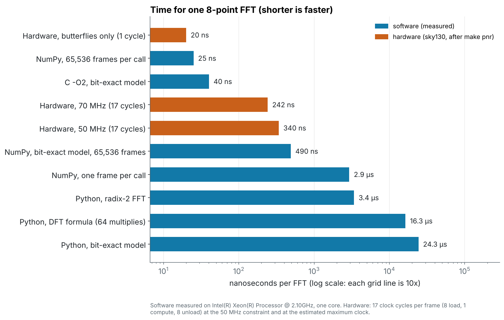
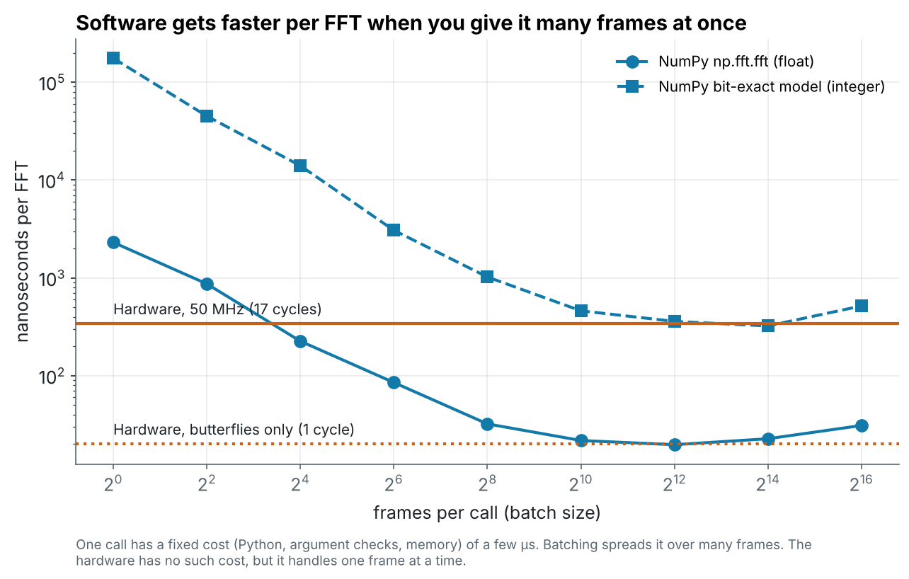
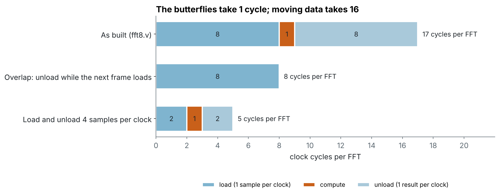
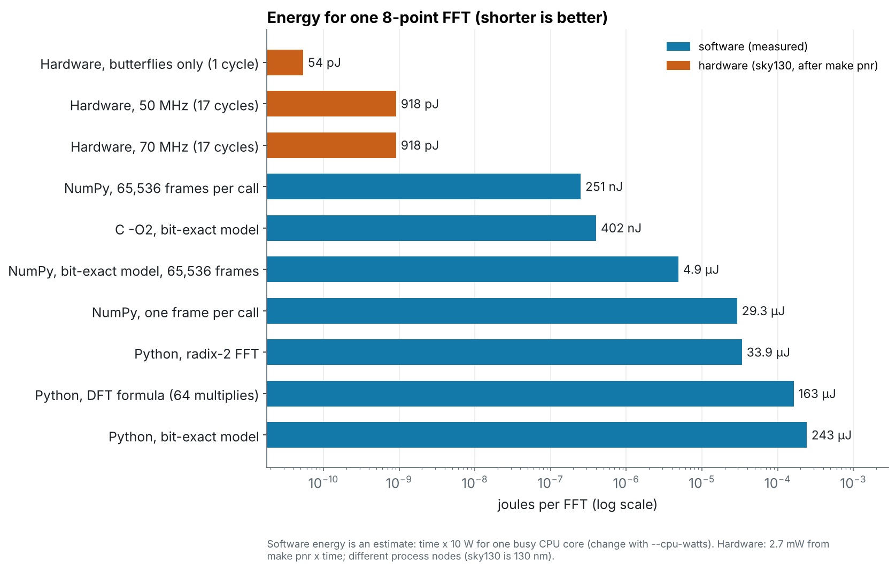
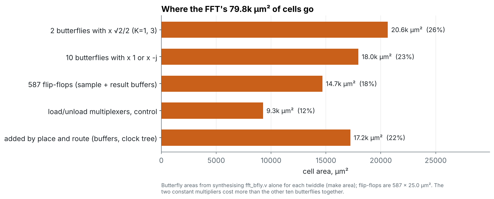

# codesign: the FFT in software vs in hardware

> **Hardware is the new Software**, so when should a job *be* hardware?

An extra module that follows [Module 6 (the FFT)](../docs/learning-path.md#module-6-the-fft-designsfft).
It takes the same 8-point FFT and runs it five ways in software (plain
Python, NumPy, a bit-exact fixed-point model, C) and compares the results
with the chip in [`designs/fft`](../designs/fft) on **speed, energy and
area**. The answer is not "hardware is always faster": the numbers show
where a chip wins, where a CPU wins, and why the interface between them
matters as much as the maths.

Slides: [`slides/06b-codesign.md`](../slides/06b-codesign.md).

## Run it

```sh
make -C designs/fft sim         # the RTL testbench writes fft8_out.csv
cd codesign
make check                      # bit-exact Python model vs the RTL, every output bit
make bench                      # time the software on your machine, redraw the charts
make bench CPU_WATTS=15         # with your CPU's power per busy core
make area                       # area of each butterfly variant on sky130 cells
```

Needs Python 3 with `numpy` and `matplotlib` (`pip install -r
python/requirements.txt`), a C compiler, and Yosys for `make area`.

| File | What it is |
| --- | --- |
| [`fft_sw.py`](fft_sw.py) | The FFT in software: the DFT formula, a radix-2 FFT, and a **bit-exact model** of `fft8.v` (Python and NumPy) |
| [`fft8_fixed.c`](fft8_fixed.c) | The bit-exact model in C, with a timer: what the FFT costs as firmware |
| [`benchmark.py`](benchmark.py) | Measures the software, adds the hardware numbers, draws the charts |
| [`results/bench.json`](results/bench.json) | The numbers behind the charts below |

## The golden model: same bits as the chip

`fft8_fixed()` in `fft_sw.py` does exactly what the RTL does: 17-bit
internal values, √2/2 as 23170 / 2¹⁵, truncation after every multiply and
every halving. Run on the testbench's inputs, it gives the same bits as the
hardware:

```
$ make check
Self-test:
  dft_naive      max |error| vs NumPy = 3.00e-11
  fft_python     max |error| vs NumPy = 3.75e-12
  fft8_fixed_np  max error vs float = 2.05 LSB (tolerance 3)
  fft8_fixed     matches fft8_fixed_np: True
Bit-exact model vs RTL (designs/fft/build/fft8_out.csv):
  26 frames, 208 outputs, 0 mismatches
PASS
```

This is the first tool of hardware/software co-design. With a bit-exact
model you can try a new width or rounding in seconds in Python before
spending hours on RTL and place and route, generate test vectors for the
chip, and run the same algorithm in software when there is no chip.

## Speed



Measured on one core of a 2.1 GHz Xeon (your numbers will differ; run
`make bench`). The hardware runs at the 50 MHz the design was built for,
and at the ~70 MHz its timing slack allows.

- **Python is slow**: 3 to 24 µs per FFT. Most of that is the interpreter,
  not arithmetic.
- **One NumPy call per frame is no better** (2.9 µs): the call itself costs
  a few µs.
- **Batched NumPy and C are fast**: 25 ns and 40 ns per FFT. A modern CPU
  at 2.1 GHz with vector instructions beats our 50 MHz chip on throughput.
- **The chip takes 340 ns per FFT**, but only **20 ns** of that is the
  butterflies. The rest is moving the data in and out, one sample per clock.



Software only gets fast when it is given thousands of frames at once. That
is fine for offline analysis. It is no use for a radio that must answer
each frame within a few microseconds, which is where a chip's fixed,
predictable latency wins.

## Where the chip's time goes



The butterflies take 1 clock; loading and unloading take 16. The interface,
not the arithmetic, sets the speed. The same is true in software, where the
cost of a NumPy call hides the FFT. Two fixes in hardware:

- **Overlap**: unload frame *n* while frame *n + 1* loads (a second buffer).
  8 cycles per FFT, more than twice the throughput.
- **Wider ports**: 4 samples per clock in and out. 5 cycles per FFT, at the
  cost of more pins.

## Energy



The hardware uses **0.92 nJ** per FFT (2.7 mW from `make pnr` × 340 ns).
The software estimate is time × the power of one busy core (10 W by default;
set yours with `CPU_WATTS`):

| Version | Time per FFT | Energy per FFT | vs the chip |
| --- | ---: | ---: | ---: |
| Hardware, 50 MHz | 340 ns | 0.92 nJ | 1× |
| NumPy, 65,536 frames per call | 25 ns | 250 nJ | ~270× |
| C, bit-exact | 40 ns | 400 nJ | ~440× |
| NumPy, one frame per call | 2.9 µs | 29 µJ | ~32,000× |
| Python, radix-2 | 3.4 µs | 34 µJ | ~37,000× |

**This is where the chip wins**, by two to four orders of magnitude, even in
an old 130 nm process against a modern CPU. A CPU spends most of its
energy fetching and decoding instructions and moving data through caches;
the chip only switches the gates that do the maths.

Caveats: the software energy is an estimate, not a measurement; the
hardware power comes from OpenROAD with default switching activity; and the
two run in very different process nodes. The ratio is still large enough
that none of these change the conclusion.

## Area



The chip is 9,073 cells, **0.08 mm²** of cells on a 449 × 449 µm die. A CPU
that runs the software is a whole core with caches, many times larger even
in a far smaller process, but it can run any program. The FFT chip can only
do one thing.

Inside the chip, the two butterflies that multiply by √2/2 (K = 1 and 3)
cost more area than the other ten together: multiplying by 1 or -j is just
wiring and a negation. The 587 flip-flops of the sample and result buffers
are 18%. Measure the butterflies yourself with `make area`.

## When to use which

| Put the FFT in **software** when... | Put it in **hardware** when... |
| --- | --- |
| the size or algorithm changes often | the job is fixed (a standard such as Wi-Fi fixes N) |
| you process big batches offline | each frame needs an answer within a fixed time |
| you already have a CPU that is idle | you run on a battery or a power budget |
| volume is small (a chip costs a mask set) | volume is large, or it runs all day |

Most real products do both: a CPU runs the control and the rare cases, and
an accelerator next to it does the FFT. Deciding that split, and the
interface between the two, is **hardware/software co-design**.

## Exercises

- [ ] Run `make bench` on your own laptop. Look up your CPU's power and
      core count, and set `CPU_WATTS` to (power ÷ cores). How do the ratios
      change?
- [ ] At what batch size does NumPy beat the 50 MHz chip on your machine?
      Read it off `codesign_batch.png`.
- [ ] Use the golden model to explore widths: change `W` in `fft_sw.py` to
      12 or 20 bits (and `C` to match) and plot the maximum error against
      a float FFT. Which width would you choose for 60 dB of dynamic range?
- [ ] Replace `sum * C` in `fft_bfly.v` with shifts and adds (23170 =
      2¹⁴ + 2¹² + 2¹¹ + 2⁹ + 2⁷ + 2¹: six shifted copies, added). Re-run
      `make sim` in `designs/fft` and `make check` here, then measure the
      gain with `make area`.
- [ ] Add a second buffer to `fft8.v` so it unloads one frame while the next
      loads. Change the cycle counts in `benchmark.py` and redraw the
      charts. What does it cost in flip-flops?
- [ ] **Battery sensor:** a microphone delivers 8,000 samples per second,
      one FFT every 8 samples. How much power does the chip need for that?
      How much would a 10 W core need if it could sleep between frames, and
      if it could not?
