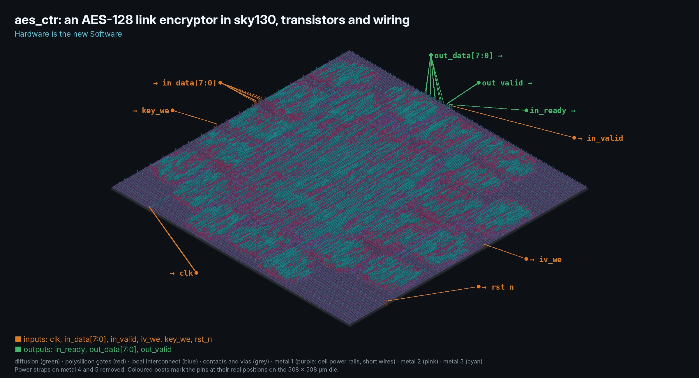
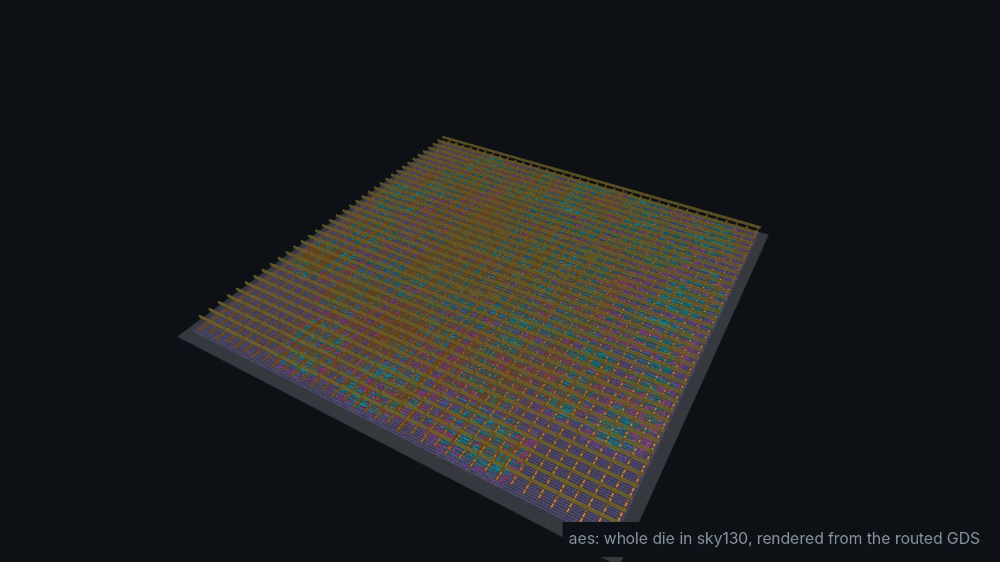
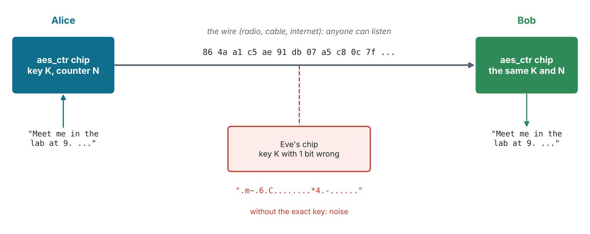
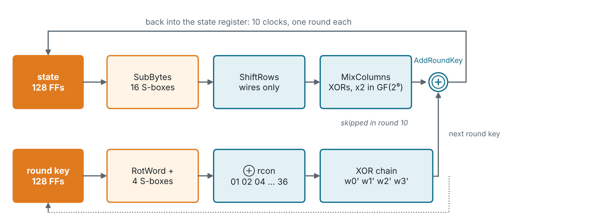
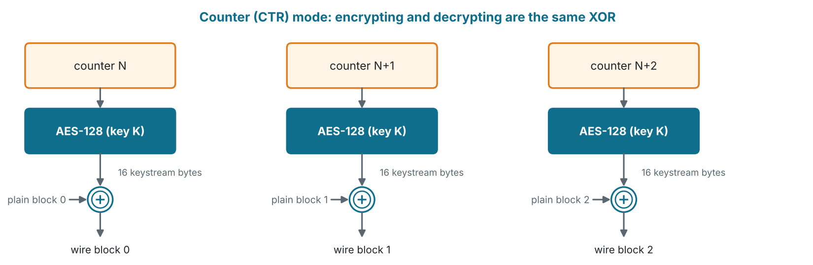
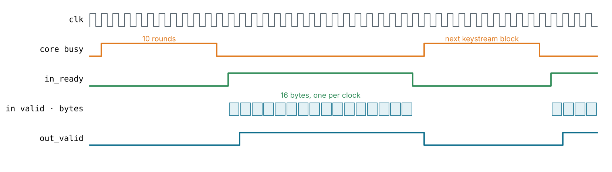
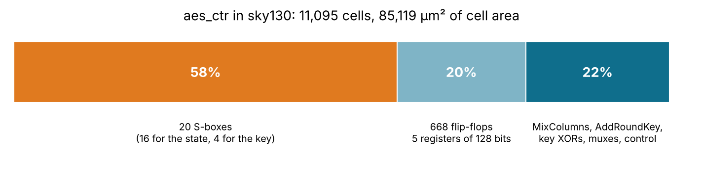
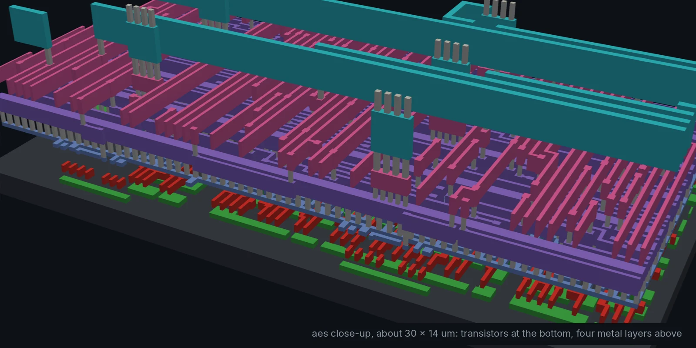
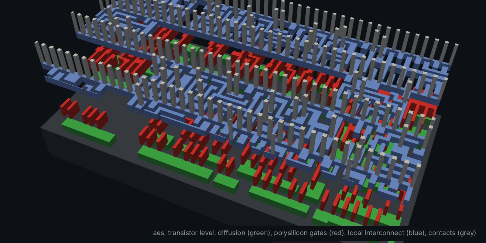

# aes: an encryption chip for private communication (Module 11, advanced)





`aes_ctr` is a link encryptor: bytes go in, bytes come out XORed with a
keystream made by an AES-128 core. Put one chip at each end of a wire,
load both with the same key and starting counter, and the wire carries only
noise to anyone without the key. The same chip encrypts and decrypts.

```text
$ make sim
AES-128 core, known answers:
  ok    FIPS-197 appendix B    3925841d02dc09fbdc118597196a0b32  (10 clocks)
  ok    FIPS-197 C.1           69c4e0d86a7b0430d8cdb78070b4c55a  (10 clocks)
  ok    SP 800-38A ECB #1      3ad77bb40d7a3660a89ecaf32466ef97  (10 clocks)
  ok    SP 800-38A ECB #2      f5d3d58503b9699de785895a96fdbaaf  (10 clocks)
  ok    SP 800-38A ECB #3      43b1cd7f598ece23881b00e3ed030688  (10 clocks)
  ok    SP 800-38A ECB #4      7b0c785e27e8ad3f8223207104725dd4  (10 clocks)
  ok    SP 800-38A F.5.1 CTR-AES128, 64 bytes, 48 stall clocks

Alice sends: Meet me in the lab at 9. Hardware is the new Software. Bring GDS
On the wire: 86 4a a1 c5 ae 91 db 07 a5 c8 0c 7f a2 48 f5 1a 8d 71 82 8b 62 04 4f 0b ...
Bob reads:   Meet me in the lab at 9. Hardware is the new Software. Bring GDS
Eve reads:   ......$.2.Qc.zl...;.......HK.8.9;..J......z..H..R}.x!.x....Q..8H

PASS: 6 core known answers, SP 800-38A CTR, Alice -> Bob over a private link, 0 errors
```



## Files

| File | What it is |
| --- | --- |
| `rtl/aes128.v` | The AES-128 encryption core: one round per clock, round keys made on the fly |
| `rtl/aes_sbox.v` | The S-box as a 256-entry table, generated by `python3 python/aes_model.py --sbox` |
| `rtl/aes_ctr.v` | The chip: counter (CTR) mode on a byte stream, key and counter loaded through the same pins |
| `tb/aes_ctr_tb.v` | Known answers for the core and the chip, then Alice, Bob and Eve on one wire |
| `cocotb/test_aes.py` | The same and more from Python, against the model in `python/aes_model.py` |

## Architecture

**The core** (`aes128`) is iterative: the logic for one round is built once
and used ten times, so a block takes 10 clocks after `start`. Each clock
does SubBytes (16 S-boxes), ShiftRows (wires), MixColumns (XORs; skipped in
round 10) and AddRoundKey, and makes the next round key with 4 more S-boxes.



**The chip** (`aes_ctr`) turns the core into a stream cipher with counter
mode (NIST SP 800-38A): it encrypts the counter block, XORs the 16 keystream
bytes with the data, and counts the low 32 bits of the counter up by one.



| Pin | Dir | |
| --- | --- | --- |
| `in_data[7:0]` | in | a key, counter or data byte |
| `key_we` | in | shift `in_data` into the key, most significant byte first (16 writes) |
| `iv_we` | in | shift `in_data` into the counter block, the same way |
| `in_valid` | in | `in_data` is a data byte; taken when `in_ready` is high |
| `in_ready` | out | a keystream byte is ready |
| `out_data[7:0]` | out | `in_data` ⊕ keystream, one clock after it was taken |
| `out_valid` | out | `out_data` is valid |

Writing the key or the counter throws away the keystream block in hand,
even one the core is still making (the `stale` flag), so a new key never
mixes with an old keystream. The core needs 12 clocks per keystream block,
so `in_ready` drops for 12 clocks after every 16 bytes: 16 bytes every 28
clocks, 229 Mbit/s at 50 MHz.



## Verification

`make sim` checks the core against FIPS-197 (appendix B and C.1) and the
four ECB blocks of SP 800-38A F.1.1, the chip against SP 800-38A F.5.1
(CTR-AES128), and then sends a message from Alice's chip to Bob's over a
"wire" while Eve listens with a different key. It writes
`build/aes_link.csv`.

`make cocotb` runs five Python tests against `python/aes_model.py`, a
plain AES-128 written step by step from FIPS-197:

| Test | Checks |
| --- | --- |
| `test_fips197` | the known answers through the chip (counter = plaintext, data = zeros) |
| `test_sp800_38a_ctr` | the CTR vectors, encrypt then decrypt |
| `test_random_messages` | random keys, counters (with the 32-bit wrap), lengths and idle gaps |
| `test_rekey_mid_block` | a new key or counter mid-block and while the core is busy |
| `test_alice_bob` | the round trip, and a one-bit key error gives unrelated bytes |

## Results

| Testbench | Cells | Die | Clock | Worst slack | Power | DRC |
| --- | --- | --- | --- | --- | --- | --- |
| `PASS: 6 core known answers, SP 800-38A CTR, ...` | 11,095 (668 flip-flops) | 508 × 508 µm | 50 MHz | +10.07 ns | 11.5 mW | 0 |

`make pnr` takes about 25 minutes: the S-boxes are dense random logic and
detailed routing needs several passes to clear every conflict. The 20
S-boxes are more than half the area:



| Close-up of the wiring | Transistor level |
| --- | --- |
|  |  |

## Before you use this for real secrets

This is a teaching chip. It is checked against the standard's test vectors,
but it has no protection against power analysis or fault attacks, CTR mode
gives no integrity (a flipped bit on the wire flips the same bit at Bob),
and a key and counter pair must never be used twice. Real products use a
reviewed implementation and an authenticated mode such as AES-GCM.

The slide deck for this module: [slides/12-aes.md](../../slides/12-aes.md).
