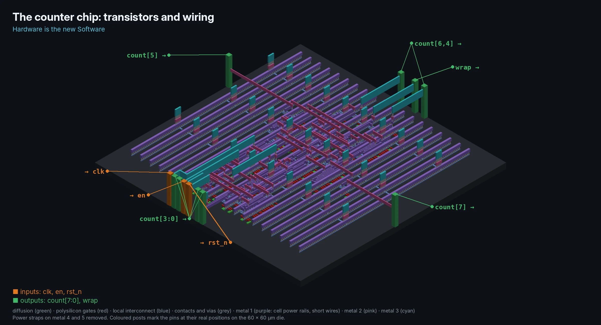
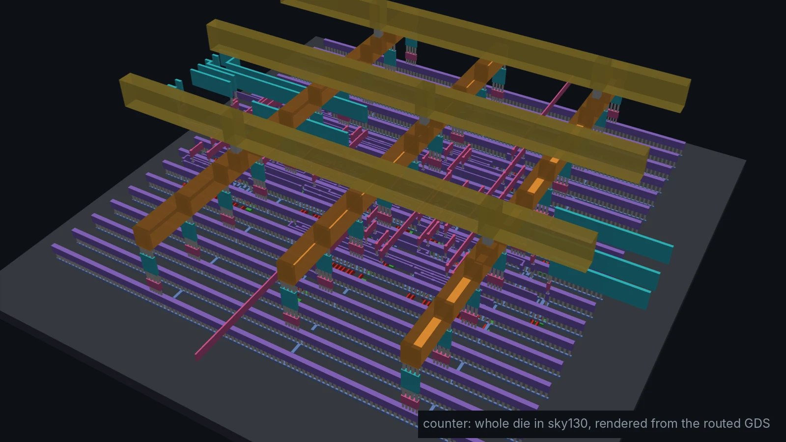
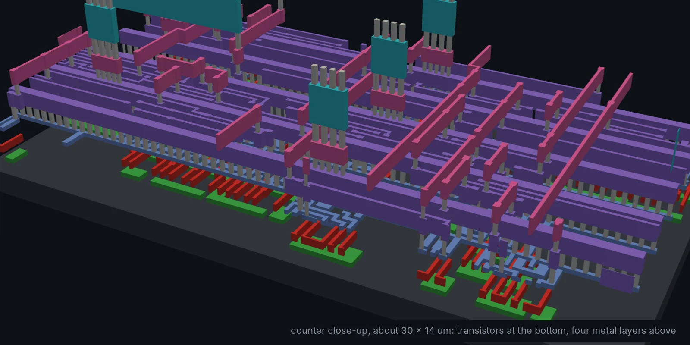
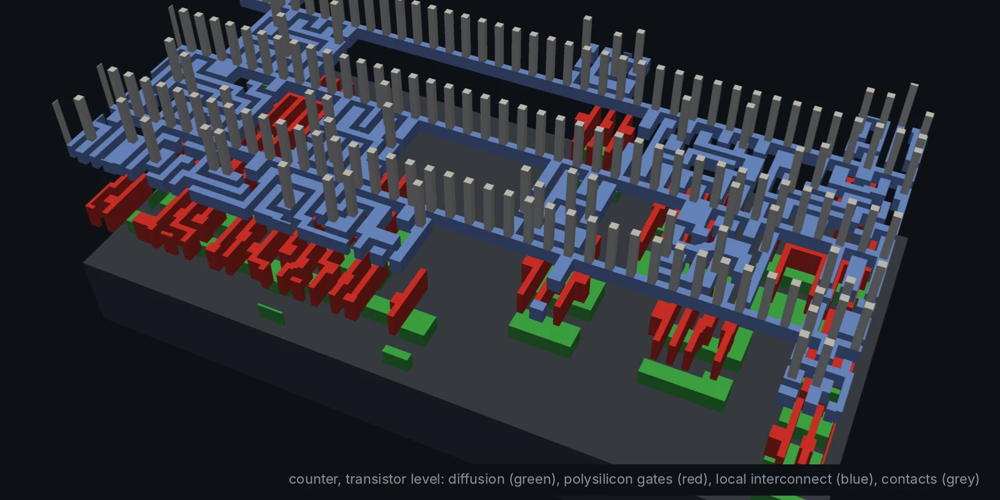

# counter: the whole flow in one afternoon (Module 1, basic)

A parameterised up-counter with enable, asynchronous active-low reset and a
`wrap` output. It is small enough to predict every result by hand, so it is
the design to learn the tools on.

| Target              | What it does                                         | Output (in `build/`)          |
| ------------------- | ---------------------------------------------------- | ----------------------------- |
| `make sim`          | Icarus Verilog, self-checking testbench              | `sim.log`, `counter.vcd`      |
| `make waves`        | Opens the VCD in GTKWave                             |                               |
| `make lint`         | Verilator `--lint-only -Wall`                        |                               |
| `make verilator`    | Same testbench compiled with Verilator               | `obj_dir/`                    |
| `make synth`        | Yosys generic synthesis                              | `counter_generic.v`, `synth_generic_stat.txt` |
| `make show`         | Schematic of the synthesised circuit                 | `counter.svg`                 |
| `make synth-sky130` | Yosys onto sky130 `hd` standard cells                | `counter_sky130.v`, `synth_sky130_stat.txt` |
| `make pnr`          | OpenROAD-flow-scripts, RTL to GDS (Docker)           | `orfs/results/.../6_final.gds` |
| `make pnr-gui`      | OpenROAD GUI on the final layout                     |                               |

## Results

| Testbench | Cells | Die | Clock | Worst slack | DRC |
| --- | --- | --- | --- | --- | --- |
| `PASS: 100 cycles, 5 wrap-arounds, 0 errors` | 27 (8 flip-flops) | 60 × 60 µm | 100 MHz | +5.24 ns | 0 |

`make pnr` finishes in well under a minute. Pictures of each stage are
written to `build/orfs/reports/sky130hd/counter/base/*.webp`.

| Close-up of the wiring | Transistor level |
| --- | --- |
|  |  |
