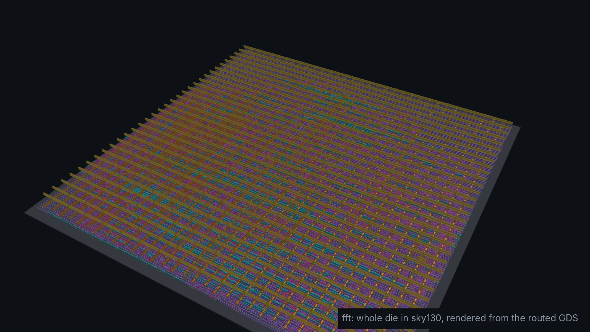
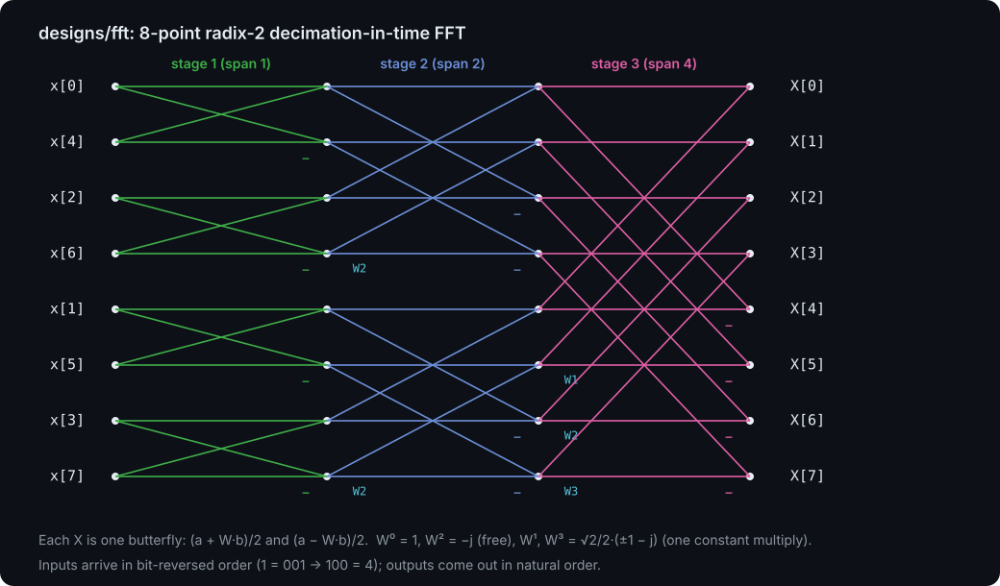
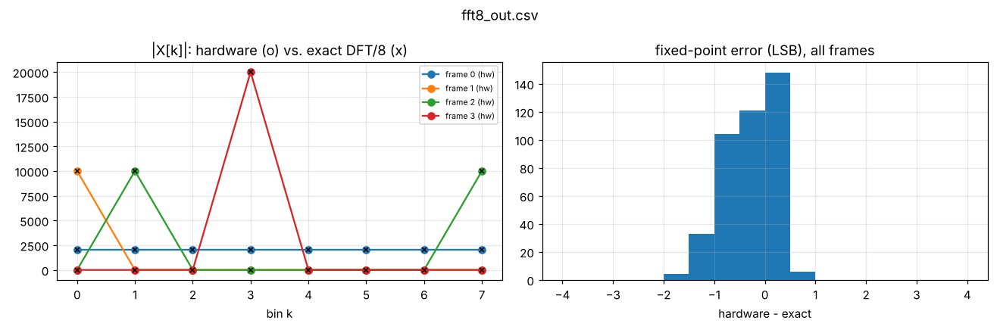
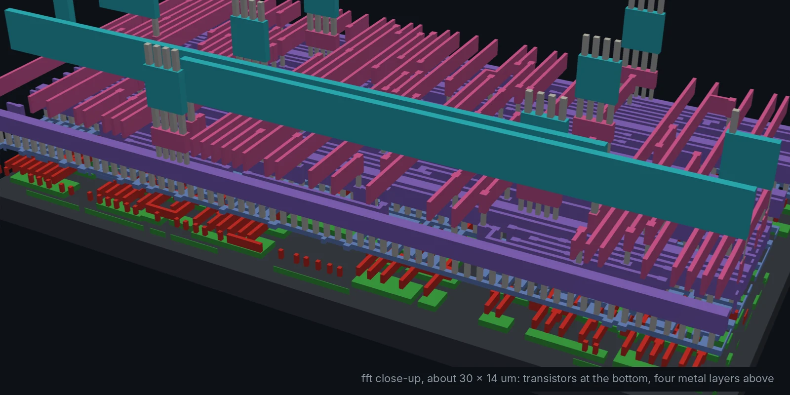
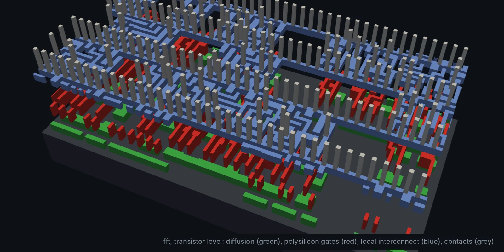

# fft: 8-point complex FFT (Module 6, advanced)

X[k] = (1/8) Σ x[n] exp(-j 2π n k / 8), radix-2 decimation in time, with
16-bit complex inputs and 17-bit complex outputs.

## Architecture

- `rtl/fft_bfly.v`: one butterfly with a fixed twiddle. For N = 8 the
  twiddles are 1, -j (free: swap and negate) and √2/2 (±1 - j), which is one
  constant multiply per component.
- `rtl/fft8.v`: bit-reversal, three stages of four butterflies, and a small
  state machine: load 8 samples, compute in one cycle, stream out X[0..7].

Each butterfly divides by 2, so the output never overflows. The price is
truncation error, which `make plot` shows as a histogram leaning slightly
negative (truncation always rounds down).

## Verification

Every frame is compared with a floating-point DFT within 3 LSB: impulse, DC,
a cosine on bin 1, a complex tone on bin 3, full-scale corners and 20 random
frames.

## Results

| Testbench | Cells | Die | Clock | Worst slack | Power | DRC |
| --- | --- | --- | --- | --- | --- | --- |
| `PASS: 26 frames, max error 2 LSB` | 9,073 | 449 × 449 µm | 50 MHz | +5.77 ns | 2.7 mW | 0 |

| Close-up of the wiring | Transistor level |
| --- | --- |
|  |  |
