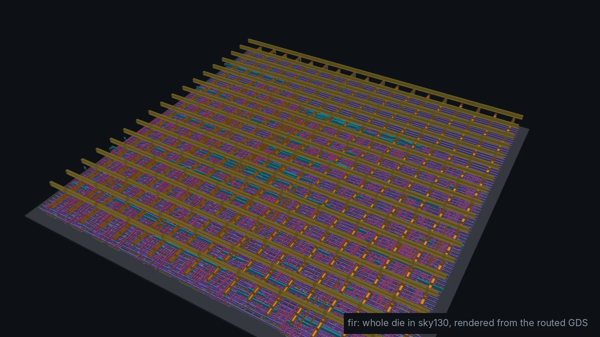
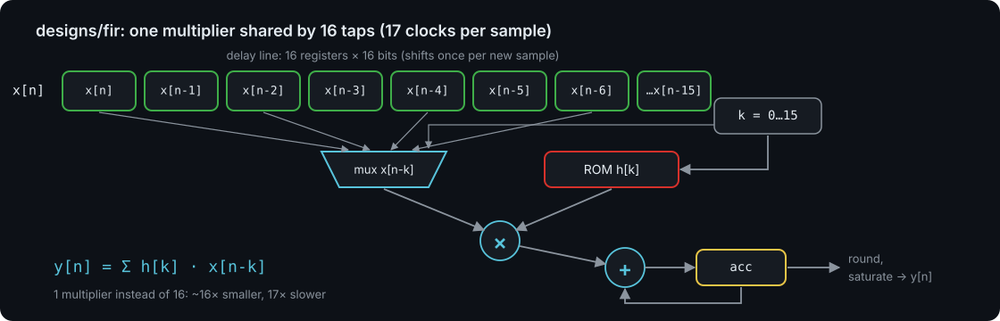
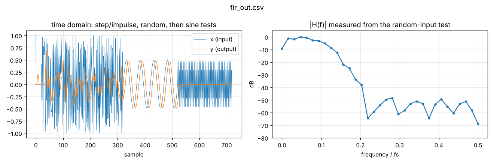
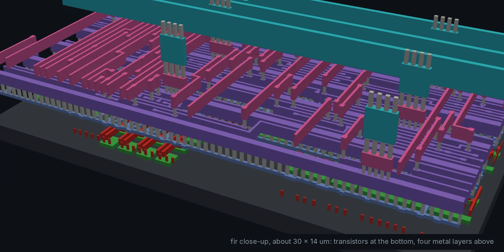
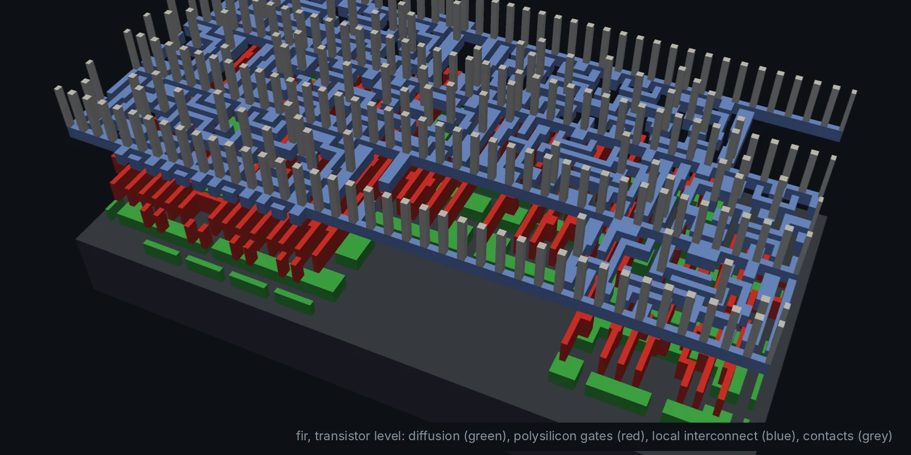

# fir: 16-tap low-pass FIR filter (Module 4, advanced)

y[n] = Σ h[k] x[n-k], k = 0..15, with Q1.15 samples and coefficients, a
cutoff of 0.1 fs (designed by `python/dsp_coeffs.py`), round-to-nearest and
saturation on the output.

## Architecture

One multiplier and one accumulator are reused for all 16 taps, so a sample
takes 17 clock cycles. That is the opposite trade-off from `designs/iir`,
which computes everything in one cycle. Most of the area is the delay line:
16 samples × 16 bits = 256 flip-flops.

## Verification

Impulse response = coefficients; 300 random full-scale samples compared bit
for bit with a model of the same arithmetic; and the gain at 0.02 fs (pass
band) and 0.3 fs (stop band) measured from sine bursts. `make plot` turns the
random-input test into a measured |H(f)|:

## Results

| Testbench | Cells | Die | Clock | Worst slack | Power | DRC |
| --- | --- | --- | --- | --- | --- | --- |
| `PASS: 720 samples bit-exact vs. model` | 2,123 | 253 × 253 µm | 100 MHz | +0.06 ns | 4.9 mW | 0 |

At 100 MHz and 17 cycles per sample the filter handles up to ~5.9 Msample/s.

| Close-up of the wiring | Transistor level |
| --- | --- |
|  |  |

To change the filter: edit `FIR_CUTOFF` or `FIR_TAPS` in
`python/dsp_coeffs.py`, run it, and paste the printed coefficients into
`rtl/fir.v` (function `coef`) and `tb/fir_tb.v` (array `h`).
