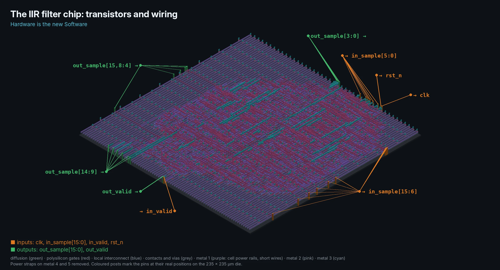
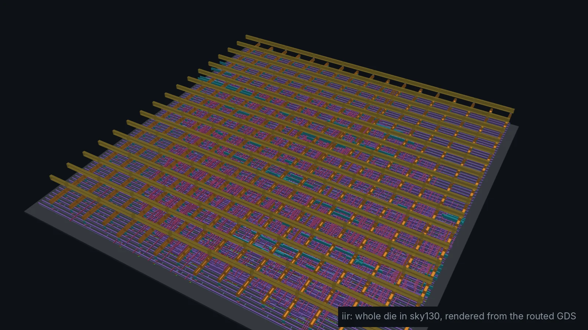
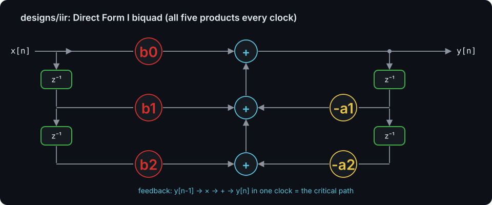
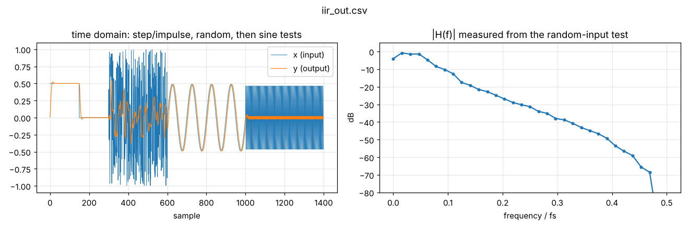
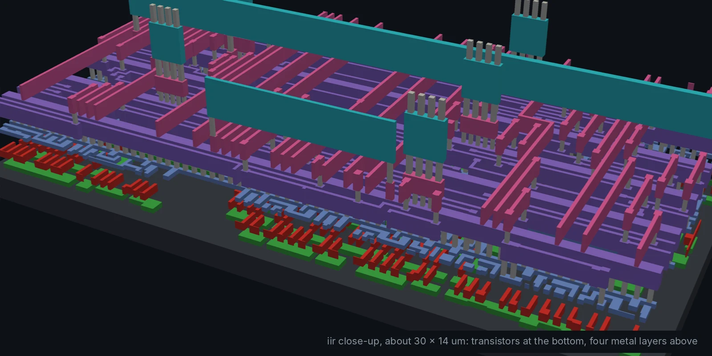
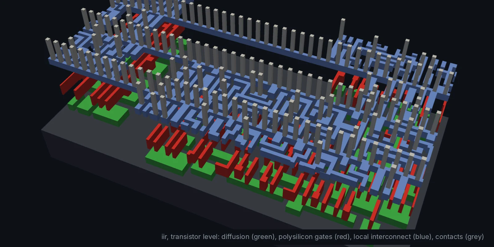

# iir: 2nd-order IIR low-pass biquad (Module 5, advanced)

y[n] = b0 x[n] + b1 x[n-1] + b2 x[n-2] - a1 y[n-1] - a2 y[n-2]: a Butterworth
low-pass with cutoff 0.05 fs, coefficients in Q2.14, designed by
`python/dsp_coeffs.py` with the bilinear transform.

## Architecture

Fully parallel, one sample per clock. The coefficients are constants, so
synthesis turns each multiplier into a few shifts and adds. The feedback
path (y[n-1] → multiply → add → y[n]) is the critical path and cannot be
pipelined without changing the filter, so this design is constrained to a
50 MHz clock (it actually closes at about 90 MHz).

## Verification

Step response settles to the input (DC gain 1); 300 random samples bit-exact
vs. a model; gain at 0.01 fs (pass) and 0.2 fs (stop, about -26 dB).

## Results

| Testbench | Cells | Die | Clock | Worst slack | Power | DRC |
| --- | --- | --- | --- | --- | --- | --- |
| `PASS: 1400 samples bit-exact vs. model` | 1,560 | 235 × 235 µm | 50 MHz | +9.07 ns | 1.3 mW | 0 |

Compare with the FIR: a sharper filter in fewer cells, at 50 Msample/s
instead of 5.9.

| Close-up of the wiring | Transistor level |
| --- | --- |
|  |  |
