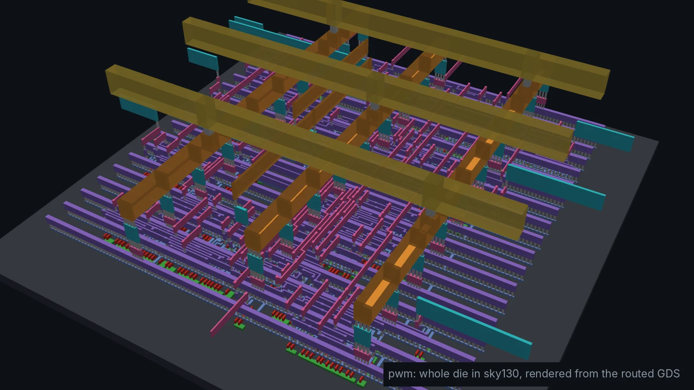
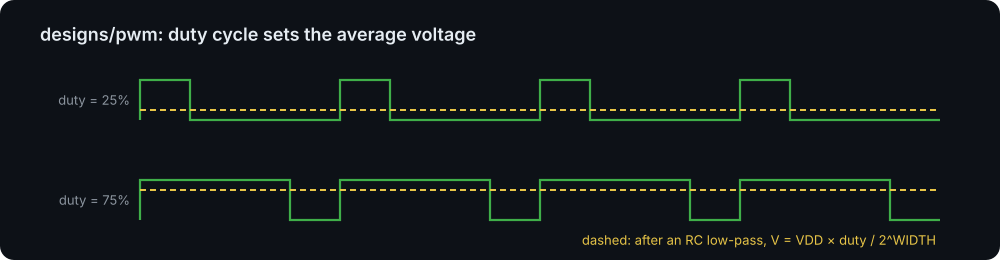
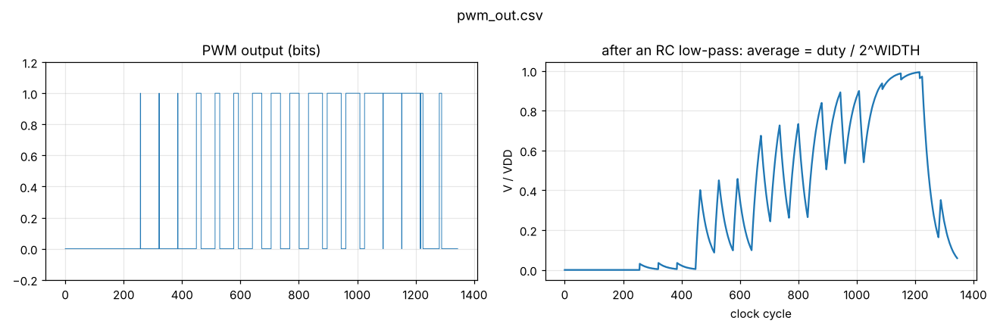
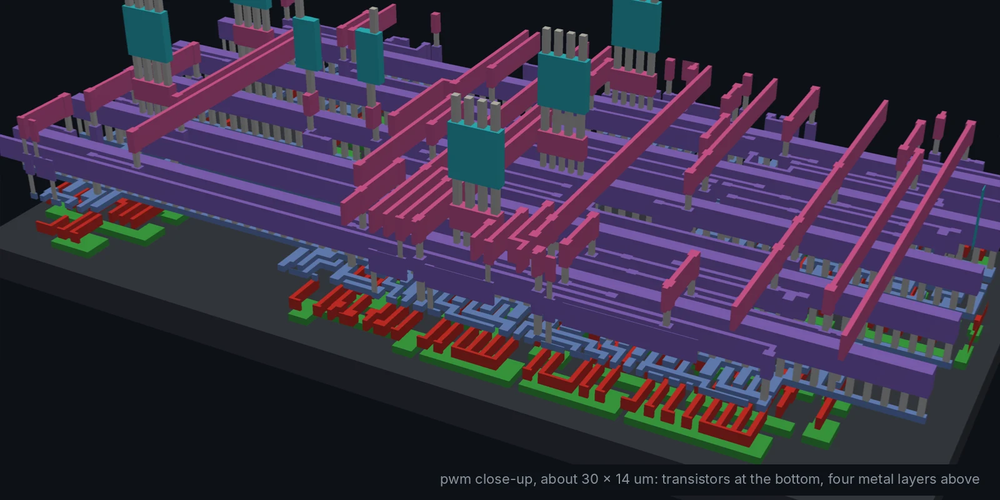
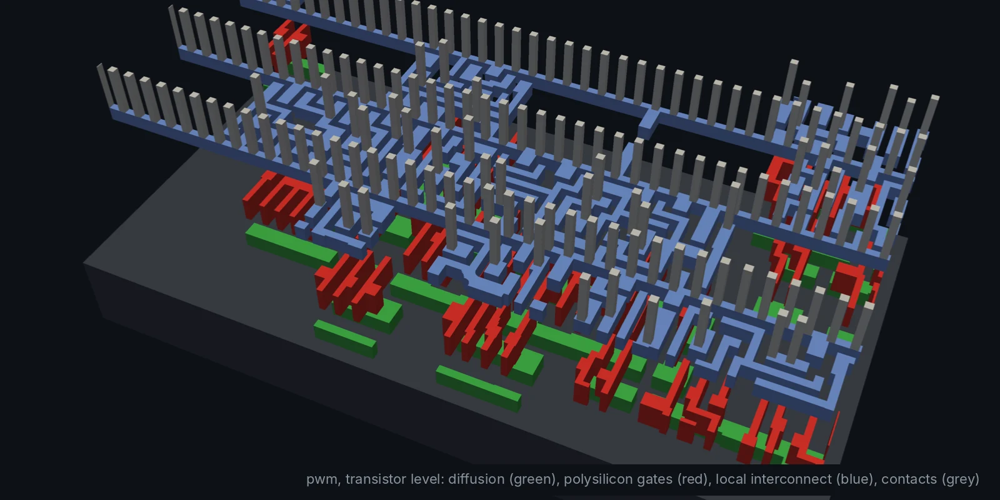

# pwm: pulse-width modulator (Module 2, basic)

Switches `pwm_out` high for `duty` out of every 2^WIDTH clock cycles. After a
low-pass filter the average is VDD × duty / 2^WIDTH, so this is a timer
peripheral, a motor/LED driver and a 1-bit DAC in one.

What to look at:

- `duty` is latched once per period (double buffering), so changing it
  mid-period never makes a short glitch pulse.
- The output comes straight from a flip-flop, so it cannot glitch either.
- The testbench checks the exact high time for duty values 0, 1, 16, 32, 48,
  63 and 8, and `make plot` shows the "RC-filtered" analog level.

## Results

| Testbench | Cells | Die | Clock | Worst slack | DRC |
| --- | --- | --- | --- | --- | --- |
| `PASS: all duty cycles exact` | 71 (17 flip-flops) | 60 × 60 µm | 100 MHz | +6.15 ns | 0 |

| Close-up of the wiring | Transistor level |
| --- | --- |
|  |  |
