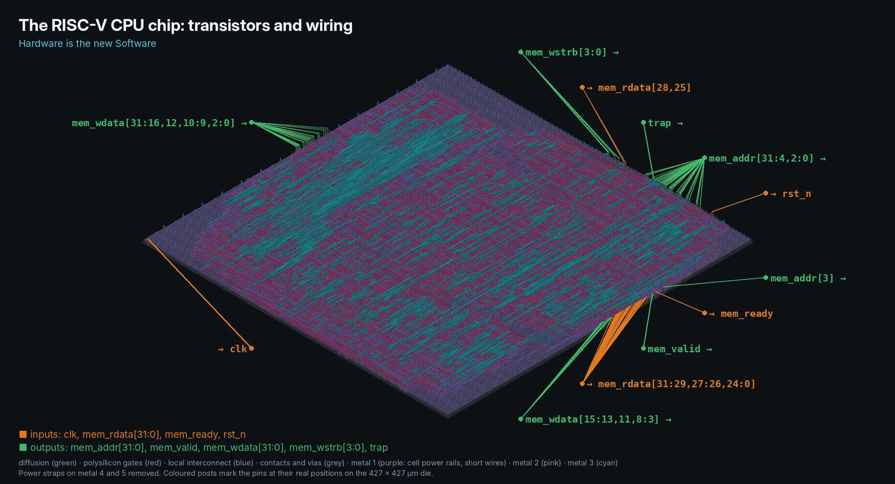
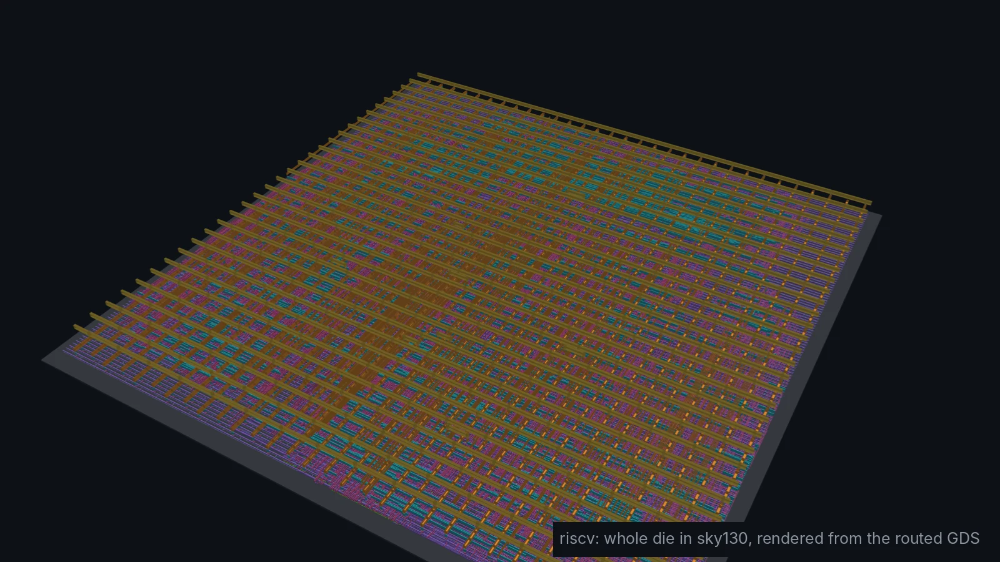
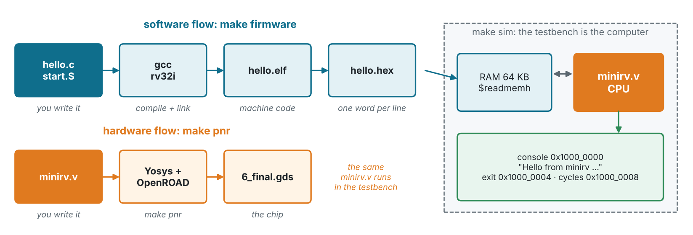
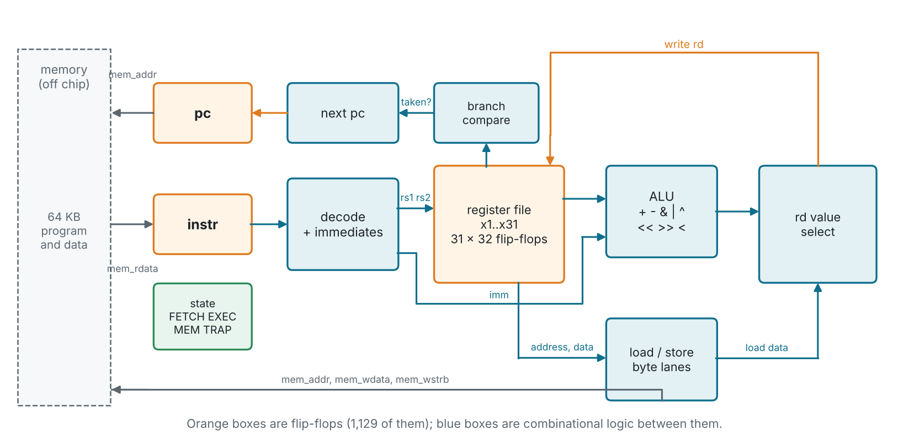
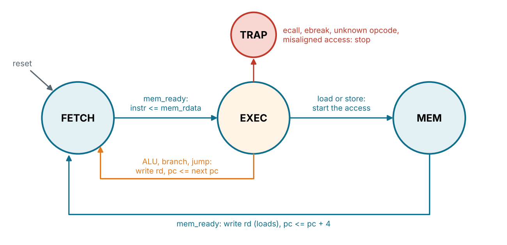
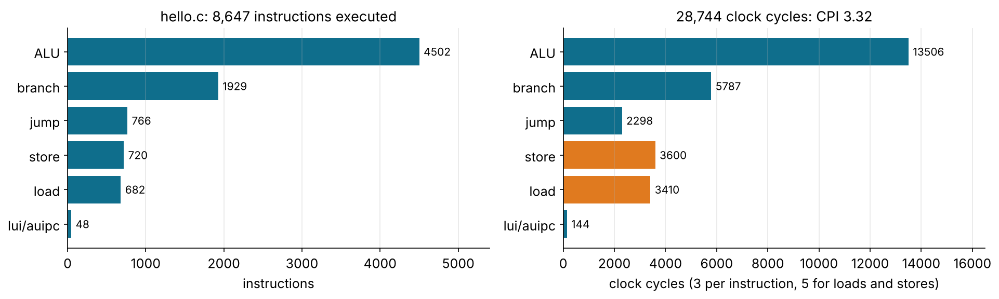
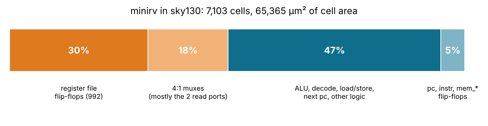
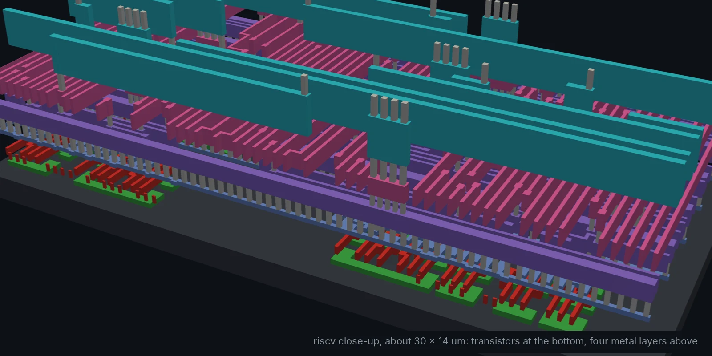
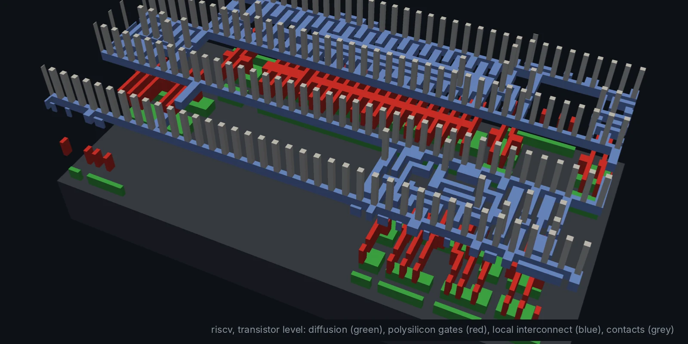

# riscv: a RISC-V CPU that runs C (Module 9, advanced)





`minirv` is a small 32-bit RISC-V processor (RV32I) in one Verilog file.
It runs ordinary C compiled by `gcc`, and goes through the same flow as
every other design here, down to a sky130 layout. Hardware is the new
Software: here a software compiler and a hardware compiler meet in one repo.

```text
$ make sim
isa_test: exit 0 after 217 instructions, 686 cycles (CPI 3.16)

Hello from minirv, a RISC-V CPU written in Verilog!
Hardware is the new Software.

Fibonacci: 1 1 2 3 5 8 13 21 34 55 89 144

  ok    fib(30) = 832040
  ok    10! = 3628800 (software multiply)
  ok    1000000 / 7 = 142857 (software divide)
  ok    25 primes below 100
  ok    sort 10 numbers
  ok    crc32("Hardware is the new Software")

That took 25599 clock cycles.
hello: exit 0 after 8647 instructions, 28744 cycles (CPI 3.32)
PASS: isa_test, hello.c and ebreak, 0 errors
```

## Files

| File | What it is |
| --- | --- |
| `rtl/minirv.v` | The CPU: decode, register file, ALU, branches, loads/stores, state machine |
| `tb/minirv_tb.v` | The rest of the computer: 64 KB RAM, console, exit and cycle registers |
| `firmware/hello.c` | A C program: prints, multiplies, divides, sorts, CRC-32, checks itself |
| `firmware/isa_test.S` | Checks every instruction against the RISC-V spec |
| `firmware/start.S`, `link.ld` | Start-up code (stack, `.bss`) and the memory map |
| `firmware/*.hex`, `*.lst` | Compiled programs and their disassembly (committed) |

## Architecture



The CPU is **multi-cycle**: one instruction at a time goes through FETCH,
EXEC and, for loads and stores, MEM. ALU, branch and jump instructions
take 3 clocks, loads and stores 5. That is slow next to a pipeline, but
every signal is easy to follow in a waveform.





- All 37 RV32I instructions a C compiler uses; `fence` is a no-op.
- `ecall`, `ebreak`, unknown opcodes and misaligned accesses stop the CPU
  with `trap` high. No CSRs, interrupts or caches.
- One memory port with a valid/ready handshake and byte write strobes. The
  program memory is outside the chip: the testbench provides it.

| Address | |
| --- | --- |
| `0x0000_0000` | 64 KB RAM: code, data, stack |
| `0x1000_0000` | console: a byte written here is printed |
| `0x1000_0004` | exit: writing here ends the program with that exit code |
| `0x1000_0008` | cycles: reads the clock count since reset |

## Running your own C

```sh
sudo apt install gcc-riscv64-unknown-elf   # the RISC-V cross compiler
# edit firmware/hello.c, then
make firmware sim
vvp build/sim +trace                       # print every instruction as it runs
```

There is no C library: print through the console register as `hello.c`
does. The CPU has no multiply or divide, so gcc calls libgcc's
`__mulsi3` and `__udivsi3`: look for them in `firmware/hello.lst`.

## Verification

Three programs, each one checks itself: `isa_test` (on the first wrong
result it exits with the number of the failing check, so you can find it
in `isa_test.lst`), `hello.c` (returns the number of failed checks), and a
one-word `ebreak` program that must raise `trap`. The testbench also
counts the instruction mix:



## Results

| Testbench | Cells | Die | Clock | Worst slack | Power | DRC |
| --- | --- | --- | --- | --- | --- | --- |
| `PASS: isa_test, hello.c and ebreak, 0 errors` | 6,248 (1,129 flip-flops) | 427 × 427 µm | 50 MHz | +9.43 ns | 7.4 mW | 0 |

`make pnr` takes about 8 minutes. The register file (992 flip-flops and
two 32-way read multiplexers) is about half the area:



| Close-up of the wiring | Transistor level |
| --- | --- |
|  |  |

The slide deck for this module: [slides/09-riscv.md](../../slides/09-riscv.md).
