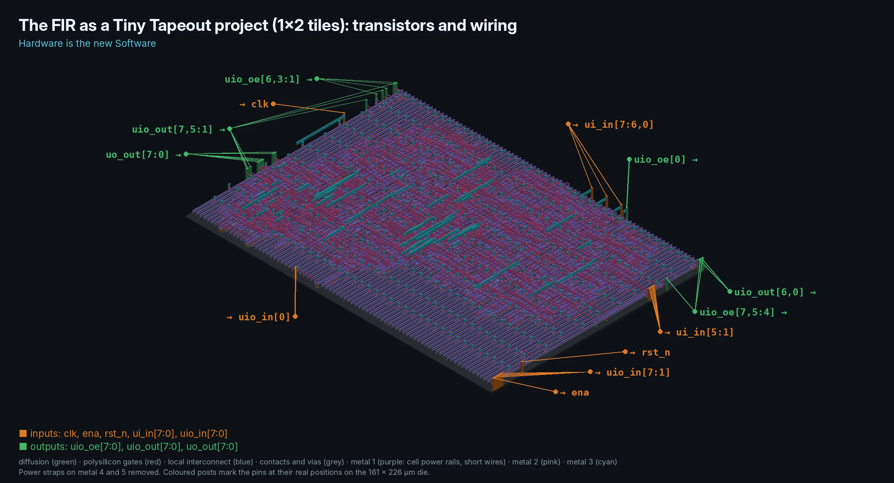
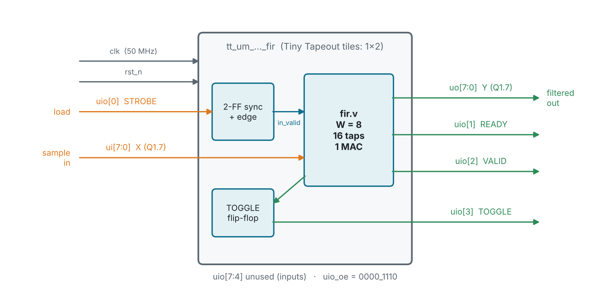
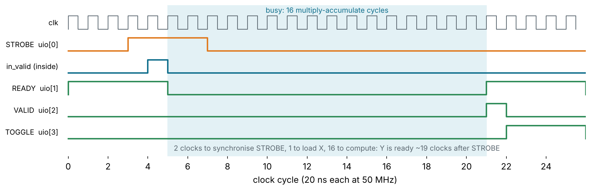
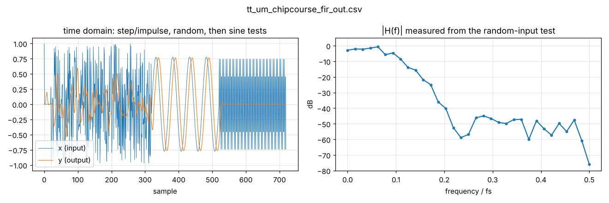
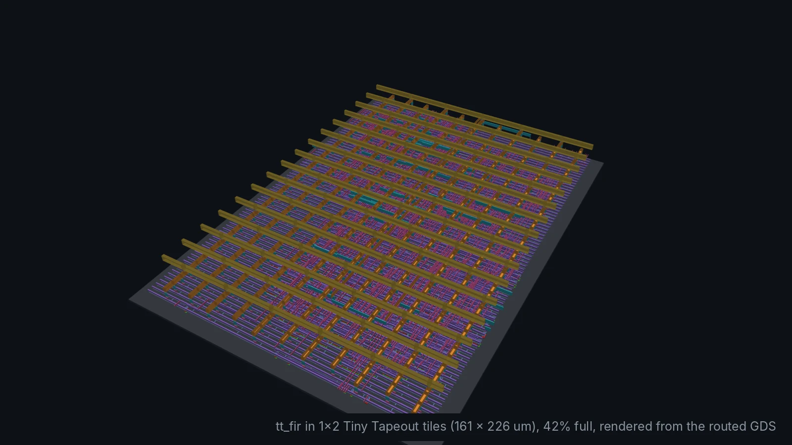

# tt_fir: the FIR filter as a Tiny Tapeout chip (Module 9, capstone)



The 16-tap low-pass FIR from [`designs/fir`](../fir), packaged as a
[Tiny Tapeout](https://tinytapeout.com/) project you can send to a real
shuttle. The filter core is the **same file**: `src/fir.v` is a link to
`designs/fir/rtl/fir.v`, built with its sample width parameter set to 8, so
one sample fits the 8 input pins and one result fits the 8 output pins.

What is new is everything around the core that a real chip needs: a fixed
pinout, an input from the outside world that is not synchronous to the
clock, and a tile of fixed size that the design must fit.

## The pins



| Pin | Dir | Function |
| --- | --- | --- |
| `ui[7:0]` | in | X, the next sample, signed Q1.7 |
| `uo[7:0]` | out | Y, the latest filtered sample, signed Q1.7, held until the next one |
| `uio[0]` | in | STROBE: a rising edge loads X |
| `uio[1]` | out | READY: high when a new sample can be loaded |
| `uio[2]` | out | VALID: high for one clock when Y changes |
| `uio[3]` | out | TOGGLE: flips on every new Y, so a slow reader cannot miss it |

STROBE comes from a microcontroller or a button, so it can change at any
moment relative to `clk`. Two flip-flops synchronise it (to keep a
metastable value away from the filter), and a third detects its rising
edge, which becomes the filter's one-cycle `in_valid`:



## Files

```
info.yaml          Tiny Tapeout project description: title, top module, tiles, pinout
src/project.v      the tt_um_ top module: pins, STROBE synchroniser, TOGGLE
src/fir.v          link to designs/fir/rtl/fir.v (copied by make tt-export)
tb/tt_fir_tb.v     the course testbench (make sim): drives only the pins
test/              Tiny Tapeout's cocotb test (make tt-test), as their CI runs it
docs/info.md       the datasheet page for the shuttle
orfs/              make pnr on a die the size of the tiles
```

## Verify

```sh
cd designs/tt_fir
make sim          # PASS: 720 samples bit-exact vs. model through the Tiny Tapeout pins
make lint         # Verilator, -Wall, clean
make tt-test      # cocotb (pip install -r test/requirements.txt): TESTS=1 PASS=1
make plot         # waveforms and measured |H(f)|
```

Both testbenches talk to the chip only through its pins, the way the demo
board's microcontroller will, and compare every output bit for bit with a
model of the same arithmetic. A 0.3·f_s tone comes out as exactly 0: what
leaks through the stop band is smaller than one 8-bit LSB (−42 dB of full
scale).



The measured response flattens out around −50 dB above 0.2·f_s: that is the
8-bit output's rounding noise, not the filter. Compare it with the 16-bit
FIR's plot in [`designs/fir`](../fir).

## Does it fit?

| Tiles | Die | Cells | Utilisation | Worst slack at 50 MHz | Power | DRC |
| --- | --- | ---: | ---: | ---: | ---: | ---: |
| 1x1 | 161.00 × 111.52 µm | 1,161 | 85% | +10.08 ns | 1.2 mW | 0 |
| **1x2** (`info.yaml`) | 161.00 × 225.76 µm | 1,161 | 42% | +9.80 ns | 1.2 mW | 0 |

Numbers from `make pnr` (OpenROAD-flow-scripts, sky130hd, typical corner),
with `orfs/config.mk` set to each die size. The 16-bit FIR needs 25,200 µm²;
halving the sample width halves the delay line and the multiplier, and the
8-bit version is 12,000 to 13,300 µm² (Yosys / ORFS synthesis).

It *routes* in one tile, but at 85% it is far above the 60% placement
density in Tiny Tapeout's default `src/config.json`, and their flow
(LibreLane) puts pins and power stripes differently from ours. So
`info.yaml` asks for **1x2 tiles**, which leaves plenty of headroom. Fitting
it in 1x1 is the capstone's stretch exercise (see the Module 9 deck).

To check 1x1 yourself, change `DIE_AREA` and `CORE_AREA` in
`orfs/config.mk` to the values in its comment and run `make pnr` again.



## Submitting

Tiny Tapeout builds every project from its own GitHub repository:

1. On GitHub, open the
   [ttsky-verilog-template](https://github.com/TinyTapeout/ttsky-verilog-template)
   (or the template for the shuttle that is open now, listed on
   [tinytapeout.com](https://tinytapeout.com/)) and click **Use this
   template**. Enable GitHub Pages and Actions as its README says.
2. Clone your new repo next to this one, then from `designs/tt_fir`:

   ```sh
   make tt-export TT_REPO=../../../my-tt-fir
   ```

   This copies `info.yaml`, `src/` (with a real copy of `fir.v`), `test/`
   and `docs/`. It keeps the template's `src/config.json` and `.github/`.
3. Rename the top module to `tt_um_<your GitHub name>_fir` in
   `src/project.v`, `info.yaml` and `test/tb.v` (names must be unique on the
   shuttle), and fill in `author` and `discord` in `info.yaml`.
4. Commit and push. The template's Actions run the cocotb test, build the
   GDS with LibreLane, run the precheck and a gate-level test, and publish
   a 3D viewer of your tile. All must be green.
5. Submit the repo on [app.tinytapeout.com](https://app.tinytapeout.com/)
   before the shuttle closes. Tiles cost money; check the current price and
   deadline there.

The local `make pnr` here is a quick fit check with the course's tools. The
template's GDS action is the real build that decides whether the shuttle
accepts the design.
