# The RTL-to-GDS flow

A digital chip starts as Verilog and ends as GDS, a file of polygons that a
foundry turns into masks. Each stage below takes the previous stage's output,
and each has a report you should learn to read.

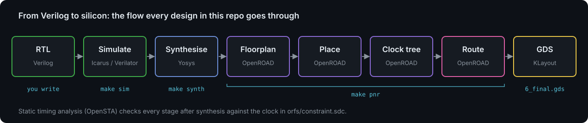

Static timing analysis (STA, OpenSTA inside OpenROAD) runs after almost every
back-end step: it checks that every path between flip-flops fits in the clock
period given in the SDC file.

## 1. RTL and simulation

- **Input:** Verilog source, a testbench.
- **Tools:** Icarus Verilog (`iverilog` + `vvp`), Verilator.
- **Output:** pass/fail, waveforms (`.vcd`).
- **Look at:** the waveform. Does `count` increment only when `en` is high?

Simulation is where nearly all bugs should be found. Everything after this
point assumes the RTL is functionally correct.

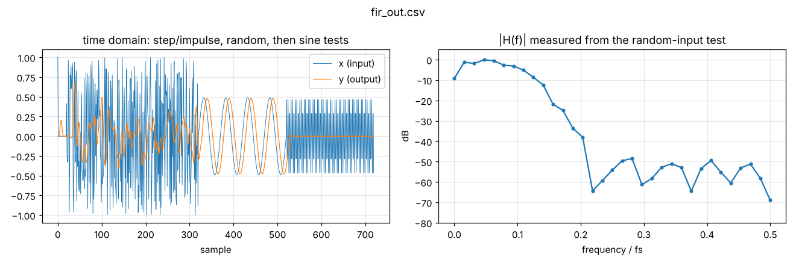

## 2. Lint

- **Tool:** `verilator --lint-only -Wall`.
- Catches width mismatches, latches inferred by accident, unused signals and
  things that simulate but do not synthesise the way you expect.

## 3. Synthesis

- **Input:** RTL. For a real target, a Liberty (`.lib`) file describing the
  standard cells: their logic function, area, timing and power.
- **Tool:** Yosys (`synth`, then `dfflibmap` + `abc` for a real library).
- **Output:** a gate-level netlist, i.e. Verilog that only instantiates cells.
- **Look at:** `stat`. How many flip-flops? (For the counter, exactly `WIDTH`.)
  What is the area? `make show` draws the circuit. The scripts are in
  `scripts/synth_generic.tcl` and `scripts/synth_sky130.tcl`.

## 4. Floorplan

- **Tool:** OpenROAD (`initialize_floorplan`, `place_pins`, `pdngen`).
- Chooses the die and core size, creates rows for cells, places the I/O pins
  and builds the power distribution network (VDD/VSS straps).
- **Output:** `2_floorplan.odb`.

The layers the back end works with, from transistors up to the power grid:

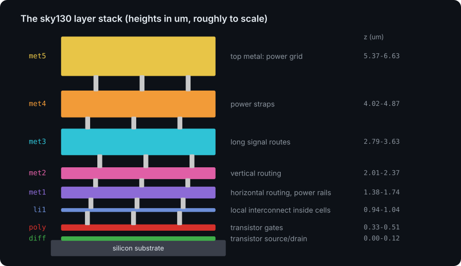

## 5. Placement

- Global placement spreads cells to minimise wire length, then detailed
  placement snaps them legally into rows.
- `PLACE_DENSITY` controls how tightly cells are packed.
- **Output:** `3_place.odb`. **Look at:** density map in the GUI.

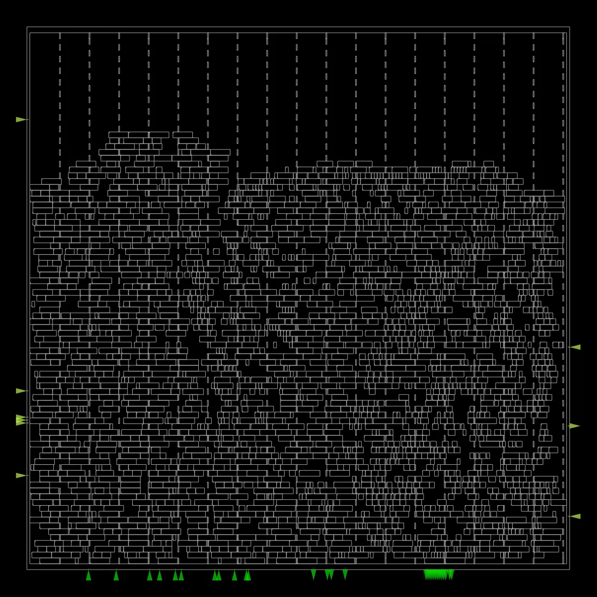

## 6. Clock tree synthesis (CTS)

- Builds a buffer tree so the clock reaches every flip-flop at nearly the same
  time (low *skew*).
- **Look at:** `4_cts` reports: skew, and setup/hold slack after CTS.

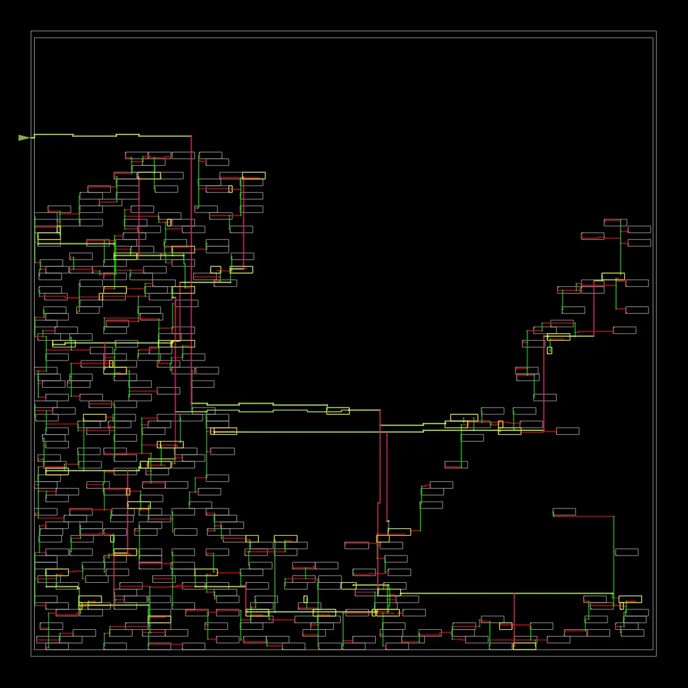

## 7. Routing

- Global routing plans which regions each net goes through; detailed routing
  draws the actual wires on metal layers `met1`..`met5` and vias.
- **Output:** `5_route.odb`. **Look at:** DRC violations count (should be 0).

Routed FIR (left) and its routing congestion map (right):

| Routing | Congestion |
| --- | --- |
| 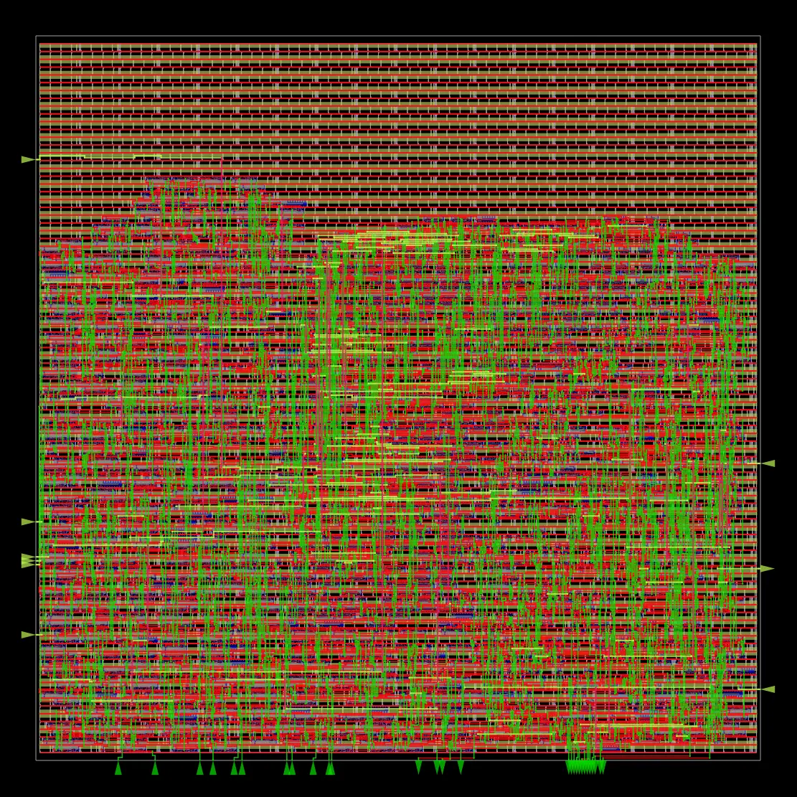 | 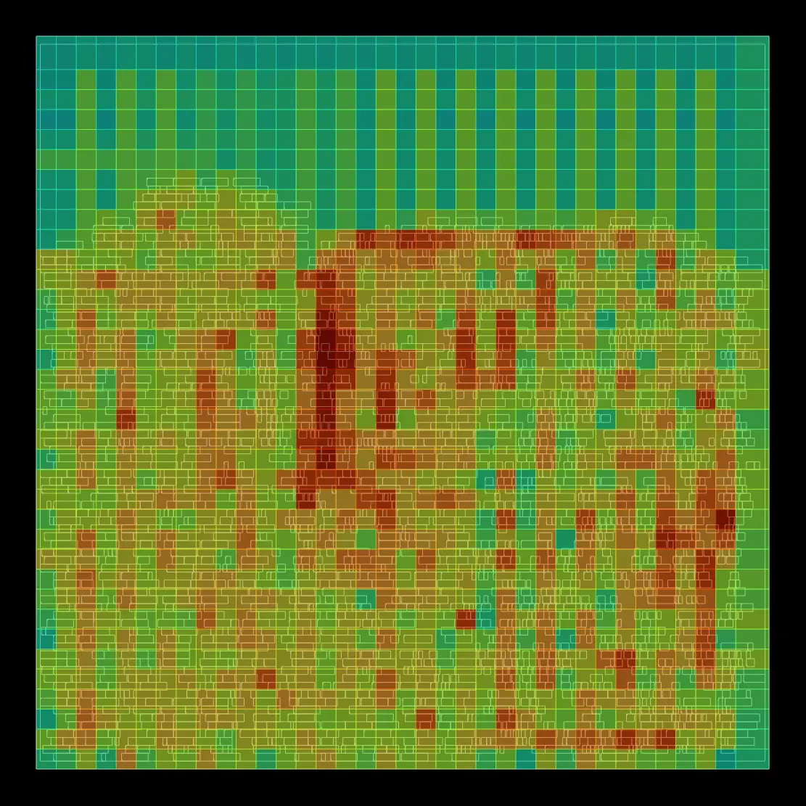 |

## 8. Finish and signoff

- Fill cells, parasitic extraction (RC of the wires), final STA, and GDS export
  with KLayout.
- **Output:** `6_final.gds`, `6_final.odb`, `reports/.../6_finish.rpt`, and
  pictures of each stage (`final_all.webp`, `final_routing.webp`, ...).
- Real tapeouts also run full DRC (design rules) and LVS (layout vs.
  schematic), e.g. with Magic, KLayout and Netgen.

The flow also checks the power grid: the IR-drop map shows how much the
supply voltage sags across the FIR when it is busy (darker is better):

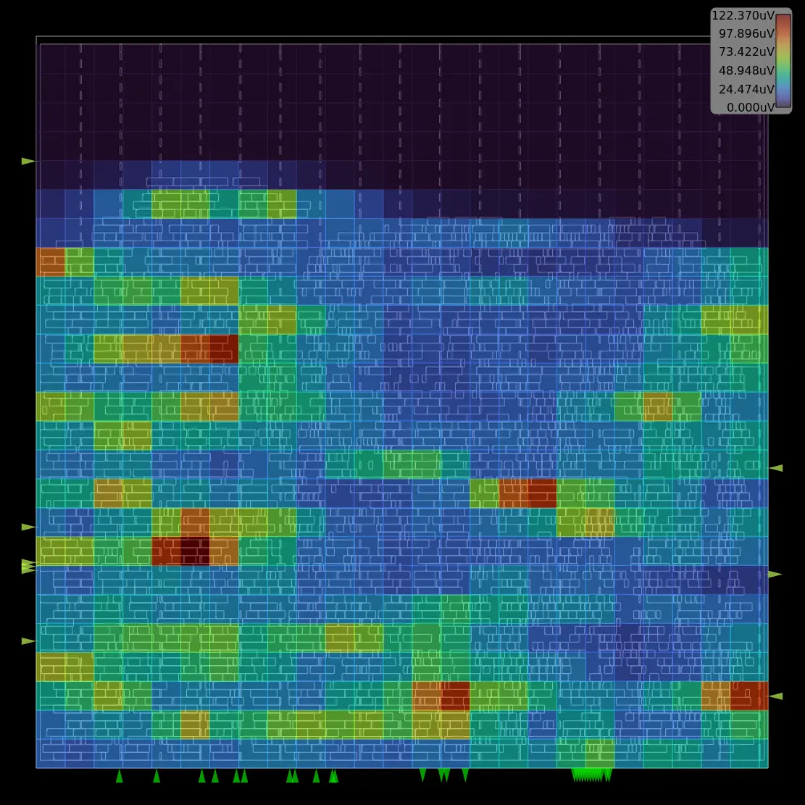

The final layout of the counter as the flow draws it, and the same GDS
rendered in 3D by `python/render_3d.py`:

| 2D (ORFS) | 3D |
| --- | --- |
| 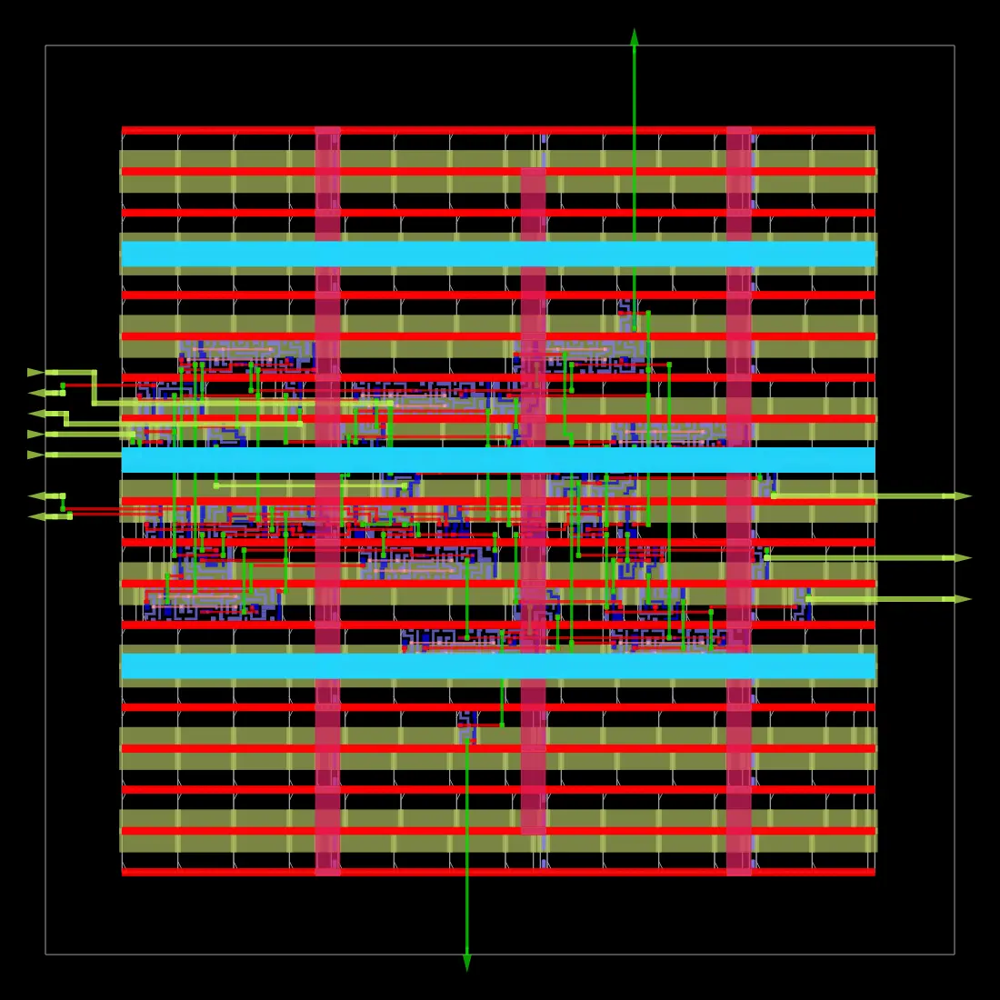 | 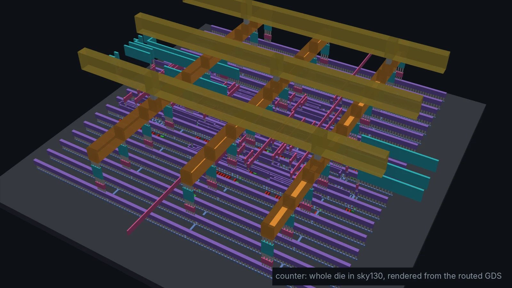 |

Render any design yourself after `make pnr`:

```sh
pip install gdstk pyvista            # Linux servers also need: apt install libosmesa6
python3 python/render_3d.py designs/fir/build/orfs/results/sky130hd/fir/base/6_final.gds -o fir.webp
python3 python/render_3d.py <gds> -o zoom.webp --region 100 100 130 115   # close-up, in um
```

## Reading timing reports

The key numbers in ORFS reports (`reports/sky130hd/counter/base/`):

- **WNS** (worst negative slack) and **TNS** (total negative slack): 0 or
  positive means every path meets timing.
- **setup slack:** how much earlier than required the data arrived.
  Negative means the clock is too fast for this logic.
- **hold slack:** negative means data changed too soon after the edge; CTS and
  the repair steps usually fix this with buffers.

To see what happens when timing fails, set `clk_period` in
`orfs/constraint.sdc` to something impossible like `1.0` and rerun `make pnr`.

The worst path of the FIR, highlighted on the layout (`final_worst_path.webp`):

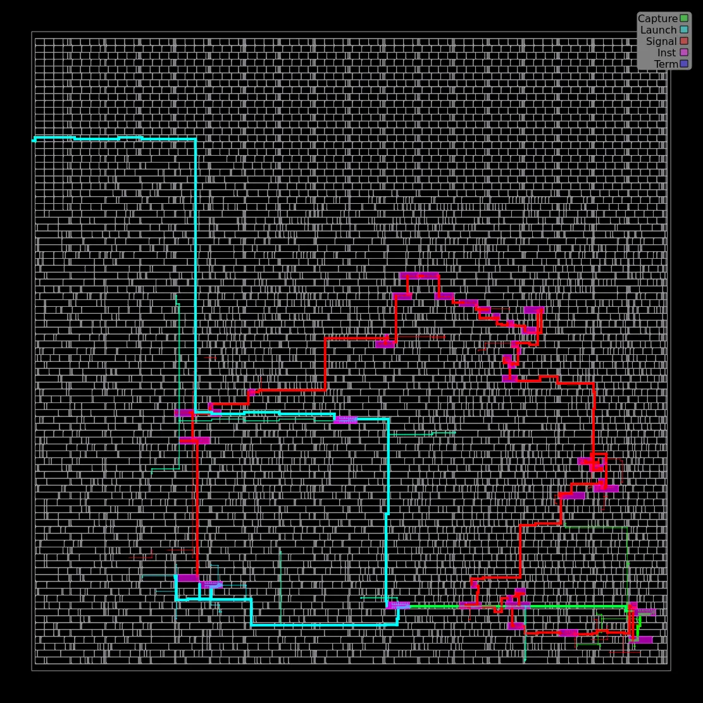
