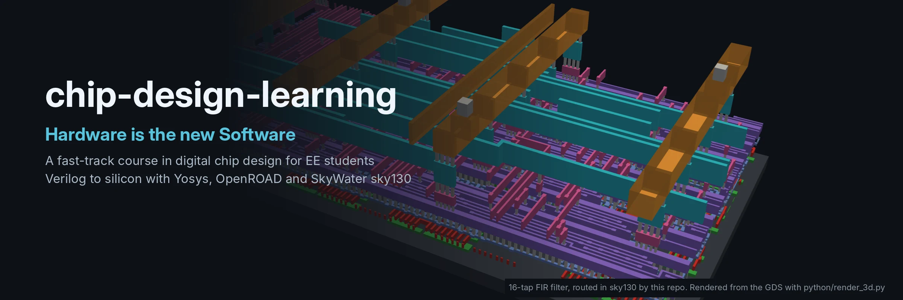

# Fast track: digital chip design for EE students

> **Hardware is the new Software.** You will write chips the way you write
> programs: in a text editor, tested by scripts, built by a flow, versioned
> in git.

This course is for electronics and electrical engineering students who
already know circuits, digital logic and signals & systems, and want to turn
that into working chip designs quickly. It skips what you already know and
spends the time on what an EE curriculum usually leaves out: writing
synthesisable hardware, verifying it, fixed-point DSP, and getting from RTL
to a real layout with open-source tools.

**You should already know:** Boolean logic and flip-flops, binary/two's
complement, convolution, the Z-transform and frequency response, the DFT, and
basic programming (Python or C).

**Format:** 8 modules, each 3 to 6 hours. A typical pace is two modules a
week, so four weeks in total. Every module has a working design in
`designs/`, a self-checking testbench, and exercises. Every design goes
through the same flow:

```
make sim  ->  make lint  ->  make synth / synth-sky130  ->  make pnr
```

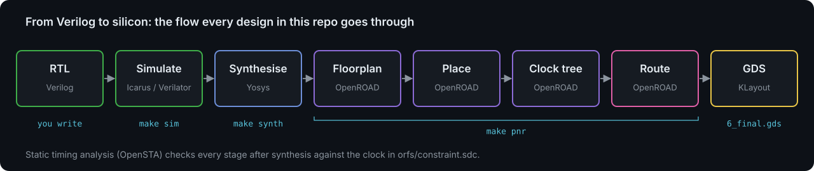

| #  | Module                          | Design            | Level    | Key idea                                  |
| -- | ------------------------------- | ----------------- | -------- | ----------------------------------------- |
| 1  | The flow, end to end            | `counter`         | Basic    | RTL to GDS in one afternoon               |
| 2  | Sequential control and timers   | `pwm`             | Basic    | Registers, comparators, glitch-free outputs |
| 3  | Fixed-point arithmetic          | (primer)          | Core     | Q formats, rounding, saturation           |
| 4  | FIR filters                     | `fir`             | Advanced | Time-shared MAC, throughput vs. area      |
| 5  | IIR filters                     | `iir`             | Advanced | Feedback, stability, parallel datapath    |
| 6  | The FFT                         | `fft`             | Advanced | Butterflies, twiddles, scaling            |
| 6b | The FFT in software vs hardware | `codesign/`       | Advanced | Speed, energy, area; golden models        |
| 7  | Timing, area and power          | all               | Advanced | Reading reports, making trade-offs        |
| 8  | Your own design and tapeout     | yours             | Project  | Putting it all together                   |

Tick the boxes as you go. Each module also has a slide deck with more
detail (theory, diagrams, worked examples, results): see [slides/](../slides/).

---

## Module 1: The flow, end to end (`designs/counter`)

Goal: run every tool once on a design simple enough that you can predict
every result, so you learn the tools rather than the design.

Read: [flow-overview.md](flow-overview.md), [setup.md](setup.md).

What you will build, and what it looks like as a chip (60 × 60 µm, the
yellow and orange bars are the power grid on the top metal layers):

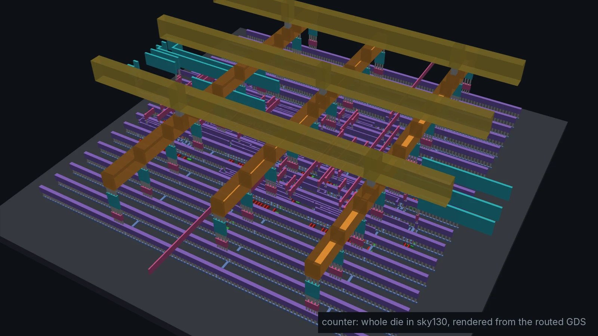

Every layout in this course uses the same stack of layers, from transistors
at the bottom to thick power metal at the top:

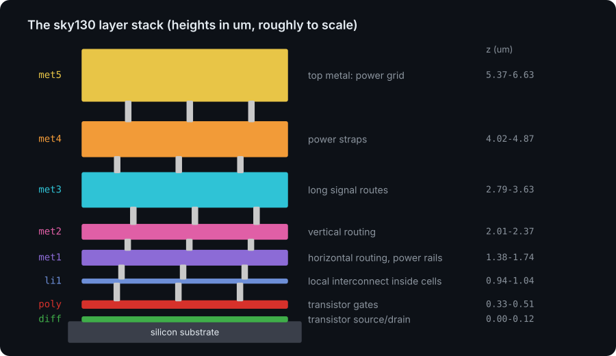

Verilog you need now: `module`, `input/output`, `wire` vs. `reg`,
`always @(posedge clk)`, non-blocking `<=` for flip-flops, `assign` for
combinational logic. If Verilog is new, do the first sections of
[HDLBits](https://hdlbits.01xz.net/) alongside this module.

- [ ] `make doctor`, then `make sim` and `make waves` in `designs/counter`.
      Find the cycle where `wrap` is high.
- [ ] `make lint`, `make synth`, `make show`. Count the flip-flops in the
      schematic: it should equal `WIDTH`.
- [ ] `make synth-sky130`: which sky130 cell is the flip-flop, and why is it
      the one with a reset pin (`dfrtp`)?
- [ ] `make pnr`, then open `6_final.gds` in KLayout or `make pnr-gui`.
- [ ] **Exercise:** add a synchronous `load` input. Extend the testbench
      model, and make sure the test fails if you break the RTL on purpose.

## Module 2: Sequential control and timers (`designs/pwm`)

Goal: a block every microcontroller has, and the bridge between digital and
analog: average voltage = VDD x duty / 2^WIDTH.

- Counters and comparators as the building blocks of timers
- Double-buffering a register so updates never glitch the output
- Registered outputs vs. combinational outputs

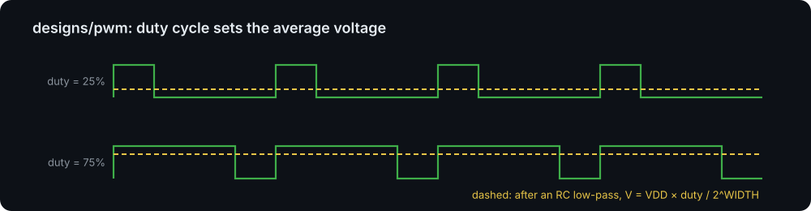

- [ ] `make sim plot` in `designs/pwm`. The plot shows the PWM bits and the
      output of a digital "RC filter".

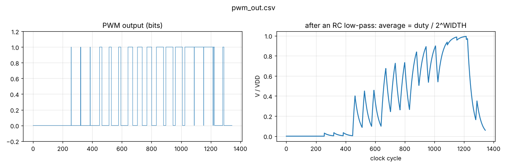
- [ ] **Exercise:** with a 100 MHz clock, what PWM frequency does WIDTH=8
      give? What WIDTH would you need for 16-bit audio, and what would the
      PWM frequency be? (This is why audio DACs use sigma-delta instead.)
- [ ] **Exercise:** add a dead-time generator: two complementary outputs
      `pwm_h`, `pwm_l` that are never high at the same time, with a
      programmable gap. This is what drives a half-bridge in a motor or
      power converter.

## Module 3: Fixed-point arithmetic (primer)

Goal: represent real numbers with integers and know exactly how many bits
every signal needs.

Read: [fixed-point.md](fixed-point.md).

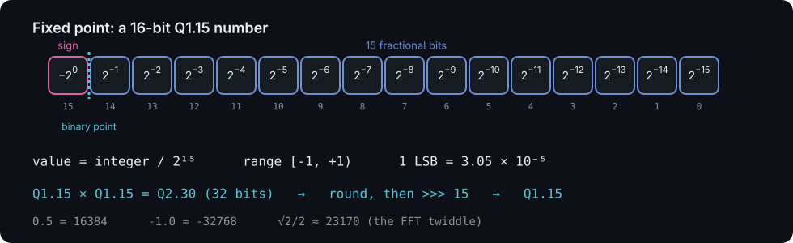

- [ ] Run `python3 python/dsp_coeffs.py --plot` and compare the floating and
      fixed-point responses in `build/filters.png`.

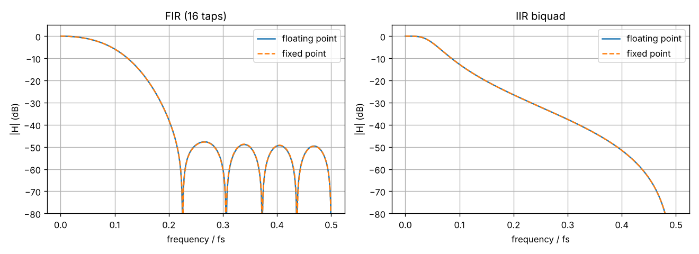
- [ ] Do the exercises at the end of `fixed-point.md`.

## Module 4: FIR filters (`designs/fir`)

Goal: implement y[n] = sum h[k] x[n-k] in hardware and understand the
throughput vs. area trade-off.

- Direct form FIR; symmetric (linear-phase) coefficients
- One time-shared multiply-accumulate (MAC) unit vs. one multiplier per tap
- Valid/ready handshakes
- Bit-exact verification against a reference model

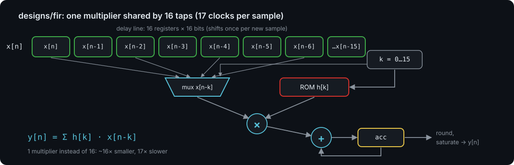

- [ ] `make sim plot`. The right-hand plot is |H(f)| *measured from the
      hardware's output* for random input. Compare it with the design
      response from `dsp_coeffs.py`.

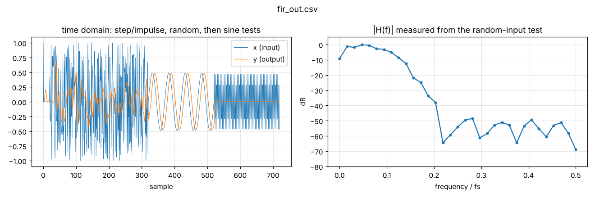
- [ ] `make synth-sky130` and `make pnr`. How much of the area is the delay
      line (256 flip-flops) vs. the multiplier?

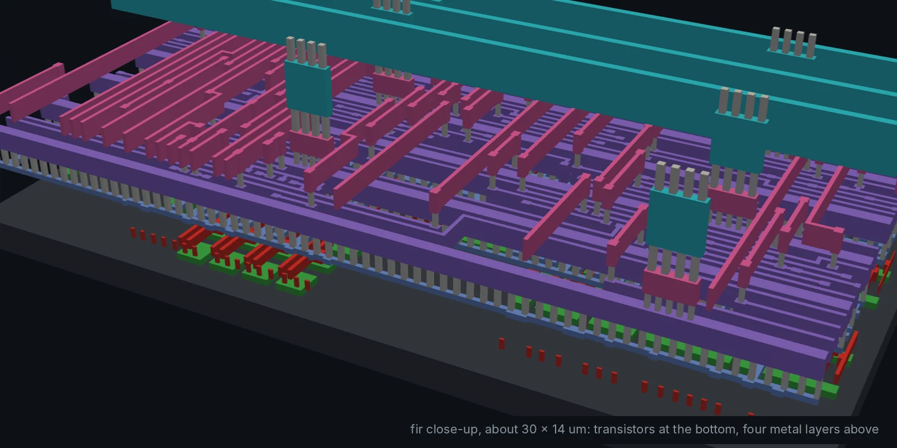
- [ ] **Exercise:** change the cutoff in `dsp_coeffs.py` to 0.2 fs, paste the
      new coefficients into `fir.v` and the testbench, and re-run.
- [ ] **Exercise:** the coefficients are symmetric (h[k] = h[15-k]). Add
      x[n-k] + x[n-15+k] first and halve the number of multiplies, so a
      sample takes 9 cycles instead of 17.
- [ ] **Stretch:** write a fully parallel version (16 multipliers, one sample
      per clock) and compare area and maximum clock frequency.

## Module 5: IIR filters (`designs/iir`)

Goal: get a sharp filter from very few multipliers, and see why feedback
makes hardware harder.

- Direct Form I biquad; Butterworth design with the bilinear transform
- Constant-coefficient multipliers become shifts and adds
- Quantisation moves poles; saturation prevents overflow oscillation
- Why you cannot simply pipeline a feedback loop

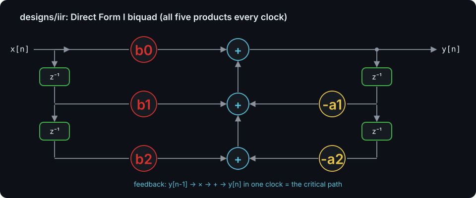

- [ ] `make sim plot`. Note the step response settles to exactly the input
      (DC gain 1).

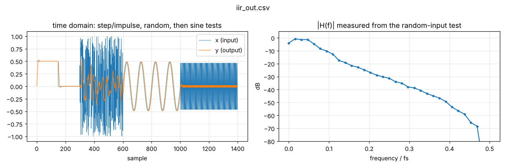
- [ ] `make pnr`. Find the critical path in the timing report: it goes
      around the feedback loop (y[n-1] -> multiply -> add -> y[n]).
- [ ] **Exercise:** turn the low-pass into a high-pass (see the RBJ
      cookbook formulas in `dsp_coeffs.py`) and verify it.
- [ ] **Exercise:** cascade two biquads for a 4th-order filter.
- [ ] **Stretch:** reduce the coefficient precision until the filter goes
      unstable; watch the testbench output.

## Module 6: The FFT (`designs/fft`)

Goal: implement the DFT efficiently and connect the math you know to the
butterfly structure.

- Radix-2 decimation in time: bit-reversed input, log2(N) stages
- Twiddle factors; for N=8, multiplying by -j is free and sqrt(2)/2 is a
  constant multiply
- Scaling by 1/2 per stage to prevent growth; truncation bias

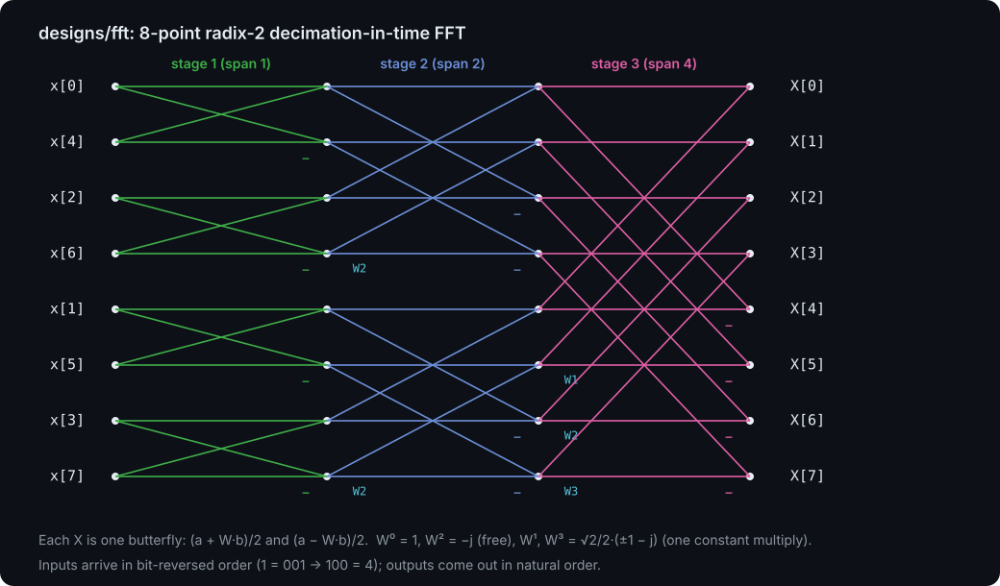

- [ ] `make sim plot`. Check the impulse, DC, single-bin and complex-tone
      frames against what you expect from theory.

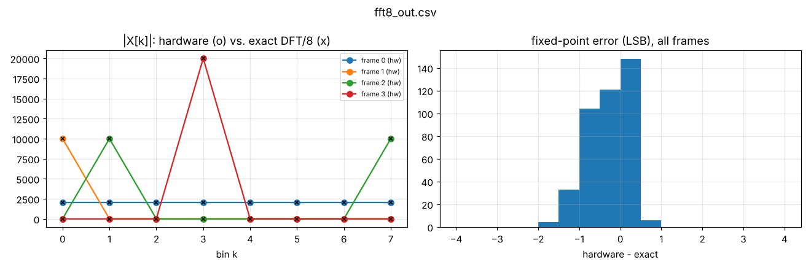
- [ ] Draw the 8-point butterfly diagram on paper and match each
      `fft_bfly` instance in `fft8.v` to it.

The 9,100 cells of the FFT, down at the transistor level:

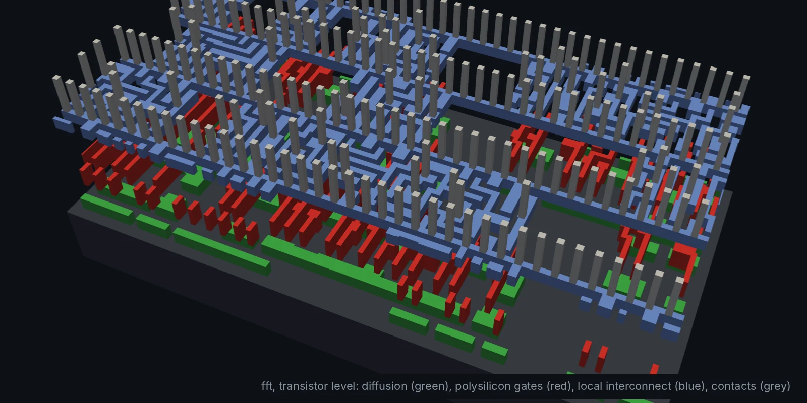
- [ ] **Exercise:** add an inverse FFT mode (conjugate the twiddles, or
      swap re/im on input and output) and test that IFFT(FFT(x)) = x/8.
- [ ] **Exercise:** register the outputs of stage 2 (pipelining) and see how
      the maximum clock frequency changes after `make pnr`.
- [ ] **Stretch:** a 64-point FFT with a single butterfly, a RAM and a
      twiddle ROM (the "in-place, iterative" architecture used in real
      chips).

## Module 6b: The FFT in software vs in hardware (`codesign/`)

Goal: compare the same FFT as Python, NumPy, C and as the chip on speed,
energy and area, and learn when a job should be hardware. See
[codesign/README.md](../codesign/README.md) and the
[slides](../slides/06b-codesign.md).

- A bit-exact Python model of `fft8.v` that matches the RTL on every output bit
- Batched NumPy and C beat the 50 MHz chip on throughput; the chip uses
  ~270× to 30,000× less energy per FFT and has a fixed latency
- 16 of the chip's 17 cycles per FFT are moving data: the interface matters

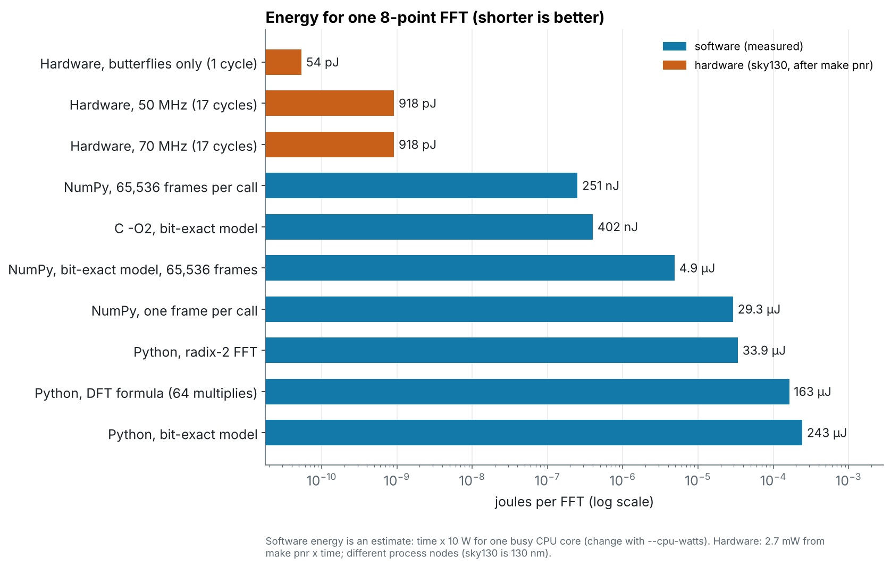

- [ ] `make -C codesign check bench`. Compare your machine's numbers with
      the charts.
- [ ] **Exercise:** the exercises in [codesign/README.md](../codesign/README.md#exercises).

## Module 7: Timing, area and power

Goal: read implementation reports like a designer and make trade-offs.

For each design, `build/orfs/reports/sky130hd/<top>/base/` has timing,
area, power and images of each stage. See
[flow-overview.md](flow-overview.md#reading-timing-reports).

These are the numbers `make pnr` gives for each design (sky130hd, typical
corner). Reproduce them, then use them for the exercises:

| Design  | Cells | Cell area (µm²) | Die (µm) | Clock  | Worst slack | Fastest clock | Power  |
| ------- | ----: | --------------: | -------: | -----: | ----------: | ------------: | -----: |
| counter |    27 |             339 |   60 × 60 | 10 ns |     5.24 ns |      ~210 MHz | 0.08 mW |
| pwm     |    71 |             908 |   60 × 60 | 10 ns |     6.15 ns |      ~260 MHz | 0.11 mW |
| fir     | 2,123 |          25,200 | 253 × 253 | 10 ns |     0.06 ns |      ~100 MHz | 4.9 mW |
| iir     | 1,560 |          19,000 | 235 × 235 | 20 ns |     9.07 ns |       ~90 MHz | 1.3 mW |
| fft     | 9,073 |          79,800 | 449 × 449 | 20 ns |     5.77 ns |       ~70 MHz | 2.7 mW |

"Fastest clock" is 1 / (clock period - worst slack), a first estimate; the
tools re-optimise when you actually tighten the constraint.

The flow also draws pictures of each stage. For the FIR, the placement, the
clock tree and the worst timing path:

| Placement | Clock tree | Worst path |
| --- | --- | --- |
| 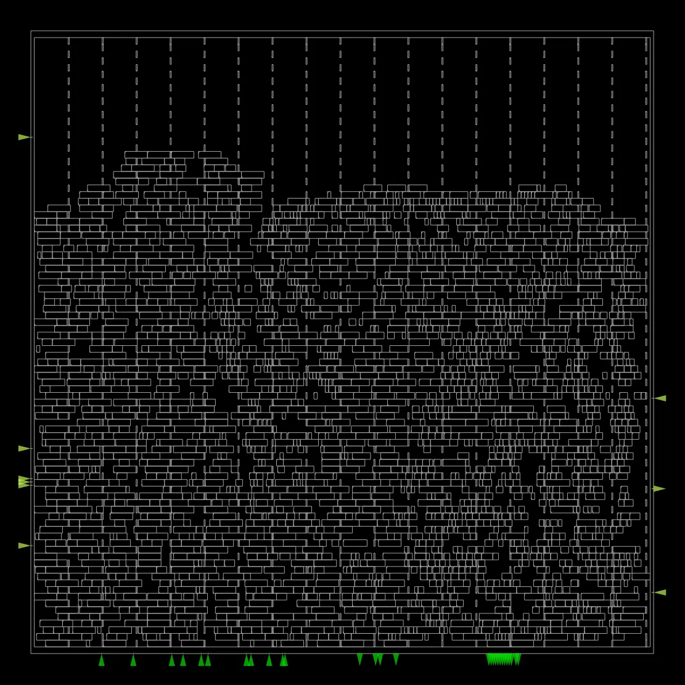 | 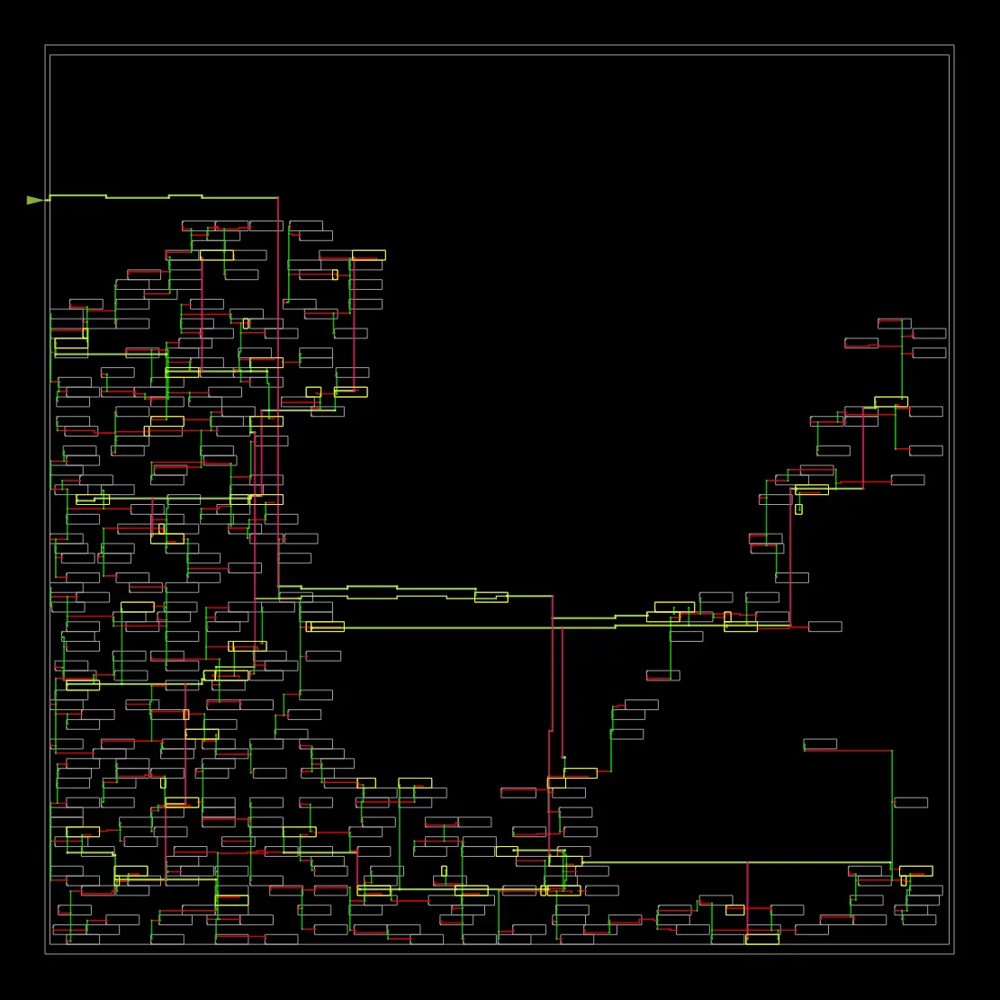 | 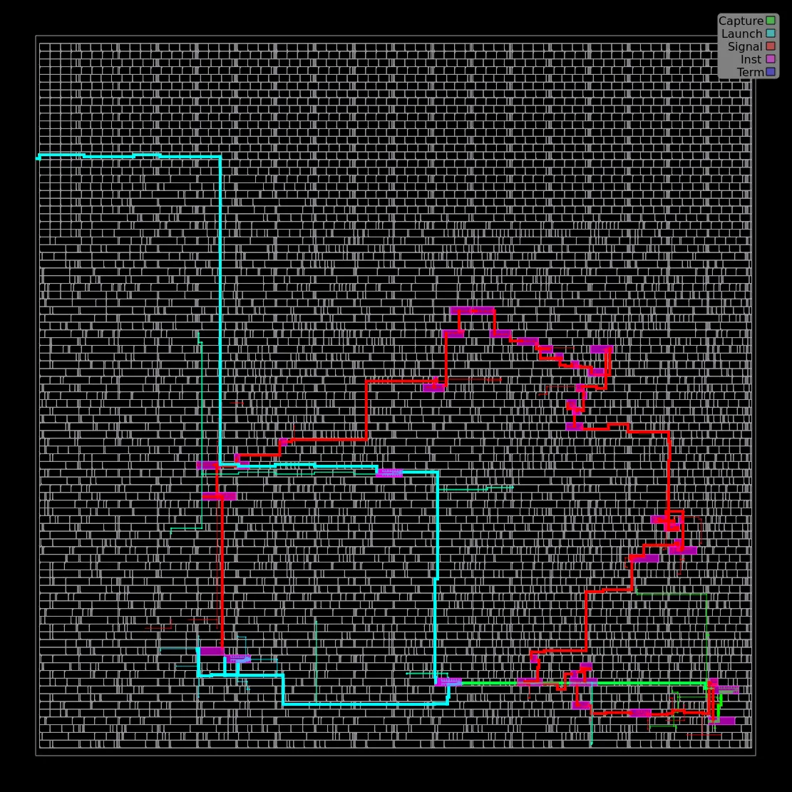 |

- [ ] Run `make pnr` for each design and check your numbers against the
      table (`6_finish.rpt`, `synth_stat.txt`).
- [ ] **Exercise:** find the highest clock frequency each DSP design can
      reach by lowering `clk_period` in its `orfs/constraint.sdc`. Compute
      the maximum *sample rate* for each (remember the FIR needs 17 cycles
      per sample).
- [ ] **Exercise:** compare FIR (time-shared) and IIR (parallel) in
      "samples per second per mm^2".

## Module 8: Your own design and tapeout

Pick a project, add it under `designs/<name>` (copy any example; the README
explains how) and take it through `make check` and `make pnr`. Ideas, all
classic EE blocks:

- NCO / DDS sine generator (phase accumulator + sine lookup table)
- CORDIC for sin/cos or vector magnitude
- Sigma-delta DAC or a CIC decimation filter for a sigma-delta ADC
- UART or SPI controller, then attach it to one of the DSP blocks
- Goertzel detector for DTMF tones

Then learn what a real tapeout adds: DRC/LVS signoff (Magic, KLayout,
Netgen), I/O pads and the harness around your design.
[Tiny Tapeout](https://tinytapeout.com/) is the most accessible way to get a
small design fabricated, and it uses the same open-source tools.

---

## Further reading

- [Open-source chip design tools](tools.md): every tool by job (simulation,
  synthesis, place and route, timing, verification, analog, PCB), with where
  it fits in this course
- *Digital Design and Computer Architecture*, Harris & Harris: Verilog and
  digital design refresher
- [HDLBits](https://hdlbits.01xz.net/): Verilog practice problems
- *DSP Architecture, Algorithms and VLSI* or *VLSI Digital Signal Processing
  Systems* (Parhi): pipelining, retiming, folding of DSP hardware
- *Understanding Digital Signal Processing*, Lyons: practical DSP, fixed point
- [ZipCPU blog](https://zipcpu.com/): practical FPGA/ASIC DSP and formal verification
- [Yosys docs](https://yosyshq.readthedocs.io/projects/yosys/en/latest/),
  [ORFS docs](https://openroad-flow-scripts.readthedocs.io/)

## Glossary

| Term     | Meaning                                                             |
| -------- | ------------------------------------------------------------------- |
| RTL      | Register-transfer level: the Verilog you write                      |
| Netlist  | A circuit described as instances of cells connected by nets         |
| PDK      | Process design kit: everything the foundry gives you for a process  |
| Liberty  | `.lib` file with timing, power and function of each standard cell   |
| GDS      | Final layout polygons sent to the foundry                           |
| SDC      | Timing constraints file                                             |
| STA      | Static timing analysis                                              |
| WNS/TNS  | Worst / total negative slack                                        |
| CTS      | Clock tree synthesis                                                |
| DRC/LVS  | Design rule check / layout vs. schematic                            |
| MAC      | Multiply-accumulate                                                 |
| Qm.n     | Fixed-point format: m integer bits (incl. sign), n fractional bits  |
| Twiddle  | The complex constant W^k = exp(-j2πk/N) in an FFT butterfly          |
