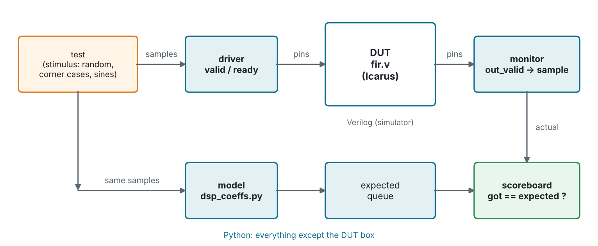
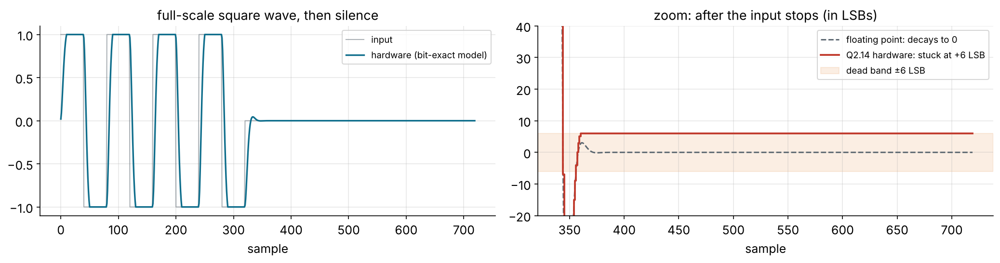
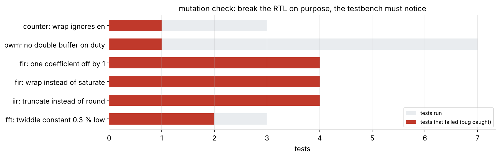

# Verification with cocotb: testing hardware from Python

> **Hardware is the new Software**, and software is tested by scripts.
> cocotb lets you write the testbench for a Verilog design in plain Python,
> with numpy, random numbers and your filter-design code at hand.

Every design in this course already has a self-checking Verilog testbench
(`tb/*_tb.v`, run by `make sim`). Each one also has a **cocotb** testbench
in `cocotb/test_<design>.py` that checks the same design from Python. This
side module (2 to 3 hours, best done after Module 4) compares the two
styles and teaches the structure that industrial testbenches use.

Slides: [slides/09-verification.md](../slides/09-verification.md).

## Setup

```sh
pip install -r python/requirements-verif.txt   # cocotb 2.0 + numpy
make cocotb DESIGN=fir                         # one design
make check-cocotb                              # every design (what CI runs)
```

You also need Icarus Verilog (`make doctor` checks). In a design folder,
`make cocotb` runs every test in `cocotb/test_<design>.py`. Useful options:

| Command | Does |
| ------- | ---- |
| `make cocotb COCOTB_TEST_FILTER=test_impulse` | run only the tests whose name matches |
| `make cocotb COCOTB_RANDOM_SEED=1234` | replay a random run exactly (the seed is printed at the top of each log) |
| `make cocotb WAVES=1` | also dump a waveform to `build/cocotb/` |

## How cocotb works

The simulator (Icarus) runs the Verilog. cocotb attaches to it through the
simulator's VPI interface and runs your Python **coroutines** alongside it.
A coroutine drives pins (`dut.in_valid.value = 1`), then `await`s
simulation events (`await RisingEdge(dut.clk)`, `await ReadOnly()`), and
reads pins (`dut.out_sample.value.to_signed()`). Simulation time only
moves while Python is waiting.



Every testbench in this repo has the same parts:

- **driver**: turns "send this sample" into pin wiggles, obeying the
  valid/ready handshake. Inputs are driven on the falling edge, half a clock
  away from the rising edge where the DUT samples them.
- **monitor**: a background coroutine (`cocotb.start_soon`) that watches
  the outputs and turns them back into samples, periods or FFT bins.
- **model**: the golden reference. For the filters it is built from
  `python/dsp_coeffs.py`, *the same script that designed the filter*: if the
  ROM in the RTL and the design script ever disagree, the test fails.
- **scoreboard**: compares what came out with what the model predicted.

## What each testbench checks

| Design | Tests | Highlights |
| ------ | ----- | ---------- |
| `counter` | reset, wrap, random enable | 2,000 cycles of random `en`, model in two lines of Python |
| `pwm` | 6 duty values (parametrised), glitch test | a period monitor; `duty` changed mid-period at random times |
| `fir` | impulse, random bit-exact, saturation, frequency response | model from `dsp_coeffs.py`; \|H(f)\| fitted with numpy and compared with the ideal |
| `iir` | step, random bit-exact, overload, frequency response | finds the **dead band** below |
| `fft` | hand-checkable spectra, full scale, 200 random frames | reference is `numpy.fft.fft(x) / 8`; reports SQNR (~80 dB) |

## A real finding: the IIR dead band

`test_overload_recovers` hits the biquad with a full-scale square wave and
then silence. The output saturates cleanly (good: no overflow oscillation),
but it never returns to zero: it stops at **+6 LSB forever**.



This is a *granular limit cycle*. With zero input and a constant output y,
the next output is `round(y · (−a1 − a2)) = round(0.92 · y)`, and for
|y| ≤ 6 rounding gives back y itself. The hardware is bit-exact with the
model, so this is not an RTL bug; it is a property of rounding in a
feedback loop. The test computes the dead band from the coefficients and
asserts the output stays inside it. A Verilog testbench that only checked
"close to zero" would have hidden it. Exercise 3 below removes it.

## Does the testbench actually catch bugs?

A test that always passes is worthless. Break the RTL on purpose (a
*mutation*), run `make cocotb`, and check that something fails. These were
measured on this repo:



Notice the PWM: only `test_no_glitch` catches the missing double buffer.
Constant-duty tests can never see it, which is why random stimulus matters.

## Verilog testbench or cocotb?

| | Verilog testbench | cocotb |
| - | - | - |
| Language | same as the design | Python |
| Reference model | written again in Verilog | reuse numpy, scipy, your design scripts |
| Random stimulus | `$random`, one seed | Python `random`, seed printed and replayable |
| Speed | fastest | slower (Python ↔ simulator calls), fine for unit tests |
| Runs on | any simulator | Icarus, Verilator 5.036+, commercial simulators |
| In industry | small block tests | common in open-source and startups; UVM (SystemVerilog) in big companies |

Use both: the Verilog testbench is quick to read next to the RTL, the
cocotb one scales to real models and long random runs.

## Exercises

- [ ] **Mutate.** Pick a design, make a one-character change to its RTL
      that you think is subtle, and run `make cocotb`. If nothing fails, add
      a test that catches it.
- [ ] **Coverage by hand.** In `test_counter.py`, count the cycles where
      the counter is at its maximum and `en` is low (so `wrap` must stay
      low). How often does that happen? Bias the random `en` so it does.
- [ ] **Kill the dead band.** Change the IIR rounding in a copy of
      `iir.v` (e.g. truncate toward zero, or keep 2 extra fraction bits in
      the y state), update `BiquadModel` to match, and make
      `test_overload_recovers` require the output to reach exactly 0.
- [ ] **New test.** Add a test to `test_fft.py` that feeds a sine on every
      bin 0..7 and checks Parseval's theorem: the energy of the output
      equals the energy of the input divided by 8.
- [ ] **Your own design (Module 8).** Add `cocotb/test_<name>.py` to your
      design folder. `make cocotb` runs it, and `make check-cocotb` (and CI)
      picks it up automatically.

## Further reading

- [cocotb documentation](https://docs.cocotb.org/)
- [cocotb examples](https://github.com/cocotb/cocotb/tree/master/examples)
- *Writing Testbenches using SystemVerilog*, Bergeron: the driver/monitor/scoreboard structure in depth
