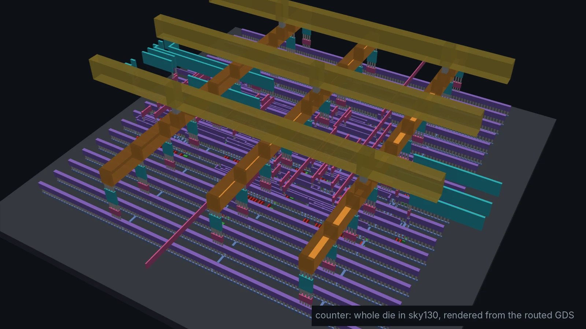
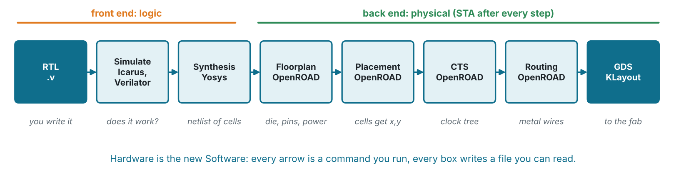
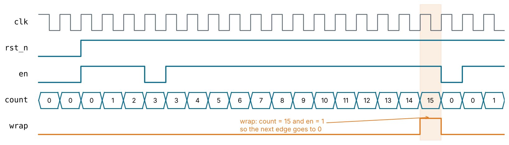
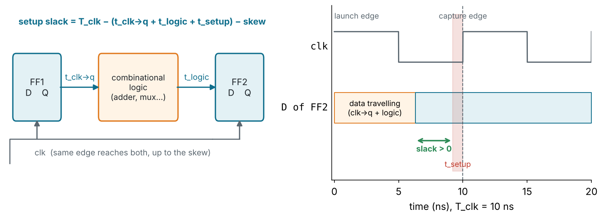
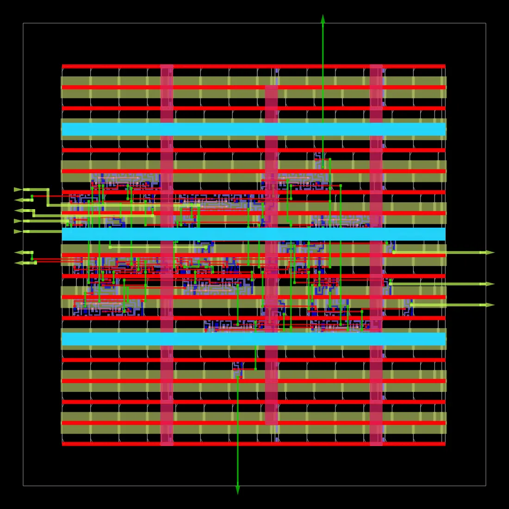
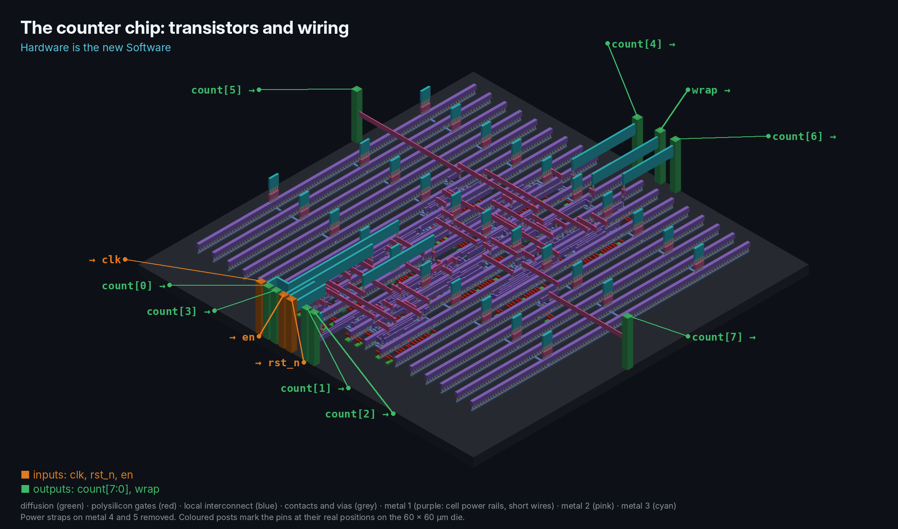
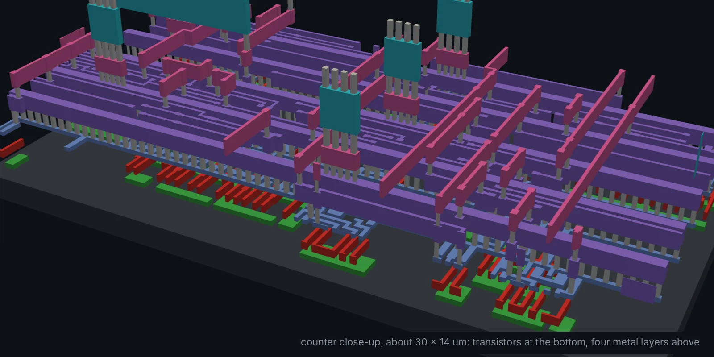
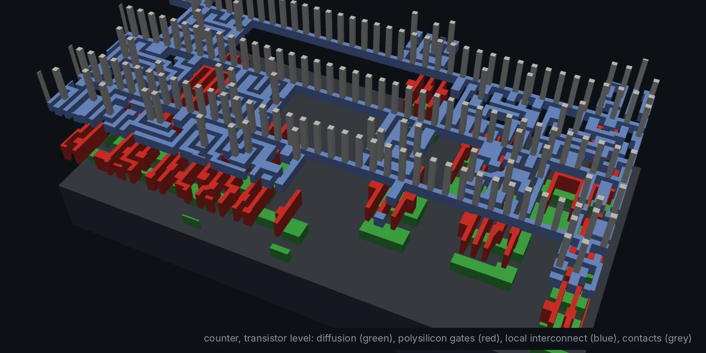
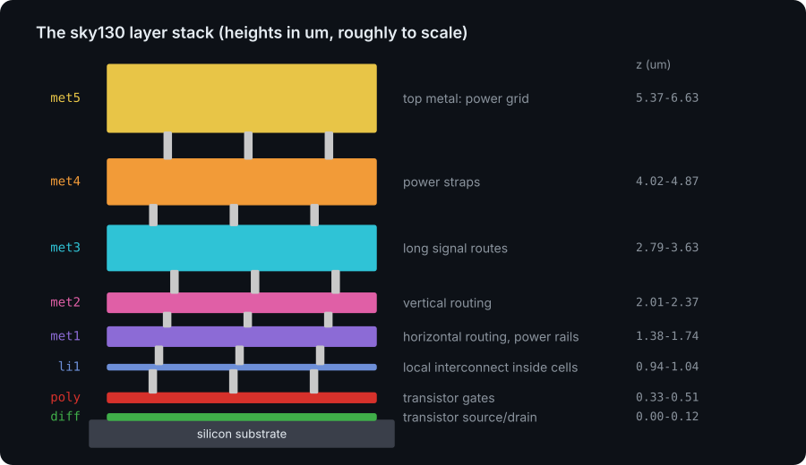

<!-- _class: lead -->
<!-- _paginate: false -->
<!-- _footer: '' -->



# Module 1
## The flow, end to end

**Hardware is the new Software**

Design: `designs/counter` · Level: basic · 3 to 4 hours

---

## Why this module exists

You already know what a flip-flop is. What you have probably never done is
turn a few lines of Verilog into **polygons a foundry can manufacture**.

This module runs **every tool once** on a design so simple you can predict
every result. That way, when a number looks wrong, it is the tool you are
learning about, not the design.

By the end you will have:

- simulated, linted and synthesised an 8-bit counter
- mapped it onto real SkyWater 130 nm standard cells
- placed and routed it into a 60 × 60 µm layout that meets timing at 100 MHz

---

## Hardware is the new Software

| Software habit           | Chip design equivalent in this repo                    |
| ------------------------ | ------------------------------------------------------ |
| source code              | Verilog RTL in `designs/<name>/rtl/`                   |
| unit tests               | self-checking testbench, `make sim` prints `PASS`      |
| compiler warnings        | `make lint` (Verilator `-Wall`)                        |
| compiler                 | Yosys synthesis: RTL → netlist of gates                |
| linker / packager        | OpenROAD: netlist → placed, routed layout (GDS)        |
| CI on every push         | `.github/workflows/ci.yml` runs `make check`           |
| open-source toolchain    | Icarus, Verilator, Yosys, OpenROAD, KLayout, sky130    |

Everything is a text file and a `make` target. You can diff it, review it and
run it in CI.

---

## The RTL-to-GDS flow



- **Front end** decides *what* the logic is. Bugs here are functional.
- **Back end** decides *where* every transistor and wire goes. Problems here
  are timing, area, power and manufacturability.

---

## The design: an 8-bit counter

```verilog
module counter #(parameter WIDTH = 8) (
    input  wire             clk,
    input  wire             rst_n,   // asynchronous, active-low
    input  wire             en,
    output reg  [WIDTH-1:0] count,
    output wire             wrap     // high when the next edge wraps to 0
);
    wire at_max = &count;            // reduction AND: all ones?

    always @(posedge clk or negedge rst_n) begin
        if (!rst_n)  count <= {WIDTH{1'b0}};
        else if (en) count <= count + 1'b1;
    end

    assign wrap = en & at_max;
endmodule
```

---

## Reading the Verilog as hardware

<div class="cols">
<div>

- `always @(posedge clk ...)` with `<=` → **flip-flops**, one per bit of
  `count`
- `or negedge rst_n` → flip-flops with an **asynchronous reset pin**
- `count + 1'b1` → an **incrementer** (a chain of half adders)
- `if (en)` → a **mux** or an enable pin on the flip-flop
- `&count`, `en & at_max` → an **AND tree**: pure combinational logic

</div>
<div>

> Rule of thumb: before you synthesise, sketch the circuit you expect. After
> synthesis, check that the tool built what you sketched. If it did not,
> one of you is wrong, and it is usually the Verilog.

`wire` vs `reg` is a Verilog type, not a hardware type: a `reg` assigned in
a combinational `always @*` is still just wires.

</div>
</div>

---

## Step 1: simulate

```sh
cd designs/counter
make sim        # iverilog -g2012 -Wall ... && vvp
make waves      # opens build/counter.vcd in GTKWave
```

```
PASS: 100 cycles, 5 wrap-arounds, 0 errors
```



---

## What makes a testbench *self-checking*

```verilog
// Reference model: what we EXPECT the hardware to do
reg [WIDTH-1:0] expected;

task check;
    if (count !== expected) begin
        $display("ERROR t=%0t: count=%0d expected=%0d", $time, count, expected);
        errors = errors + 1;
    end
endtask

@(negedge clk) en = ($random % 4) != 0;   // random stimulus
@(posedge clk) if (en) expected = expected + 1'b1;
```

- Drive on the **falling** edge, check after the **rising** edge: no races.
- `!==` compares X and Z too: an uninitialised output fails the test.
- It also fails if `wrap` never happened: **a test that cannot fail is not
  testing anything.**

---

## Step 2: lint

```sh
make lint       # verilator --lint-only -Wall --top-module counter rtl/counter.v
```

Lint catches what simulates fine but is still wrong:

| Warning           | Typical cause                                         |
| ----------------- | ----------------------------------------------------- |
| `WIDTH`           | `assign y8 = a4 + b4;` silently loses the carry       |
| `LATCH`           | `always @*` with an `if` and no `else`                |
| `UNUSEDSIGNAL`    | a wire you forgot to connect                          |
| `BLKSEQ`          | `=` in a clocked block (simulation/synthesis mismatch) |
| `MULTIDRIVEN`     | the same signal assigned in two `always` blocks       |

`` `default_nettype none `` at the top of each file turns a typo in a signal
name into an error instead of a new 1-bit wire.

---

## Step 3: synthesis with Yosys

```sh
make synth      # generic gates, no PDK needed
make show       # schematic: build/counter.svg
```

```
   Number of cells:                 28
     $_DFFE_PN0P_                    8     <- 8 flip-flops: D, enable, reset-to-0, active-low
     $_XOR_                          5
     $_AND_ / $_ANDNOT_ / $_NAND_    9     <- incrementer carry chain and the AND tree
     ...
```

`$_DFFE_PN0P_` decodes as: **DFF**, **E**nable, **P**ositive clock,
**N**egative reset, reset value **0**, **P**ositive enable.

What `synth` does: `hierarchy` → `proc` (always blocks to muxes and FFs) →
`opt` → `techmap` (to gates) → `abc` (logic minimisation).

---

## Step 3b: onto real sky130 cells

```sh
make synth-sky130   # downloads the sky130_fd_sc_hd Liberty file once
```

```
   Number of cells:                 24
     sky130_fd_sc_hd__dfrtp_1        8    <- D flip-flop, reset (active low), Q output
     sky130_fd_sc_hd__xor2_1         3
     sky130_fd_sc_hd__xnor2_1        3
     sky130_fd_sc_hd__a31oi_1        2    <- (A1·A2·A3 + B1)' : one cell, one gate delay
     ...
   Chip area for module '\counter': 310.30 um^2
```

- Cell names: `sky130` · `fd` (foundry) · `sc` (standard cell) · `hd` (high
  density) · `dfrtp` (function) · `_1` (drive strength).
- The **Liberty** file gives each cell's function, area, delay tables and
  power. Synthesis optimises against it.

---

## A standard cell, physically

<div class="cols">
<div>

- Every cell has the **same height** (2.72 µm in `sky130hd`) and a width
  that is a multiple of a site (0.46 µm).
- VDD runs along the top, VSS along the bottom, so cells abut in **rows** and
  share power rails.
- Inputs/outputs are small pins on metal 1 (`li1` in sky130).
- `dfrtp_1` is about 20 sites wide; an `inv_1` is 3.

</div>
<div>

```
 VDD ════════════════════════════════
     │ nand2 │  inv  │    dfrtp_1    │
     │ A B Y │ A  Y  │ D  CLK RST Q  │
 VSS ════════════════════════════════
      ← one row, cells side by side →
```

The flip-flops dominate this design's area:
8 × 25 µm² = 200 of 310 µm².

</div>
</div>

---

## Step 4: timing constraints (SDC)

```tcl
set clk_period 10.0                                   ;# 100 MHz
create_clock -name core_clock -period $clk_period [get_ports clk]
set_input_delay  [expr $clk_period * 0.2] -clock core_clock $non_clock_inputs
set_output_delay [expr $clk_period * 0.2] -clock core_clock [all_outputs]
```



STA checks **every** register-to-register path. No test vectors needed.

---

## Step 5: place and route with OpenROAD

```sh
make pnr        # OpenROAD-flow-scripts in Docker, < 1 minute for the counter
make pnr-gui    # look at the result
```

| ORFS stage      | What happens                                       | Output              |
| --------------- | -------------------------------------------------- | ------------------- |
| `1_synth`       | Yosys again, with ORFS's sky130 settings           | `1_synth.v`         |
| `2_floorplan`   | die/core size, rows, I/O pins, power grid (PDN)    | `2_floorplan.odb`   |
| `3_place`       | global then detailed placement                     | `3_place.odb`       |
| `4_cts`         | clock tree synthesis, then hold repair             | `4_cts.odb`         |
| `5_route`       | global then detailed routing on met1 .. met5       | `5_route.odb`       |
| `6_finish`      | fill cells, RC extraction, final STA, GDS          | `6_final.gds`       |

Results: `build/orfs/{logs,reports,results}/sky130hd/counter/base/`

---

## The result

<div class="cols">
<div>



</div>
<div>

From `make pnr` (sky130hd, typical corner):

| Metric             | Value          |
| ------------------ | -------------- |
| die                | 60 × 60 µm     |
| cells              | 27 (339 µm²)   |
| clock              | 10 ns (100 MHz) |
| worst setup slack  | **+5.24 ns**   |
| fastest clock      | ~210 MHz       |
| power              | 0.08 mW        |
| DRC violations     | 0              |

</div>
</div>

---

## The same chip in 3D


Rendered from the routed GDS by `python/render_3d.py`.

---

## Transistors, wiring and pins



`python/render_transistors_iso.py`: metal 1 to 3 and the transistor layers,
power straps hidden, pins at their real positions.

---

## Zooming in: from wires to transistors

<div class="cols">
<div>



About 30 × 14 µm: cells at the bottom, four metal layers above.

</div>
<div>



Transistor level: diffusion (green), polysilicon gates (red), local
interconnect (blue), contacts (grey). Where poly crosses diffusion, there
is a transistor.

</div>
</div>

---

## The sky130 layer stack



Routing uses `li1` and `met1` to `met5`; thicker upper layers carry power and
long wires because their resistance is lower.

---

## Where to look when something breaks

| Symptom                              | Look at                                           |
| ------------------------------------ | ------------------------------------------------- |
| `FAIL` in simulation                 | `make waves`; the first `ERROR` line's timestamp  |
| lint warning you do not understand   | Verilator manual, warning list                    |
| fewer flip-flops than expected       | synthesis log: "removed unused" / constant FFs    |
| negative slack                       | `reports/.../6_finish.rpt`, critical path section  |
| routing DRC errors                   | `5_route_drc.rpt`; lower `PLACE_DENSITY`           |
| flow stops early                     | the last log in `logs/sky130hd/<top>/base/`       |

---

<!-- _class: exercise -->

## Exercises

1. `make sim` and `make waves`. Find the cycle where `wrap` is high. Why is
   `wrap` combinational and not a register?
2. `make show`: count the flip-flops in the schematic. Change `WIDTH` to 16
   and 32. How do cell count and area scale? Is it linear? Why?
3. Which sky130 cell is the flip-flop, and why does it need a reset pin?
   Rewrite the reset as **synchronous** and compare the cell chosen.
4. Add a synchronous `load` input with `load_value[WIDTH-1:0]`. Extend the
   testbench model. Then break the RTL on purpose (count by 2) and confirm
   the test fails.
5. After `make pnr`, open `6_final.gds` in KLayout. Find the 8 flip-flops and
   the clock buffers.

---

## Key takeaways

- The flow is a pipeline of **open-source tools driven by text files**:
  RTL → sim → lint → synth → floorplan → place → CTS → route → GDS.
- Verify **before** synthesis. Everything after assumes the RTL is right.
- Synthesis output should match the circuit you had in mind; count the FFs.
- Timing is a **static** check of every path against the SDC clock.
- Next: Module 2 builds a real peripheral, a PWM timer, with the same flow.
