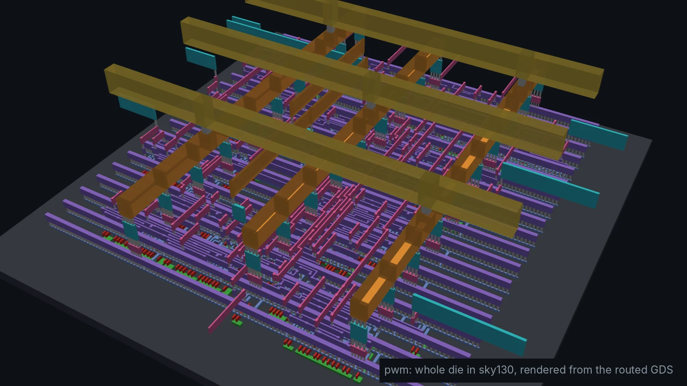
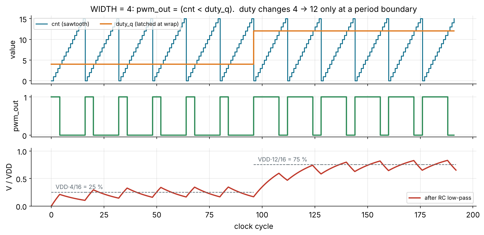
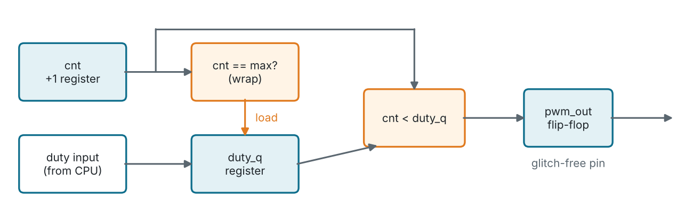
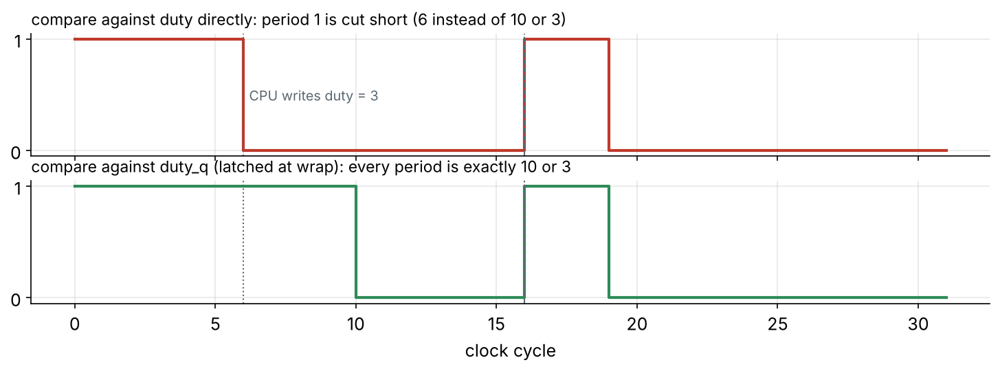
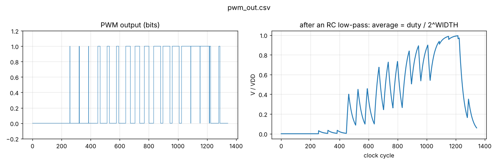

<!-- _class: lead -->
<!-- _paginate: false -->
<!-- _footer: '' -->



# Module 2
## Sequential control and timers

**Hardware is the new Software**

Design: `designs/pwm` · Level: basic · 3 to 4 hours

---

## Goals

A PWM timer is in every microcontroller, motor driver, LED dimmer and
switching power supply. It is also the simplest **digital-to-analog
converter**.

After this module you can:

- build timers from **counters and comparators**
- explain why peripheral registers are **double-buffered**
- choose between **registered** and **combinational** outputs
- relate WIDTH and clock frequency to PWM frequency and resolution
- design a **dead-time generator** for a half-bridge

---

## The idea: average voltage from a digital pin

$$V_{avg} = V_{DD} \cdot \frac{duty}{2^{WIDTH}} \qquad f_{PWM} = \frac{f_{clk}}{2^{WIDTH}}$$



The low-pass filter: an RC network, a motor's inductance, or your eye.

---

## Block diagram



Three registers (`cnt`, `duty_q`, `pwm_out`), one incrementer, one
equality check and one magnitude comparator. That is the whole timer.

---

## The RTL

```verilog
module pwm #(parameter WIDTH = 8) (
    input  wire clk, rst_n,
    input  wire [WIDTH-1:0] duty,      // 0 = always off
    output reg              pwm_out,
    output wire             period_start
);
    reg [WIDTH-1:0] cnt, duty_q;
    assign period_start = (cnt == {WIDTH{1'b0}});

    always @(posedge clk or negedge rst_n)
        if (!rst_n) begin
            cnt <= 0;  duty_q <= 0;  pwm_out <= 1'b0;
        end else begin
            cnt <= cnt + 1'b1;                          // free-running sawtooth
            if (cnt == {WIDTH{1'b1}}) duty_q <= duty;   // latch at end of period
            pwm_out <= (cnt < duty_q);                  // registered compare
        end
endmodule
```

---

## Why double-buffer `duty`?



Without the shadow register `duty_q`, a CPU write mid-period makes **one
wrong pulse**: a torque spike, an LED flicker, a supply glitch. MCU timers
do the same (preload registers in STM32 and AVR timers).

---

## Registered vs. combinational outputs

<div class="cols">
<div>

**Combinational:** `assign pwm_out = cnt < duty_q;`

- zero latency
- the comparator output can **glitch** while `cnt` bits settle after each
  edge (e.g. 0111 → 1000 passes through other values)
- a glitch on a pin that drives a power MOSFET is a real short pulse

</div>
<div>

**Registered:** `pwm_out <= cnt < duty_q;`

- one clock cycle of latency (irrelevant here)
- the pin is driven straight from a flip-flop's Q: **one clean transition
  per edge**
- timing on the pin is set by `clk→Q`, not by the logic depth

**Rule:** register every output that leaves the chip or crosses into
another clock domain.

</div>
</div>

---

## The comparator in gates

`cnt < duty_q` for WIDTH bits is a subtractor whose carry-out you keep:

```
a < b   ⇔   borrow out of (a − b)   ⇔   NOT carry out of (a + ~b + 1)
```

Yosys maps `<` to `$lt`, then to an `$alu` cell, then to a carry chain.
On sky130 that becomes a few `a21oi`, `o21ai` and `nor2` cells per bit.

```sh
cd designs/pwm
make synth            # generic cells
make synth-sky130     # ~70 cells, 17 dfrtp flip-flops (8 cnt + 8 duty_q + 1 out)
make show             # find the comparator chain in the schematic
```

---

## Simulation: checking exact high time

```sh
make sim plot     # PASS: all duty cycles exact
```



The testbench counts high cycles over exactly one period for duty = 0, 1, 16,
32, 48, 63, 8, and filters the output with `v += (pwm − v) / 32`.

---

## Testbench pattern: measure, do not eyeball

```verilog
for (k = 0; k < 7; k = k + 1) begin
    @(negedge clk) duty = duties[k];
    repeat (2 * PERIOD) @(posedge clk);       // let the new value latch
    high = 0;
    for (t = 0; t < PERIOD; t = t + 1) begin  // one full period
        @(posedge clk); #1;
        if (pwm_out) high = high + 1;
    end
    if (high != duties[k]) begin
        $display("ERROR duty=%0d: high for %0d cycles", duties[k], high);
        errors = errors + 1;
    end
end
```

Edge cases matter: **duty = 0** must never go high, **duty = 2^W − 1** must
be low for exactly one cycle.

---

## Frequency vs. resolution

| f_clk    | WIDTH | Resolution  | f_PWM      | Typical use                      |
| -------- | ----: | ----------- | ---------- | -------------------------------- |
| 100 MHz  |     8 | 256 steps   | 390.6 kHz  | DC-DC converter, LED dimming     |
| 100 MHz  |    10 | 1024 steps  | 97.7 kHz   | motor drive                      |
| 100 MHz  |    12 | 4096 steps  | 24.4 kHz   | just above hearing: class-D audio |
| 100 MHz  |    16 | 65536 steps | 1.5 kHz    | too slow for audio               |

Each extra bit of resolution **halves** the PWM frequency. For 16-bit audio
at 48 kHz you would need a 3.1 GHz clock. That is why audio DACs use
**sigma-delta** modulation: noise shaping instead of more bits.

---

## The physical result

<div class="cols">
<div>


</div>
<div>

From `make pnr` (Module 7 table):

| Metric            | Value         |
| ----------------- | ------------- |
| cells             | 71 (908 µm²)  |
| die               | 60 × 60 µm    |
| clock             | 10 ns         |
| worst slack       | +6.15 ns      |
| fastest clock     | ~260 MHz      |
| power             | 0.11 mW       |

</div>
</div>

---

## Going further: dead time for a half-bridge

<div class="cols">
<div>

```
        VDD
         │
pwm_h ──┤ high-side FET
         ├──── to motor / inductor
pwm_l ──┤ low-side FET
         │
        GND
```

</div>
<div>

```
pwm_h  ‾‾‾‾‾‾\______________/‾‾‾‾‾
pwm_l  _________/‾‾‾‾‾‾‾‾\________
             |<>|        |<>|
             dead        dead
```

</div>
</div>

If both transistors are on at once, VDD is shorted to GND
(**shoot-through**). Real FETs switch off slower than they switch on, so the
controller inserts a programmable gap where **both are off**.

---

<!-- _class: exercise -->

## Exercises

1. With a 100 MHz clock, what PWM frequency does WIDTH = 8 give? What WIDTH
   would 16-bit audio need, and what PWM frequency would result?
2. Make `pwm_out` combinational. Run `make sim`: does it still pass? Look at
   the waveform: what changed? Why does the testbench still pass?
3. Remove the `duty_q` register and compare against `duty` directly. Write
   a test that changes `duty` mid-period and **fails** on this version.
4. Add a dead-time generator: outputs `pwm_h` and `pwm_l`, never high at the
   same time, with a programmable gap `dead[3:0]` in clock cycles. Prove in
   the testbench that `pwm_h & pwm_l` is never 1.
5. **Stretch:** a centre-aligned PWM (count up then down). Why do motor
   controllers prefer it? (Hint: harmonics and current sampling.)

---

## Key takeaways

- Timers are **counters + comparators**; almost every peripheral is built
  from those two blocks.
- **Double-buffer** any register software can write while hardware is
  using it.
- **Register outputs** that leave the chip: no glitches, predictable timing.
- PWM trades frequency for resolution, one bit at a time.
- Next: Module 3, the arithmetic you need before building filters.

---

<!-- quiz: generated by slides/answers/make_quizzes.py on the quiz-answers branch -->
<!-- _class: quiz -->

## Quiz (1/2)

1. f_clk = 50 MHz and WIDTH = 10. What is the PWM frequency?
   <span class="opts">**A** ~48.8 kHz &nbsp;·&nbsp; **B** ~97.7 kHz &nbsp;·&nbsp; **C** ~195 kHz &nbsp;·&nbsp; **D** 5 MHz</span>
2. VDD = 1.8 V, WIDTH = 8, duty = 64. What average voltage does the filtered output give?
   <span class="opts">**A** 0.225 V &nbsp;·&nbsp; **B** 0.45 V &nbsp;·&nbsp; **C** 0.9 V &nbsp;·&nbsp; **D** 1.35 V</span>
3. When does the RTL copy `duty` into the shadow register `duty_q`?
   <span class="opts">**A** every clock &nbsp;·&nbsp; **B** when `cnt` is all ones (end of the period) &nbsp;·&nbsp; **C** when `pwm_out` rises &nbsp;·&nbsp; **D** only at reset</span>
4. Why is `pwm_out` a register and not `assign pwm_out = cnt < duty_q;`? <span class="sa">*(short answer)*</span>

---


<!-- _class: quiz -->

## Quiz (2/2)

5. WIDTH = 8 and duty = 255. For how many clock cycles per period is `pwm_out` low?
   <span class="opts">**A** 0 &nbsp;·&nbsp; **B** 1 &nbsp;·&nbsp; **C** 128 &nbsp;·&nbsp; **D** 255</span>
6. `make synth-sky130` reports 17 flip-flops. Where do they come from? <span class="sa">*(short answer)*</span>
7. You add one bit of resolution (WIDTH 8 → 9) at the same clock. What happens to f_PWM?
   <span class="opts">**A** it doubles &nbsp;·&nbsp; **B** it stays the same &nbsp;·&nbsp; **C** it halves &nbsp;·&nbsp; **D** it drops by 1/256</span>
8. What is shoot-through in a half-bridge, and what prevents it? <span class="sa">*(short answer)*</span>

> Answer on paper first, then check yourself against the answer key on the `quiz-answers` branch (`slides/answers/`).
