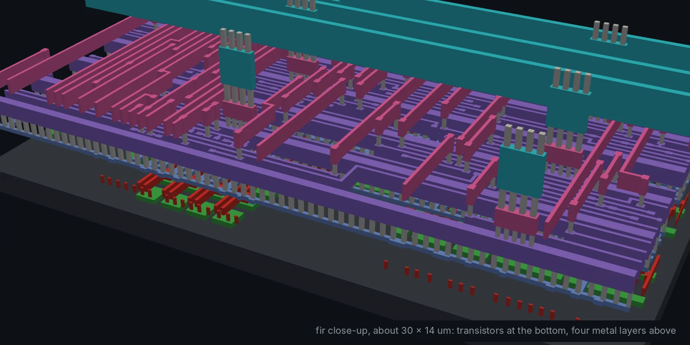
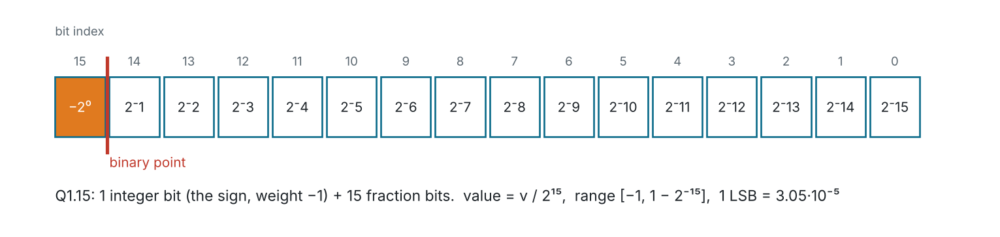
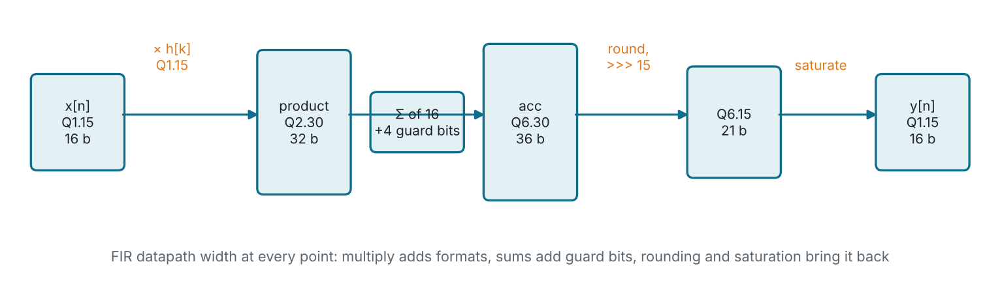
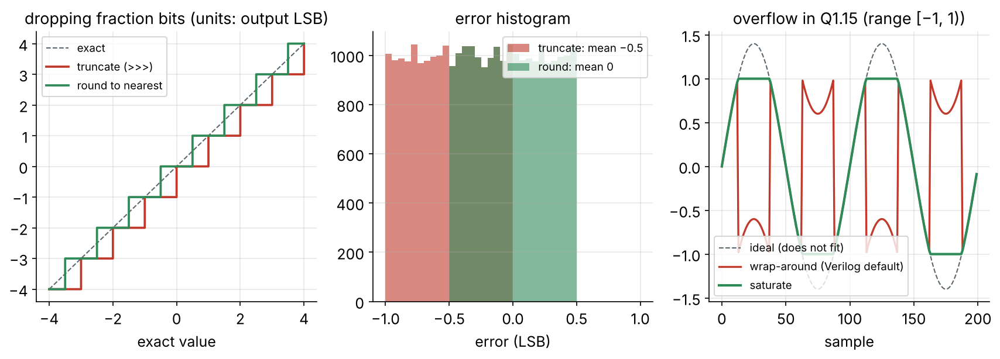
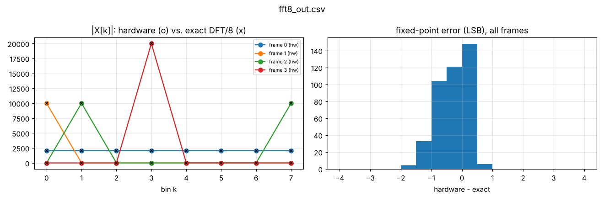
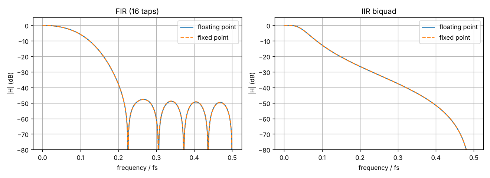

<!-- _class: lead -->
<!-- _paginate: false -->
<!-- _footer: '' -->



# Module 3
## Fixed-point arithmetic

**Hardware is the new Software**

Primer for Modules 4 to 6 · Level: core · 3 hours
Read along: `docs/fixed-point.md`

---

## Why not just use floating point?

In numpy a filter coefficient is `0.0201` and nobody thinks about it. In
silicon every bit costs area, power and delay.

| Operator (sky130hd, Yosys)        | Size                                        |
| --------------------------------- | ------------------------------------------- |
| 16 × 16-bit signed multiplier     | ~1,250 cells, ~9,500 µm²                     |
| this course's whole 16-tap FIR    | ~2,100 cells (one multiplier + 256 FFs)     |
| IEEE-754 float multiply-add       | a 24-bit multiplier **plus** exponent alignment, normalisation and rounding: several times larger and slower |

DSP hardware (audio codecs, radios, image pipelines, ML accelerators) uses
**fixed point**: an integer with an *implied* binary point. You decide where
the point is, at design time, for every signal.

---

## The Q format



`Qm.n` = signed, `m` integer bits (including the sign), `n` fraction bits,
stored as an `(m+n)`-bit two's-complement integer `v`:

$$\text{real} = \frac{v}{2^{n}}$$

---

## Common formats

| Format | Bits | Range                | 1 LSB              | Used in this course            |
| ------ | ---: | -------------------- | ------------------ | ------------------------------ |
| Q1.15  |   16 | [−1, 1 − 2⁻¹⁵]       | 3.05·10⁻⁵ (−90 dB) | samples, FIR coefficients      |
| Q2.14  |   16 | [−2, 2 − 2⁻¹⁴]       | 6.10·10⁻⁵          | IIR coefficients (a1 = −1.56)  |
| Q2.30  |   32 | [−2, 2)              | 9.3·10⁻¹⁰          | Q1.15 × Q1.15 product          |
| Q6.30  |   36 | [−32, 32)            | 9.3·10⁻¹⁰          | FIR accumulator                |
| Q1.7   |    8 | [−1, 1 − 2⁻⁷]        | 7.8·10⁻³ (−42 dB)  | low-cost audio, ML inference   |

Worked examples in Q1.15:

- `0.5 → 0.5 × 2¹⁵ = 16384`
- `−1.0 → −32768` (the most negative value; **+1.0 does not exist**)
- `0.0201 → 658.6 → 659`

---

## Dynamic range: ~6 dB per bit

Quantisation error is uniform in ±½ LSB, so for a full-scale sine:

$$SNR \approx 6.02 \cdot N + 1.76 \text{ dB}$$

| Bits | SNR     | Where you meet it                    |
| ---: | ------- | ------------------------------------ |
| 8    | ~50 dB  | telephone-quality µ-law, 8-bit ADCs  |
| 12   | ~74 dB  | most MCU ADCs                        |
| 16   | ~98 dB  | CD audio                             |
| 24   | ~146 dB | pro audio (analog noise dominates)   |

Use the same rule for **internal** signals: every rounding step adds noise,
so internal widths are usually a few bits wider than the input.

---

## Rule 1: addition grows by one bit

To add, both operands must have the **same binary point** (align first).

```
  Q1.15 + Q1.15  →  Q2.15     (17 bits: the sum of two values near 1 can be near 2)
```

Adding **N** values needs `ceil(log2 N)` extra **guard bits**:

| Terms summed | Guard bits | Example                        |
| -----------: | ---------: | ------------------------------ |
| 2            | 1          | one butterfly in the FFT        |
| 5            | 3          | the IIR biquad (5 products)     |
| 16           | 4          | the 16-tap FIR accumulator      |

Guard bits make the **intermediate** sum safe even if the final result fits
in fewer bits.

---

## Rule 2: multiplication adds the formats

$$Q_{a.b} \times Q_{c.d} = Q_{(a+c).(b+d)}$$

```
  Q1.15 × Q1.15 = Q2.30    (32 bits)
  Q1.15 × Q2.14 = Q3.29    (32 bits)   <- IIR: sample × coefficient
```

To return to Q1.15 you **drop** fraction bits (shift right by 15) and
**keep** 16 bits. Both steps lose information: rounding and overflow.

Why Q2.30 and not Q1.30? `(−1) × (−1) = +1`, which does not fit in Q1.x.
It is the only product that needs the extra integer bit.

---

## Bit growth through the FIR datapath



Write this diagram for every DSP block **before** you write Verilog. Every
width in `designs/fir/rtl/fir.v` comes from it: `AW = W + CW + 4 = 36`.

---

## Rule 3: rounding when you drop bits



- **Truncation** `x >>> n`: free, but rounds toward −∞, a **−½ LSB bias**.
- **Round to nearest** `(x + 2^(n−1)) >>> n`: one adder, no bias.
- **Wrap-around** is Verilog's default on overflow. **Saturation** clamps.

---

## Which rounding, which overflow?

| Design   | Rounding           | Overflow handling                     |
| -------- | ------------------ | ------------------------------------- |
| `fir`    | round to nearest   | saturate output                        |
| `iir`    | round to nearest   | saturate (essential: output is fed back) |
| `fft`    | truncate (cheap)   | scale by ½ per stage: overflow is impossible |

Truncation bias accumulates: a long FIR with truncation has a DC offset. In
the FFT the −½ LSB bias per stage shows up in the error histogram:



---

## In Verilog: the signed arithmetic recipe

```verilog
wire signed [15:0] x, h;                         // Q1.15
wire signed [31:0] p = x * h;                    // Q2.30: both signed -> signed multiply

// Sign-extend before adding into a wider accumulator
wire signed [35:0] acc_next = acc + {{4{p[31]}}, p};

// Round to nearest and drop 15 fraction bits
wire signed [35:0] r = (acc_next + (36'sd1 <<< 14)) >>> 15;

// Saturate to Q1.15
wire signed [15:0] y = (r >  36'sd32767) ?  16'sd32767 :
                       (r < -36'sd32768) ? -16'sd32768 : r[15:0];
```

---

## The four classic Verilog pitfalls

| Pitfall | What happens | Fix |
| --- | --- | --- |
| one operand of `*` unsigned | **whole** expression becomes unsigned | declare both `signed`; `$signed()` |
| `>>` on a signed value | logical shift fills with 0: negative numbers become huge | use `>>>` |
| part-select `p[30:15]` | result is **unsigned**, even if `p` is signed | `$signed(p[30:15])` |
| unsized literal `4'd3` mixed in | expression silently becomes unsigned | `4'sd3` or a signed `localparam` |

All four simulate without any error. A **bit-exact model** in the testbench
is the only reliable way to catch them, which is why Modules 4 to 6 use one.

---

## Coefficient quantisation

`python3 python/dsp_coeffs.py --plot` designs both filters in floating point,
rounds the coefficients, and compares:



FIR: 16-bit coefficients change the response by a fraction of a dB.
IIR: coefficients move the **poles**; see Module 5.

---

## Workflow: from algorithm to bit-exact hardware

1. **Design in floating point** (numpy, `dsp_coeffs.py`): is the algorithm right?
2. **Quantise coefficients**, re-check the response.
3. **Write a fixed-point model** (Python or in the testbench) that does
   *exactly* the integer operations the hardware will: same widths, same
   rounding, same saturation.
4. **Compare model vs. float**: is the quantisation noise acceptable?
5. **Write RTL**, compare against the fixed-point model **bit for bit**.

Step 3 is what separates "it looks right on a plot" from "it is right".

---

<!-- _class: exercise -->

## Exercises

1. Convert `0.70710678` (√2/2, used in the FFT) to Q1.15. What is the error
   in LSBs? *(Answer: 23170, error ≈ −0.47 LSB.)*
2. What Q format is the product of a Q1.15 sample and a Q2.14 coefficient?
   How many bits?
3. How many guard bits does a 64-tap FIR accumulator need? A 100-tap one?
4. In `designs/fir/rtl/fir.v`, replace round-to-nearest with truncation.
   Does the testbench catch it? Update the model too, and measure the DC
   error of a long constant input.
5. Reduce the IIR coefficients to Q2.8 in `python/dsp_coeffs.py`. How far do
   the poles move? Is the filter still stable?

---

## Key takeaways

- Fixed point = integer + a binary point **you** track on paper.
- **Add:** align points, +1 bit per doubling of terms (guard bits).
- **Multiply:** formats add, `Q1.15 × Q1.15 = Q2.30`.
- **Drop bits:** round to nearest unless the bias is provably harmless.
- **Overflow:** saturate, or scale so it cannot happen. Never wrap.
- Verify against a **bit-exact model**, not against a plot.
- Next: Module 4 applies all of this to a real FIR filter.

---

<!-- quiz: generated by slides/answers/make_quizzes.py on the quiz-answers branch -->
<!-- _class: quiz -->

## Quiz (1/2)

1. What integer stores 0.25 in Q1.15?
   <span class="opts">**A** 256 &nbsp;·&nbsp; **B** 4096 &nbsp;·&nbsp; **C** 8192 &nbsp;·&nbsp; **D** 16384</span>
2. The 16-bit word `16'hC000` is a Q1.15 number. What is its value?
   <span class="opts">**A** −0.5 &nbsp;·&nbsp; **B** −0.25 &nbsp;·&nbsp; **C** 0.75 &nbsp;·&nbsp; **D** 1.5</span>
3. What format and width is the product of two Q1.7 numbers? <span class="sa">*(short answer)*</span>
4. You sum 32 Q1.15 values. How many guard bits does the accumulator need?
   <span class="opts">**A** 2 &nbsp;·&nbsp; **B** 4 &nbsp;·&nbsp; **C** 5 &nbsp;·&nbsp; **D** 32</span>

---


<!-- _class: quiz -->

## Quiz (2/2)

5. What is the approximate SNR of a full-scale sine quantised to 10 bits?
   <span class="opts">**A** ~42 dB &nbsp;·&nbsp; **B** ~62 dB &nbsp;·&nbsp; **C** ~74 dB &nbsp;·&nbsp; **D** ~98 dB</span>
6. Truncating with `x >>> n` introduces what error?
   <span class="opts">**A** none &nbsp;·&nbsp; **B** a +½ LSB bias &nbsp;·&nbsp; **C** a −½ LSB bias (rounds toward −∞) &nbsp;·&nbsp; **D** random sign errors</span>
7. `wire signed [15:0] a = -8;` What is `a >> 1` as a 16-bit value?
   <span class="opts">**A** −4 &nbsp;·&nbsp; **B** 32764 &nbsp;·&nbsp; **C** −32764 &nbsp;·&nbsp; **D** 4</span>
8. Why must the IIR feedback path saturate rather than wrap on overflow? <span class="sa">*(short answer)*</span>

> Answer on paper first, then check yourself against the answer key on the `quiz-answers` branch (`slides/answers/`).
