<!-- _class: lead -->
<!-- _paginate: false -->
<!-- _footer: '' -->

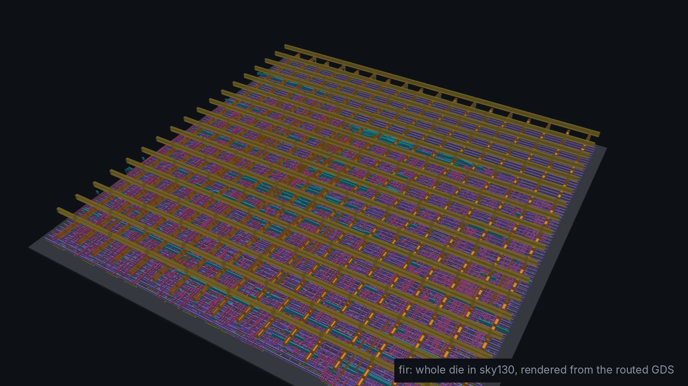

# Module 4
## FIR filters

**Hardware is the new Software**

Design: `designs/fir` · Level: advanced · 5 to 6 hours

---

## Goals

$$y[n] = \sum_{k=0}^{15} h[k]\, x[n-k]$$

You know this equation from signals and systems. This module is about
**building** it:

- choose an architecture: one multiplier per tap, or one shared multiplier
- size every register using the fixed-point rules from Module 3
- talk to the outside world with a **valid/ready handshake**
- verify **bit-exact** against a model, and measure |H(f)| *from the hardware*
- see what the filter costs in area, timing and power after place and route

---

## The filter we are building

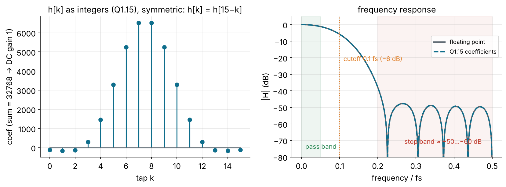

16 taps, windowed-sinc low-pass, Hamming window, cutoff 0.1 fs, designed by
`python/dsp_coeffs.py`. Coefficients are Q1.15 and sum to exactly 32768, so
the DC gain is exactly 1.0.

---

## Why linear phase matters

The coefficients are **symmetric**: h[k] = h[15 − k].

- A symmetric FIR has **linear phase**: every frequency is delayed by the
  same (15/2 = 7.5 samples). The waveform shape is preserved.
- An IIR filter cannot do this. That is why FIRs are used for audio
  crossovers, data communication pulse shaping, and image processing.
- Symmetry is also a **hardware gift**: pre-add the pair, then multiply once

$$h[k]\,x[n-k] + h[15-k]\,x[n-15+k] = h[k]\,\big(x[n-k] + x[n-15+k]\big)$$

8 multiplies instead of 16 (Exercise 3).

---

## Two architectures

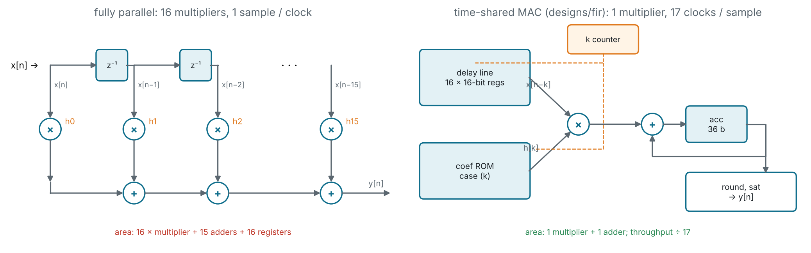

| Architecture        | Multipliers | Clocks per sample | Max sample rate at 100 MHz |
| ------------------- | ----------: | ----------------: | -------------------------: |
| fully parallel      | 16          | 1                 | 100 MS/s (if timing closes) |
| time-shared MAC     | 1           | 17                | 5.9 MS/s                   |

---

## Throughput vs. area: the central DSP trade-off

<div class="cols">
<div>

Audio at 48 kHz needs **48 thousand** samples per second. A 100 MHz MAC can
do **5.9 million**. That is 120× more than needed.

Spending 16 multipliers to go faster than anyone needs is wasted silicon.
Sharing one multiplier is called **folding** (Parhi, *VLSI DSP Systems*).

</div>
<div>

The general rule, for a filter with N taps and M multipliers:

$$\text{cycles per sample} \approx \frac{N}{M}$$

Pick M as the **smallest** value that meets the sample rate with margin.
For a 100 MS/s radio you would need M = 16 or more, and pipelining.

</div>
</div>

---

## The datapath in Verilog

```verilog
localparam AW = W + CW + 4;            // 36-bit accumulator: Q6.30

reg  [TAPS*W-1:0]    delay;            // delay[k*W +: W] holds x[n-k]
reg  [3:0]           k;                // which tap this cycle
reg  signed [AW-1:0] acc;

// The one multiplier: tap k times sample x[n-k]
wire signed [W-1:0]    x_k  = delay[k*W +: W];
wire signed [CW-1:0]   h_k  = coef(k);                    // case-statement ROM
wire signed [W+CW-1:0] prod = x_k * h_k;                  // Q2.30
wire signed [AW-1:0]   acc_next = acc + {{(AW-W-CW){prod[W+CW-1]}}, prod};

// Round to nearest, drop 15 bits, saturate to Q1.15
wire signed [AW-1:0] rounded = (acc_next + (1 <<< (FRAC - 1))) >>> FRAC;
wire signed [W-1:0]  y_sat = (rounded > YMAX) ? YMAX[W-1:0] :
                             (rounded < YMIN) ? YMIN[W-1:0] : rounded[W-1:0];
```

---

## The control: a two-state machine

```verilog
always @(posedge clk or negedge rst_n)
    if (!rst_n) begin ... end
    else begin
        out_valid <= 1'b0;
        if (!busy) begin
            if (in_valid) begin                       // accept a sample
                delay <= {delay[(TAPS-1)*W-1:0], in_sample};
                busy <= 1'b1;  k <= 0;  acc <= 0;
            end
        end else begin                                // 16 MAC cycles
            acc <= acc_next;
            k   <= k + 1'b1;
            if (k == K_LAST) begin
                busy <= 1'b0;  out_valid <= 1'b1;  out_sample <= y_sat;
            end
        end
    end
```

---

## Timeline and handshake

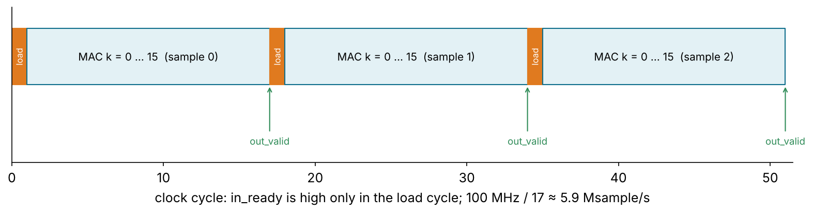

- `in_ready = !busy`. A sample moves on an edge where `in_valid && in_ready`:
  the standard **valid/ready** contract, as in AXI-Stream.
- `out_valid` pulses for one cycle with the new `out_sample`.
- Upstream holds `in_sample` and `in_valid` until it sees `in_ready`.

---

## Where does the area go?

| Block                         | Size                     | Notes                                       |
| ----------------------------- | ------------------------ | ------------------------------------------- |
| delay line                    | 16 × 16 = **256 FFs**    | `dfrtp_1` ≈ 25 µm² each → ~6,400 µm²        |
| accumulator + output          | 36 + 16 + control ≈ 58 FFs |                                            |
| 16 × 16 multiplier            | ~1,250 cells             | a combinational array; the critical path    |
| 16:1 mux for `x_k`            | 16-bit wide              | selects `delay[k*W +: W]`                   |
| coefficient ROM               | a few dozen gates         | constants: `case (k)` becomes logic         |

`make synth-sky130` reports **314 flip-flops** in total. In a real product,
a long delay line would be an **SRAM**, which is far denser than flip-flops.

---

## Verification: three independent checks

```verilog
// 1. Impulse response: y must equal the coefficients, in order
// 2. 300 random full-scale samples, bit-exact against this model:
function integer model_push(input integer x);
    ...
    for (k = 0; k < TAPS; k = k + 1) acc = acc + h[k] * xh[k];
    acc = (acc + (1 <<< 14)) >>> 15;       // same rounding as the RTL
    if (acc >  32767) acc =  32767;        // same saturation
    if (acc < -32768) acc = -32768;
// 3. Sine bursts: gain at 0.02 fs (pass band) and 0.3 fs (stop band)
```

```
PASS: 720 samples bit-exact vs. model, filter response OK
```

Check 2 proves the arithmetic; check 3 proves it is the **right filter**.

---

## Measuring |H(f)| from the hardware

```sh
cd designs/fir && make sim plot
```

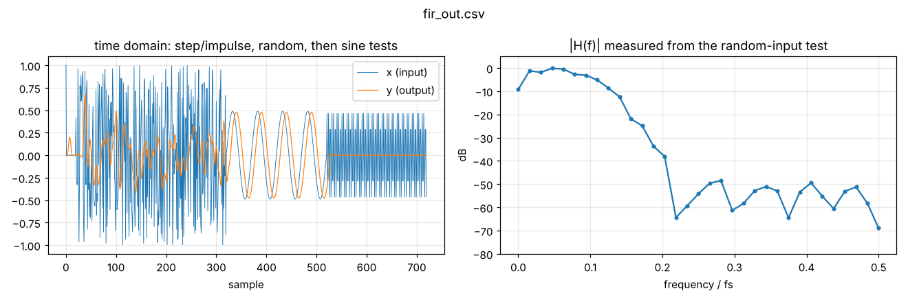

The right panel is computed from the **RTL's output** for random input. It
should match the design response from `dsp_coeffs.py`.

---

## After place and route

<div class="cols">
<div>

| Metric          | Value         |
| --------------- | ------------- |
| cells           | 2,123         |
| cell area       | 25,200 µm²    |
| die             | 253 × 253 µm  |
| clock           | 10 ns         |
| worst slack     | **+0.06 ns**  |
| power           | 4.9 mW        |

Slack is almost zero: 100 MHz is the limit for this multiplier.

</div>
<div>

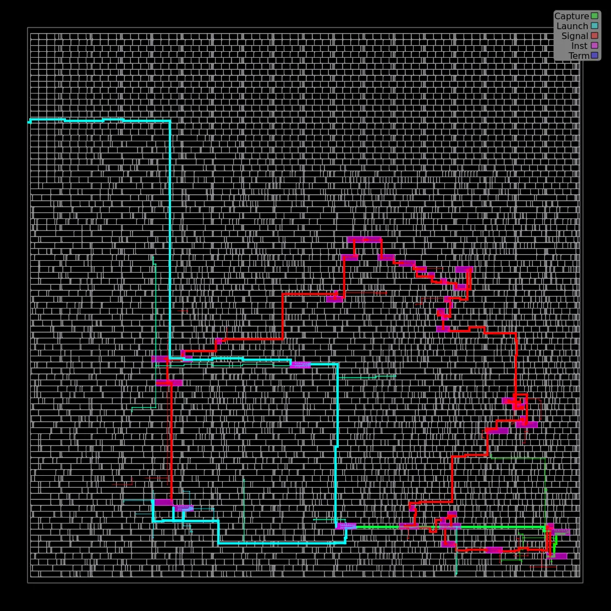

The worst path, highlighted. Which cells does it go through? Read it in
`6_finish.rpt`.

</div>
</div>

---

## Reading the layout pictures

| Placement | Clock tree | Routing |
| --- | --- | --- |
| 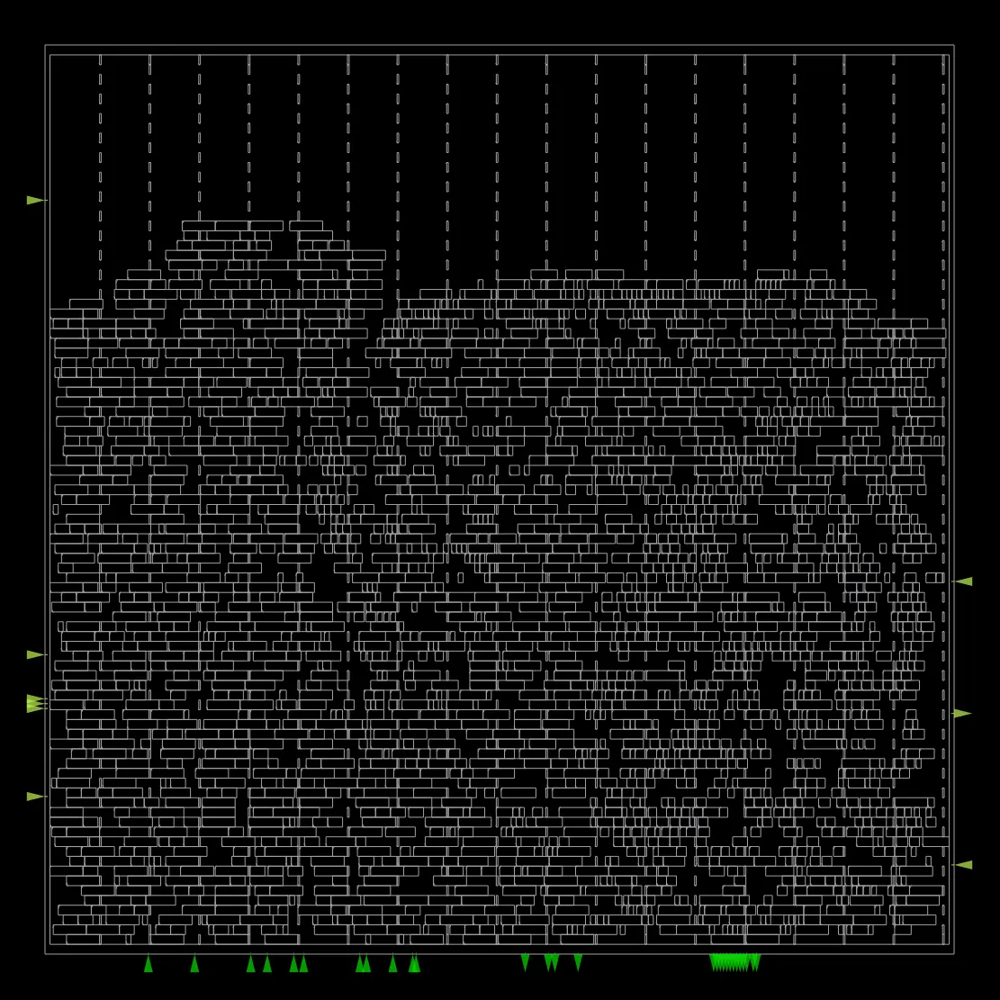 | 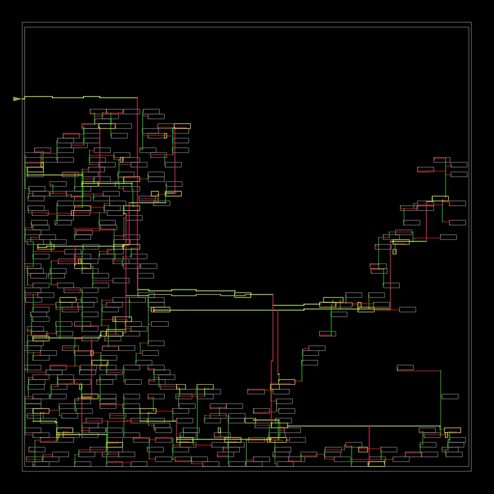 | 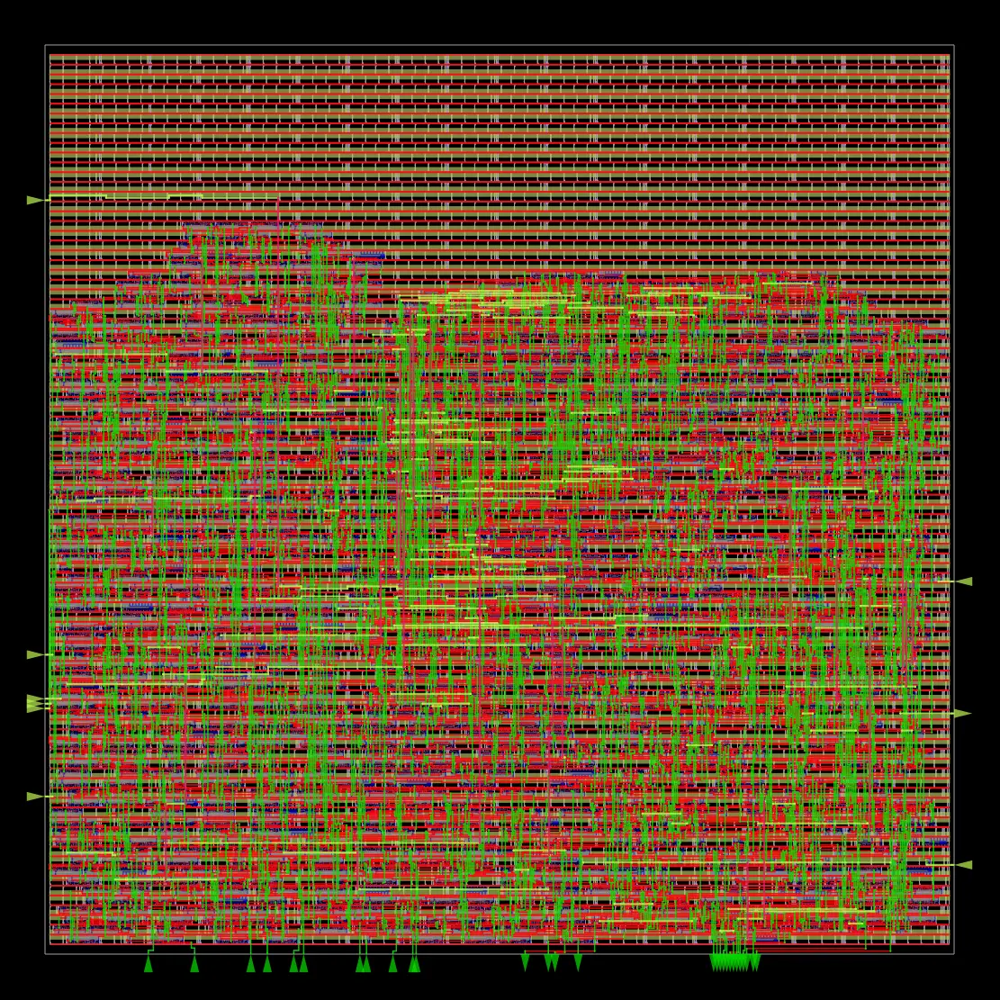 |

- **Placement:** every standard cell at its final x, y in the rows.
- **Clock tree:** ~314 flip-flops fed by a buffered tree, so the edge arrives
  everywhere within the skew budget.
- **Routing:** the wires on five metal layers.

---

## Congestion and IR drop

<div class="cols">
<div>

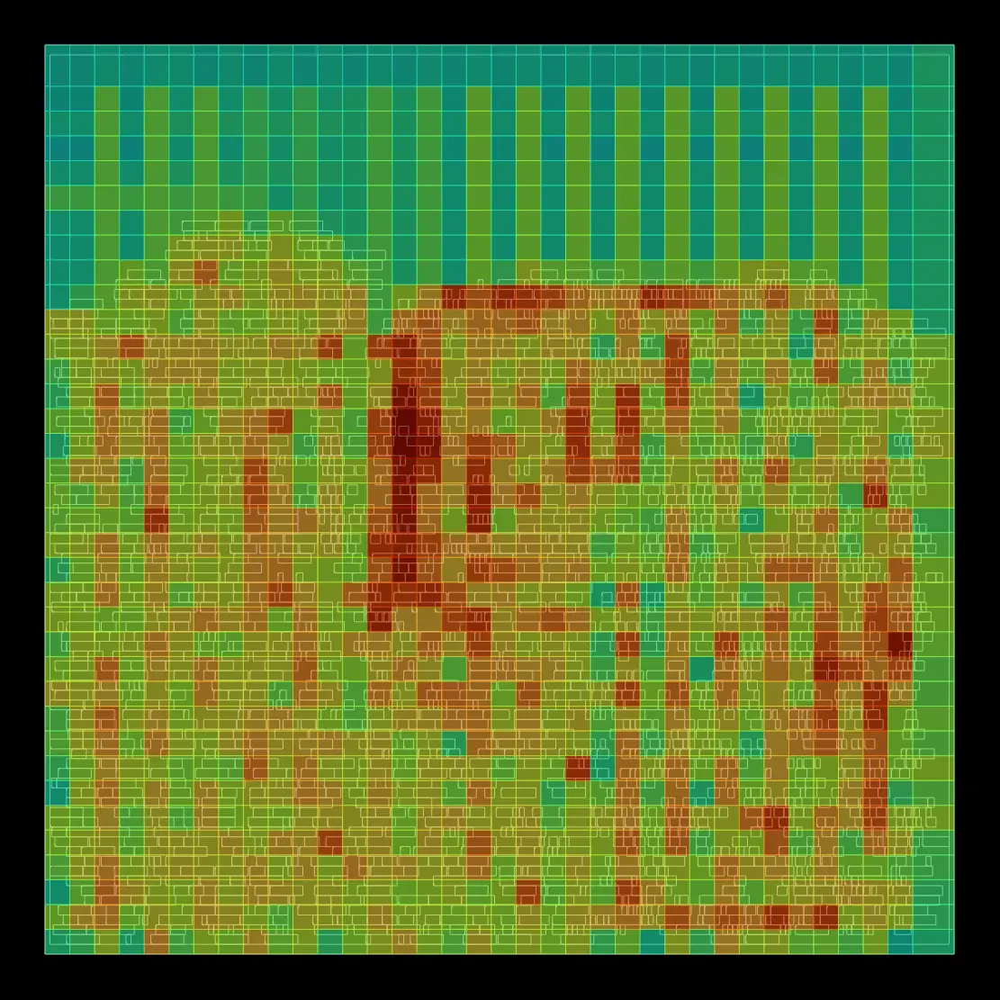

**Congestion:** routing demand vs. supply per tile. Hot tiles: lower
`PLACE_DENSITY` or grow the die.

</div>
<div>

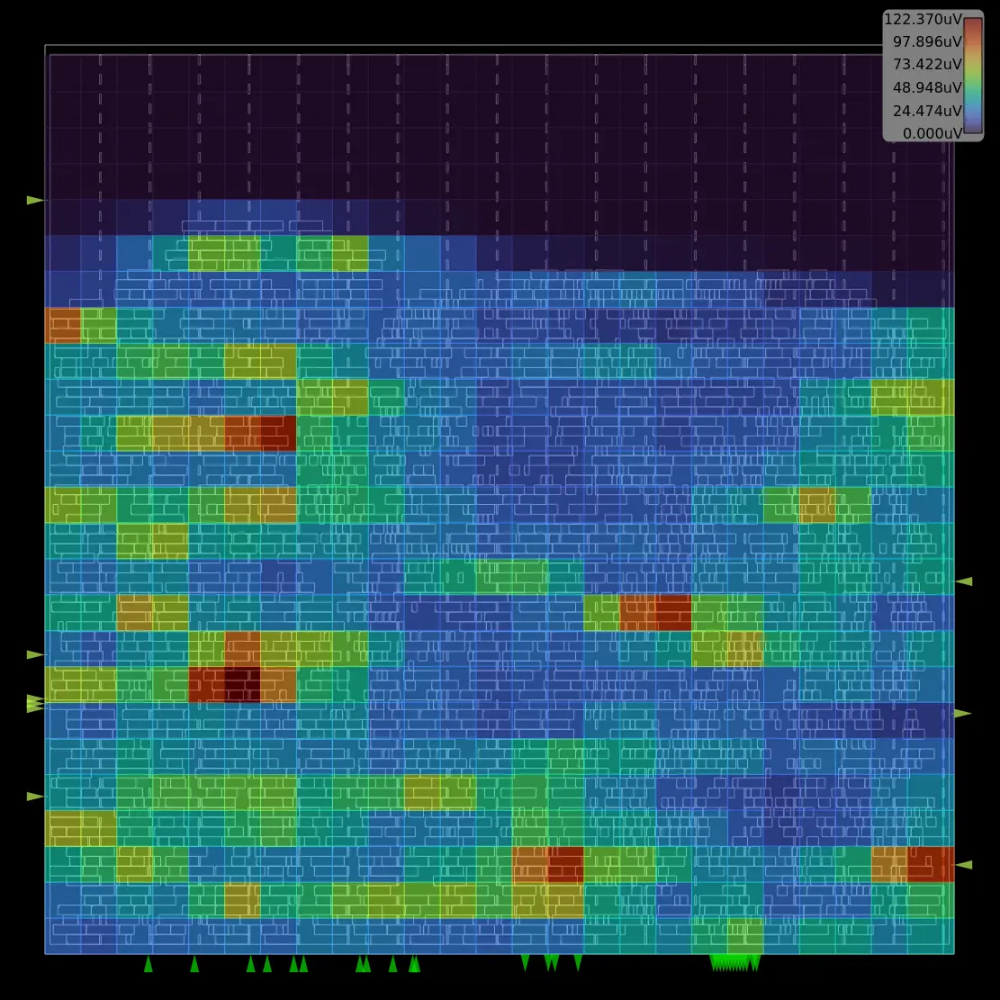

**IR drop:** voltage lost in the power grid's resistance. Cells far from the
straps see less than 1.8 V and get slower.

</div>
</div>

---

## Making it faster: pipeline the MAC

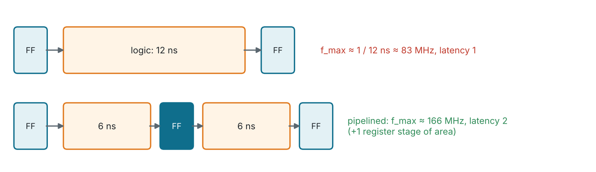

Insert a register between the multiplier and the adder:

- the clock period is set by `max(t_mult, t_add)` instead of the sum
- the result appears one cycle later: `K_LAST` logic and `out_valid` move by one
- area grows by one 32-bit register; f_max roughly doubles in the limit

---

<!-- _class: exercise -->

## Exercises

1. `make synth-sky130` and `make pnr`. How much of the area is the delay line
   vs. the multiplier? (Hint: synthesise a version with `TAPS = 32`.)
2. Change the cutoff in `dsp_coeffs.py` to 0.2 fs, paste the new coefficients
   into `fir.v` and the testbench, and re-run `make sim plot`.
3. Use symmetry: pre-add `x[n−k] + x[n−15+k]` and multiply 8 times, so a
   sample takes 9 cycles. Watch the pre-adder's extra bit.
4. Pipeline the multiplier (previous slide). Lower `clk_period` until timing
   fails, before and after. What sample rate do you reach?
5. **Stretch:** a fully parallel version (16 multipliers, one sample per
   clock). Compare area, f_max and samples per second per mm².

---

## Key takeaways

- An FIR is a **delay line + multiply-accumulate**; the architecture decides
  how many multipliers do the work.
- **Fold** the computation when the clock is much faster than the sample rate.
- Widths come from the fixed-point rules: **36-bit** accumulator for 16
  products of Q1.15 × Q1.15.
- **valid/ready** decouples the filter from whoever feeds it.
- Verify **bit-exact** and **in frequency**: two different kinds of bugs.
- Next: Module 5, IIR filters, where feedback changes everything.

---

<!-- quiz: generated by slides/answers/make_quizzes.py on the quiz-answers branch -->
<!-- _class: quiz -->

## Quiz (1/2)

1. How many clock cycles does the time-shared FIR spend per sample, and what sample rate is that at 100 MHz?
   <span class="opts">**A** 16, 6.25 MS/s &nbsp;·&nbsp; **B** 17, ~5.9 MS/s &nbsp;·&nbsp; **C** 1, 100 MS/s &nbsp;·&nbsp; **D** 32, ~3.1 MS/s</span>
2. The 16-tap filter's accumulator is 36 bits. How wide would it be for 64 taps (same Q1.15 inputs and coefficients)?
   <span class="opts">**A** 36 &nbsp;·&nbsp; **B** 38 &nbsp;·&nbsp; **C** 40 &nbsp;·&nbsp; **D** 64</span>
3. A symmetric (linear-phase) FIR has 31 taps. By how many samples does it delay every frequency?
   <span class="opts">**A** 7.5 &nbsp;·&nbsp; **B** 15 &nbsp;·&nbsp; **C** 15.5 &nbsp;·&nbsp; **D** 31</span>
4. On which clock edge does a sample move from the source into the filter? <span class="sa">*(short answer)*</span>

---


<!-- _class: quiz -->

## Quiz (2/2)

5. The Q1.15 coefficients sum to exactly 32768. What does that tell you?
   <span class="opts">**A** the filter is unstable &nbsp;·&nbsp; **B** the DC gain is exactly 1.0 &nbsp;·&nbsp; **C** the filter is high-pass &nbsp;·&nbsp; **D** the output saturates</span>
6. Which block uses most of the FIR's 314 flip-flops?
   <span class="opts">**A** the accumulator &nbsp;·&nbsp; **B** the coefficient ROM &nbsp;·&nbsp; **C** the delay line &nbsp;·&nbsp; **D** the control FSM</span>
7. A 32-tap FIR must reach 25 MS/s on a 100 MHz clock. Using cycles per sample ≈ N / M, how many multipliers (M) do you need? <span class="sa">*(short answer)*</span>
8. The testbench checks bit-exact output against a model **and** measures gain with sine bursts. Why both? <span class="sa">*(short answer)*</span>

> Answer on paper first, then check yourself against the answer key on the `quiz-answers` branch (`slides/answers/`).
