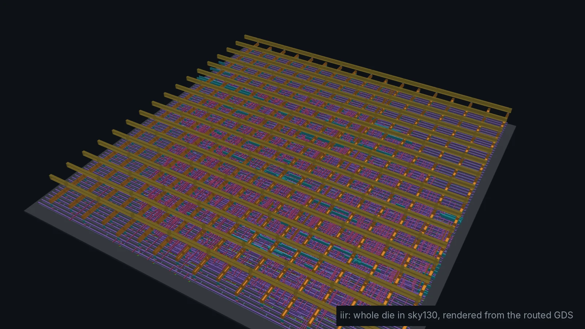
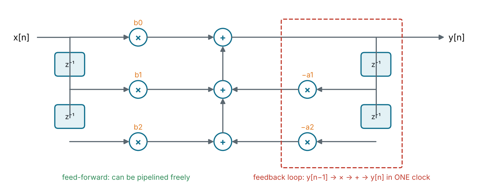
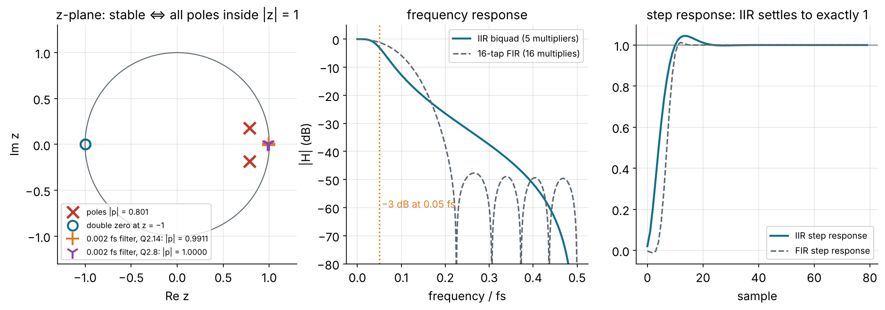
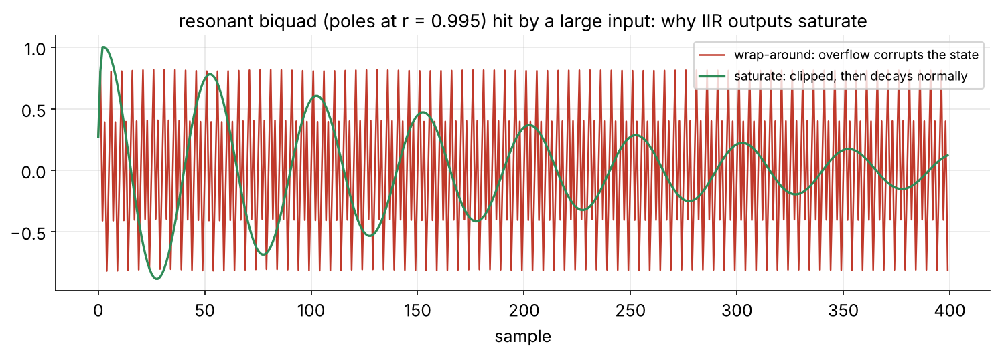
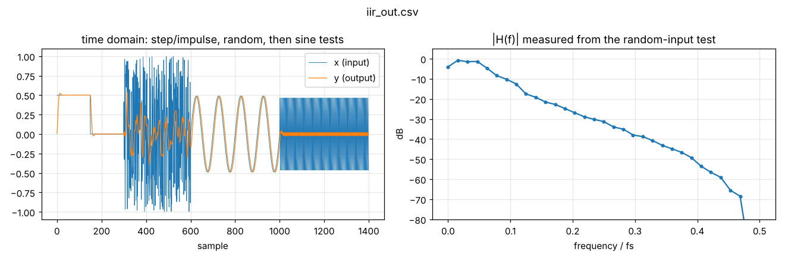

<!-- _class: lead -->
<!-- _paginate: false -->
<!-- _footer: '' -->



# Module 5
## IIR filters

**Hardware is the new Software**

Design: `designs/iir` · Level: advanced · 5 hours

---

## Goals

$$y[n] = b_0 x[n] + b_1 x[n-1] + b_2 x[n-2] - a_1 y[n-1] - a_2 y[n-2]$$

An IIR filter feeds its **output back**. Two poles do work that would take
an FIR many taps. The price shows up in hardware:

- rounding errors **recirculate**
- coefficients must keep the poles **inside the unit circle**, after rounding
- overflow can start an oscillation that **never stops**
- the feedback loop **cannot simply be pipelined**

---

## From transfer function to hardware

$$H(z) = \frac{b_0 + b_1 z^{-1} + b_2 z^{-2}}{1 + a_1 z^{-1} + a_2 z^{-2}}$$

Our filter: 2nd-order **Butterworth** low-pass, cutoff 0.05 fs, designed with
the **bilinear transform** (RBJ Audio EQ Cookbook) in `python/dsp_coeffs.py`:

| Coefficient | Float      | Q2.14 integer | Why Q2.14?                     |
| ----------- | ---------- | ------------: | ------------------------------ |
| b0, b2      | 0.020083   |           329 |                                |
| b1          | 0.040167   |           658 |                                |
| a1          | −1.561018  |       −25 576 | \|a1\| > 1: needs an integer bit |
| a2          | 0.641352   |        10 508 |                                |

DC gain = (b0 + b1 + b2) / (1 + a1 + a2) = 1.

---

## Direct Form I



4 delay registers, 5 multipliers, 1 adder tree. **Direct Form II** needs only 2
delays but its internal signal can grow large, so DF-I is the usual fixed-point choice.

---

## Poles, zeros and stability



- Our poles: |p| = 0.80, comfortable. A 0.002 fs low-pass has |p| = 0.991,
  and Q2.8 rounding puts its poles **on** the unit circle.
- 5 multipliers reach a 0.05 fs cutoff; an FIR would need far more taps.

---

## Coefficient quantisation moves poles

Pole radius for a 2nd-order section: $r = \sqrt{a_2}$. The angle is set by a1.

| Filter cutoff | Q2.14 \|p\| | Q2.10 \|p\| | Q2.8 \|p\| | Verdict at Q2.8          |
| ------------- | ----------: | ----------: | ---------: | ------------------------ |
| 0.05 fs       | 0.80085     | 0.80100     | 0.80039    | fine                      |
| 0.01 fs       | 0.95654     | 0.95658     | 0.95607    | fine                      |
| 0.002 fs      | 0.99114     | **1.00000** | **1.00000** | oscillates: unstable     |

The narrower the filter (relative to fs), the closer the poles hug z = 1,
and the more bits the coefficients need. Fixes: more bits, a lower sample
rate (decimate first), or a different structure (e.g. coupled form).

---

## Constant multipliers are cheap

The coefficients are `localparam`s, so `B1 * x` is a **constant multiply**:

```
658 = 0b0000_0010_1001_0010 = 512 + 128 + 16 + 2
B1 * x  =  (x << 9) + (x << 7) + (x << 4) + (x << 1)       // 3 adders, no multiplier
```

- Synthesis does this for you whenever one operand is a constant.
- **CSD** (canonic signed digit) also allows −1 digits, e.g.
  `15 = 16 − 1` instead of `8 + 4 + 2 + 1`: fewer non-zero digits, fewer adders.
- This is why the IIR is ~1,560 cells after P&R even though it has 5
  "multipliers": a general 16 × 16 multiplier alone is ~1,250.

---

<!-- _class: small -->

## The RTL

```verilog
localparam signed [AW-1:0] B0 = 329, B1 = 658, B2 = 329,   // Q2.14
                           A1 = -25576, A2 = 10508;

reg signed [W-1:0] x1, x2, y1, y2;                         // filter state

wire signed [AW-1:0] acc = B0 * sx(in_sample) + B1 * sx(x1) + B2 * sx(x2)
                         - A1 * sx(y1)        - A2 * sx(y2);

wire signed [AW-1:0] rounded = (acc + (1 <<< (FRAC - 1))) >>> FRAC;
wire signed [W-1:0]  y = (rounded > YMAX) ? YMAX[W-1:0] :      // saturate!
                         (rounded < YMIN) ? YMIN[W-1:0] : rounded[W-1:0];

always @(posedge clk or negedge rst_n)
    if (!rst_n) begin x1 <= 0; x2 <= 0; y1 <= 0; y2 <= 0; ... end
    else begin
        out_valid <= in_valid;
        if (in_valid) begin
            x2 <= x1;  x1 <= in_sample;
            y2 <= y1;  y1 <= y;          out_sample <= y;
        end
    end
```

---

## Why saturation is essential here



With wrap-around, one overflow flips a large positive value to a large
negative one, which is **fed back** and can sustain a large oscillation
forever (an *overflow limit cycle*). Saturation turns it into a brief clip.

---

## The feedback loop sets the clock

```
  ┌──────────────────────────────────────────────────────────────┐
  │                                                              │
  └─► y[n-1] ─► × a1 ─► + ─► round ─► saturate ─► y[n] ─► [reg] ─┘
                      all of this in ONE clock period
```

- In an FIR you can add pipeline registers anywhere: the output is just
  delayed.
- In an IIR, a register inside the loop means y[n] depends on y[n−2] instead
  of y[n−1]: **a different filter**.
- Hence the 20 ns (50 MHz) clock for this design, vs. 10 ns for the FIR.
- Advanced fixes: **look-ahead** transformation (rewrite y[n] in terms of
  y[n−2]), **block processing**, or interleaving independent channels.

---

## Verification and results

```sh
cd designs/iir && make sim plot
# PASS: 1400 samples bit-exact vs. model, filter response OK
```



Step input settles to exactly the input value (DC gain 1). Sine at 0.2 fs is
attenuated by ~26 dB, matching `dsp_coeffs.py`.

---

## FIR vs. IIR in silicon

| Metric (after `make pnr`) | FIR, time-shared | IIR, fully parallel |
| ------------------------- | ---------------: | ------------------: |
| cells                     | 2,123            | 1,560               |
| cell area                 | 25,200 µm²       | 19,000 µm²          |
| clock                     | 10 ns            | 20 ns               |
| worst slack               | +0.06 ns         | +9.07 ns            |
| cycles per sample         | 17               | 1                   |
| samples per second        | 5.9 M            | 50 M                |
| power                     | 4.9 mW           | 1.3 mW              |

The IIR is smaller **and** 8× faster here, because its "multipliers" are
constants and it has 4 state registers instead of 256. The FIR wins on
**linear phase** and **unconditional stability**.

---

## The design in 3D


---

<!-- _class: exercise -->

## Exercises

1. `make pnr`. Find the critical path in the timing report. Does it go around
   the feedback loop (y1 → multiply → add → y)?
2. Turn the low-pass into a high-pass (RBJ cookbook formulas, in
   `dsp_coeffs.py`) and verify it: the step response must now decay to 0.
3. Cascade two biquads for a 4th-order filter. Why is a cascade of 2nd-order
   sections better than one 4th-order direct form?
4. Set `IIR_CUTOFF = 0.002` and reduce the coefficient bits until the filter
   goes unstable. Watch the testbench output.
5. **Stretch:** remove the saturation and find an input that makes the
   output oscillate forever. Then put it back.

---

## Key takeaways

- IIR = **feedback**: very few multipliers for a sharp response.
- Poles must stay inside |z| = 1 **after** coefficient rounding; narrow
  filters need more bits.
- **Constant** coefficients turn multipliers into shift-and-add.
- **Saturate** in any feedback path; wrap-around can oscillate forever.
- The loop cannot be naively pipelined: it sets the maximum clock.
- Next: Module 6, the FFT, from the DFT you know to butterflies in silicon.
