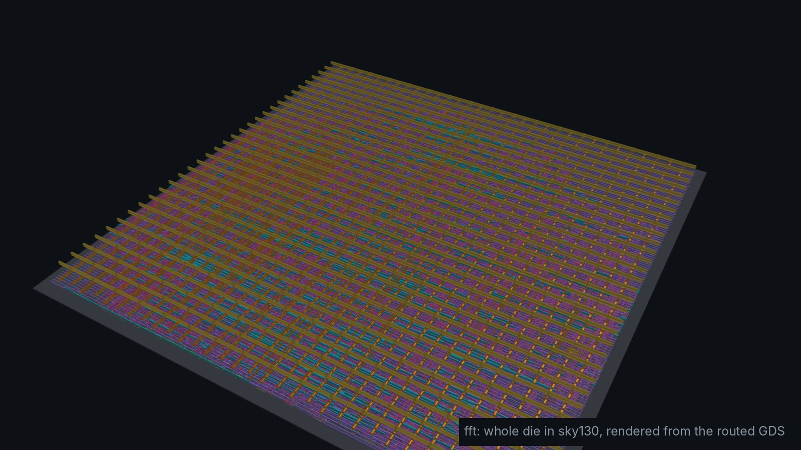
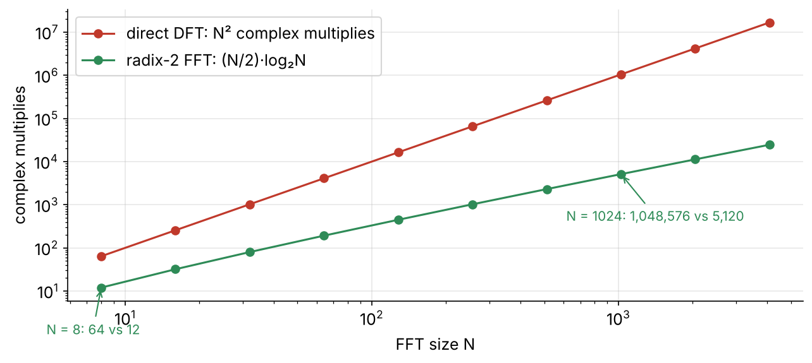
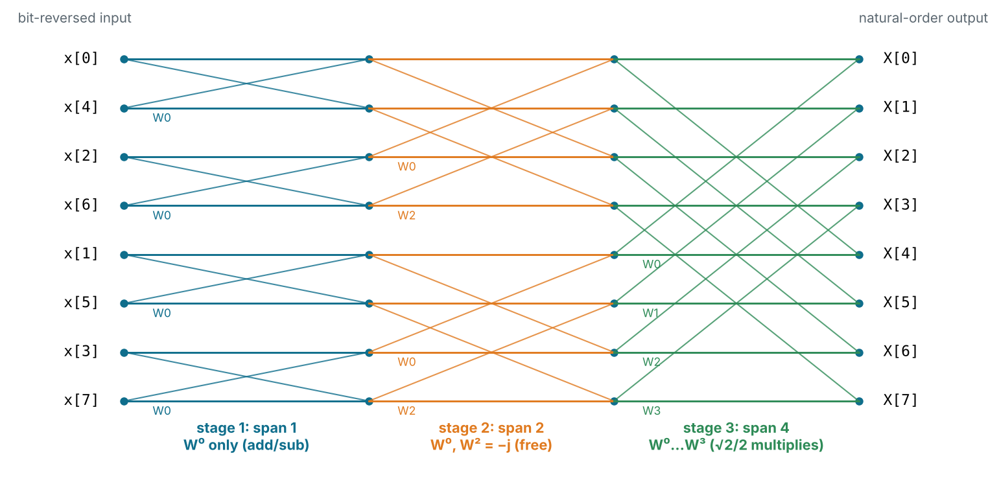
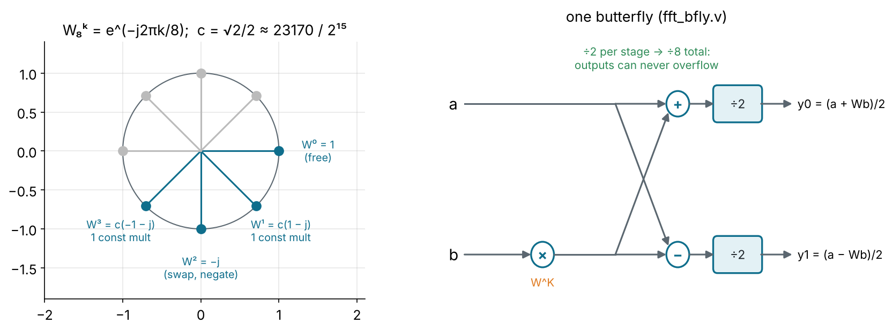
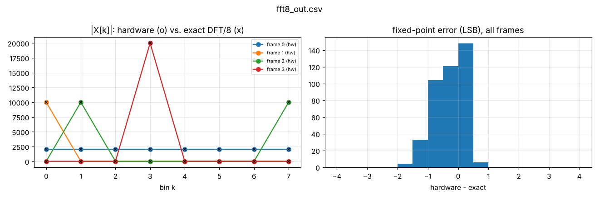

<!-- _class: lead -->
<!-- _paginate: false -->
<!-- _footer: '' -->



# Module 6
## The FFT

**Hardware is the new Software**

Design: `designs/fft` · Level: advanced · 6 hours

---

## Goals

$$X[k] = \frac{1}{8}\sum_{n=0}^{7} x[n]\, W_8^{nk}, \qquad W_8 = e^{-j2\pi/8}$$

You know the DFT. This module connects the math to **silicon**:

- why the FFT is fast: divide and conquer into **butterflies**
- **bit-reversed** input order and how it falls out of the algorithm
- **twiddle factors**, and why N = 8 needs almost no multipliers
- **scaling** to stop growth, and the cost of truncation
- a load / compute / unload controller around a combinational core

---

## Why the FFT matters



The FFT is inside every Wi-Fi, LTE/5G and DSL modem (OFDM), every spectrum
analyser, and most audio and radar processing. At N = 1024 it is ~200×
fewer multiplies than the direct DFT.

---

## Divide and conquer (decimation in time)

Split the sum into even and odd samples:

$$X[k] = \underbrace{\sum_{m} x[2m]\, W_{N/2}^{mk}}_{E[k]\text{: N/2-point DFT}} + W_N^{k} \underbrace{\sum_{m} x[2m+1]\, W_{N/2}^{mk}}_{O[k]\text{: N/2-point DFT}}$$

and because $W_N^{k+N/2} = -W_N^{k}$:

$$X[k] = E[k] + W_N^k O[k], \qquad X[k + N/2] = E[k] - W_N^k O[k]$$

One N-point DFT = two N/2-point DFTs + N/2 **butterflies**. Repeat
log₂N times: (N/2)·log₂N butterflies in total.

---

## The 8-point signal-flow graph



---

## Bit reversal

Splitting even/odd three times sorts the inputs by their **reversed** index:

| n | binary | reversed | position in stage 1 |
| -: | :----: | :------: | ------------------: |
| 0 | 000 | 000 | 0 |
| 1 | 001 | 100 | 4 |
| 2 | 010 | 010 | 2 |
| 3 | 011 | 110 | 6 |
| 4 | 100 | 001 | 1 |

In hardware this costs **nothing**: it is just wiring.

```verilog
for (i = 0; i < 8; i = i + 1) begin : g_bitrev
    localparam integer R = ((i & 1) << 2) | (i & 2) | ((i >> 2) & 1);
    assign s0_re[i*IW +: IW] = x_re[R*IW +: IW];
end
```

---

## Twiddles and the butterfly



For N = 8 there are only four twiddles: two are **free** (1 and −j: swap
and negate), two need one constant multiply by c = √2/2 per component.

---

## The butterfly in Verilog

```verilog
// t = W^K * b, chosen at elaboration time by the parameter K
if (K == 0)      begin assign t_re = br;  assign t_im = bi;  end   //  1
else if (K == 1) begin assign t_re = cs;  assign t_im = cd;  end   //  c(1 - j)
else if (K == 2) begin assign t_re = bi;  assign t_im = -br; end   // -j
else             begin assign t_re = cd;  assign t_im = -cs; end   //  c(-1 - j)

// cs = c*(re + im), cd = c*(im - re): two constant multiplies, shared
wire signed [IW+17:0] c_sum  = (br + bi) * C;     // C = 23170 = sqrt(2)/2 in Q1.15
wire signed [IW+17:0] c_diff = (bi - br) * C;

// add/subtract one bit wider, then halve: the /8 scaling, one stage at a time
wire signed [IW+1:0] s0_re = a_re + t_re;   ...
assign y0_re = s0_re[IW:1];                 // arithmetic >>1 by part-select
```

A `generate`-time parameter turns one module into four different circuits.

---

## Word growth and scaling

A complex input with |re|, |im| < 1 can have magnitude up to √2.
The DFT of N equal samples is N times larger. Options:

| Strategy                    | Width after N = 8      | Cost / risk                          |
| --------------------------- | ---------------------- | ------------------------------------ |
| no scaling                  | +3 bits (+log₂N)       | wide datapath, no overflow           |
| **÷2 every stage** (ours)   | +1 bit (for the √2)    | small; adds truncation noise every stage |
| block floating point        | +0, shared exponent    | best SNR; needs overflow detection   |

Our design: inputs Q1.15 (16 bits), internal and output **17 bits**.

---

## The cost: truncation error

Halving with `s[IW:1]` **truncates**: rounds toward −∞ every stage.



The error histogram leans negative: the −½ LSB bias from Module 3,
accumulated over 3 stages. Max error 2 LSB; the testbench allows 3.

---

## The controller: load, compute, unload

```
            in_valid (8 samples)          1 clock               8 clocks
   ┌──────────┐  cnt == 7  ┌────────────┐          ┌──────────┐
   │  S_LOAD  │ ─────────► │ S_COMPUTE  │ ───────► │ S_UNLOAD │ ──┐
   │in_ready=1│            │ y <= s3    │          │out_valid │   │
   └──────────┘            └────────────┘          └──────────┘   │
        ▲                                         cnt == 7        │
        └─────────────────────────────────────────────────────────┘
```

- The 12 butterflies are **purely combinational**: the whole FFT settles in
  one (long) clock period, which is why the clock is 20 ns.
- 17 cycles per 8-sample frame at 50 MHz: ~23.5 MS/s.

---

## Verification: frames with known answers

| Frame               | Expected X[k]                                 |
| ------------------- | --------------------------------------------- |
| impulse x[0] = A    | flat: X[k] = A/8 for all k                     |
| DC x[n] = A         | X[0] = A, all others 0                         |
| cos(2πn/8)          | X[1] = X[7] = A/2                              |
| e^(j2π·3n/8)        | X[3] = A only (complex tone: one bin)          |
| full-scale corners  | no overflow                                    |
| 20 random frames    | within 3 LSB of a floating-point DFT / 8       |

```
PASS: 26 frames, max error 2 LSB (tolerance 3)
```

Known-answer tests catch **structural** bugs (wrong twiddle, wrong wiring);
random frames catch **arithmetic** bugs.

---

## In silicon

<div class="cols">
<div>


</div>
<div>

| Metric        | Value          |
| ------------- | -------------- |
| cells         | 9,073          |
| cell area     | 79,800 µm²     |
| die           | 449 × 449 µm   |
| clock         | 20 ns          |
| worst slack   | +5.77 ns       |
| fastest clock | ~70 MHz        |
| power         | 2.7 mW         |

The largest design in the course: sample and result buffers (4 × 8 × 17 bits) and 12 butterflies.

</div>
</div>

---

## Real FFT architectures

| Architecture               | Hardware                        | Throughput            | Used in              |
| -------------------------- | ------------------------------- | --------------------- | -------------------- |
| fully combinational (ours) | all (N/2)·log₂N butterflies      | 1 frame per clock*    | small N only         |
| **pipelined** (R2SDF, R22SDF) | log₂N butterflies + delay FIFOs | 1 sample per clock    | OFDM modems, radar   |
| **in-place iterative**     | 1 butterfly + RAM + twiddle ROM  | ~(N/2)·log₂N clocks per frame | low-power sensors, audio |

\* our controller adds 8 + 8 cycles of serial load/unload around it.

Same trade-off as Module 4: more butterflies, more throughput, more area.

---

<!-- _class: exercise -->

## Exercises

1. Draw the 8-point butterfly diagram on paper and match each `fft_bfly`
   instance in `fft8.v` to it.
2. Add an inverse FFT mode: conjugate the twiddles (or swap re/im on input
   and output) and test that IFFT(FFT(x)) = x/8.
3. Replace truncation with round-to-nearest in `fft_bfly.v`. Does the error
   histogram centre on 0? What does it cost in cells?
4. Register the outputs of stage 2 (pipelining). How does the fastest clock
   change after `make pnr`? What happens to latency?
5. **Stretch:** a 64-point FFT with one butterfly, a RAM and a twiddle ROM:
   the in-place iterative architecture used in real chips.

---

## Key takeaways

- FFT = recursive even/odd split → (N/2)·log₂N **butterflies**.
- Bit reversal and the `−j` twiddle are **free**: they are wiring.
- **Scale** by ½ per stage to keep a fixed width; pay with truncation noise.
- Known-answer frames + random frames = structural + arithmetic coverage.
- Architecture spans 1 butterfly to (N/2)·log₂N: the folding trade-off again.
- Next: Module 7, reading the reports to compare all designs.
