<!-- _class: lead -->
<!-- _paginate: false -->
<!-- _footer: '' -->

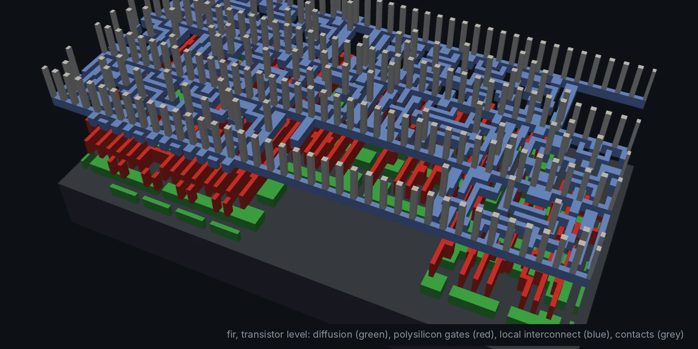

# Bonus module
## The analog bridge: ADC and DAC

**Hardware is the new Software**

Directory: `analog/` · Tools: Xschem + ngspice · Level: bonus · 3 to 4 hours

---

## Goals

Your FIR, IIR and FFT work on **numbers**. The world delivers **voltages**.

After this module you can:

- explain **sampling**, **quantisation** and **aliasing** in hardware terms
- design an **R-2R ladder DAC** and say why only two resistor values are needed
- design a **flash ADC**: sample-and-hold, reference ladder, comparators, encoder
- measure **DNL and INL**, and explain why **matching** is the analog designer's job
- draw schematics in **Xschem**, simulate in **ngspice**, and
- run a **real analog signal through your own Verilog FIR**

---

## The big picture

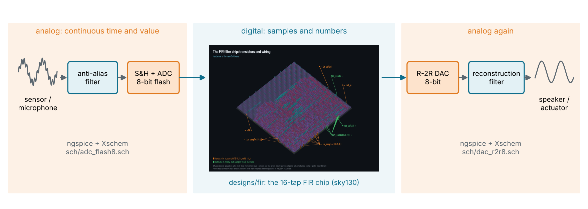

The digital chip in the middle is the real `designs/fir` layout from Module 4.

---

## Same flow, different tools

| | Digital (Modules 1 to 8) | Analog (this module) |
| --- | --- | --- |
| Source | Verilog RTL | **Xschem** schematic (`.sch`) |
| Simulator | Icarus / Verilator | **ngspice** (SPICE) |
| Test | self-checking testbench | `analog.py`: PASS / FAIL |
| Netlist | Yosys → gate netlist | Xschem → SPICE netlist |
| Layout | OpenROAD (automatic) | Magic / KLayout (by hand) |

```sh
cd analog
make sim               # netlist every schematic, run every test
make gui S=adc_flash3  # open a schematic
```

---

## Sampling and quantisation

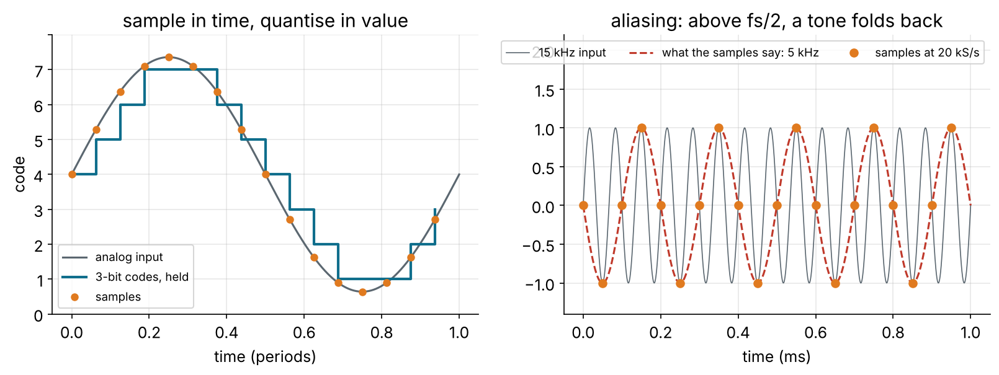

- **Time:** sample at fs. Anything above **fs/2** folds back (aliasing), so
  filter it out *before* the ADC.
- **Value:** round to one of 2^N levels. The error is at most **±½ LSB**.

---

## How many bits?

<div class="cols">
<div>

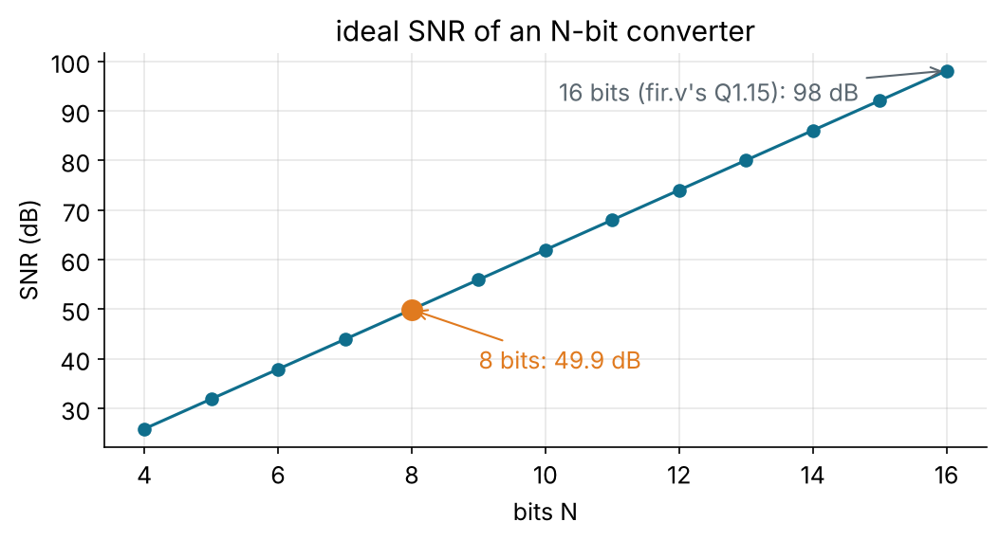

</div>
<div>

An ideal N-bit converter, full-scale sine:

$$SNR = 6.02\,N + 1.76\ \text{dB}$$

- 8 bits: **49.9 dB** (this module)
- 16 bits: **98 dB**, the Q1.15 of `fir.v`

Every extra bit: **+6 dB**, and half the LSB to get right in analog.

</div>
</div>

---

## The DAC: an R-2R ladder

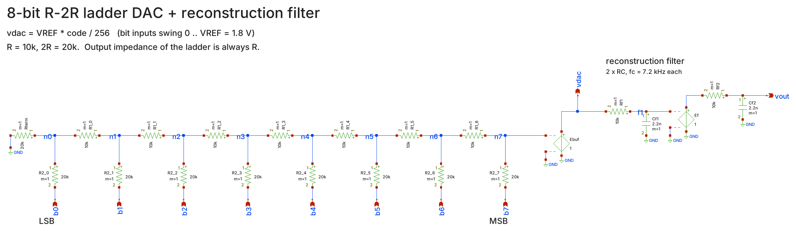

Each bit drives **2R** into a ladder of **R**. Looking left from any node you
see exactly 2R, so each node halves the current: bit *i* adds VREF / 2^(8−i).

---

## Binary weights from equal resistors

<div class="cols">
<div>

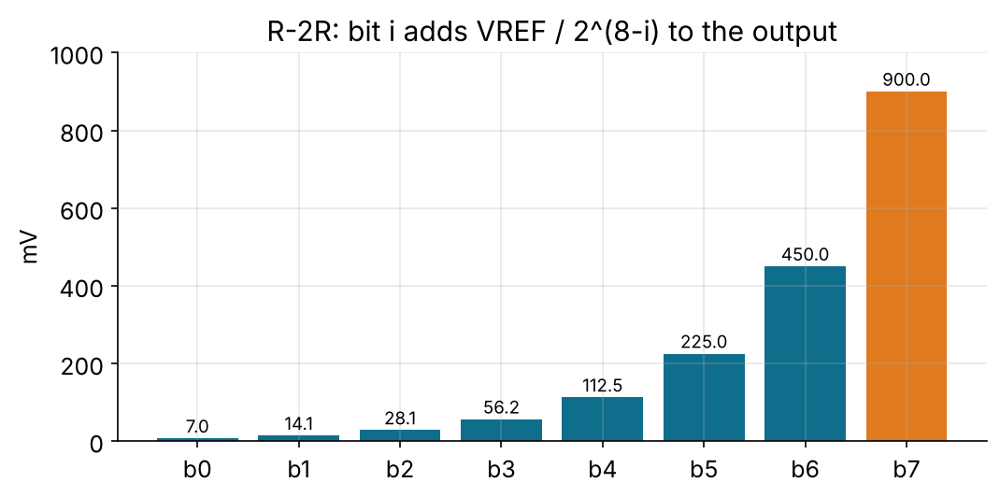

</div>
<div>

$$v_{dac} = V_{REF}\cdot\frac{code}{256}$$

- VREF = 1.8 V, 1 LSB = **7.03 mV**
- only **two values** (10 k, 20 k) for any N
- output impedance is always **R**: buffer it
- 2 RC poles at 7.2 kHz smooth the staircase

</div>
</div>

---

## The netlist Xschem writes

```spice
** sch_path: analog/sch/dac_r2r8.sch
.subckt dac_r2r8 b0 b1 b2 b3 b4 b5 b6 b7 vdac vout
Rterm n0 GND 20k m=1
R2_0 n0 b0 20k m=1
R1_0 n1 n0 10k m=1
R2_1 n1 b1 20k m=1
...
R2_7 n7 b7 20k m=1
Ebuf vdac GND n7 GND 1          * ideal unity-gain buffer
Rf1 f1 vdac 10k m=1             * reconstruction filter, pole 1
Cf1 f1 GND 2.2n m=1
Ef net1 GND f1 GND 1
Rf2 vout net1 10k m=1           * pole 2
Cf2 vout GND 2.2n m=1
.ends
```

Same idea as Yosys: the picture becomes a text netlist the simulator reads.

---

## Testing the DAC: all 256 codes

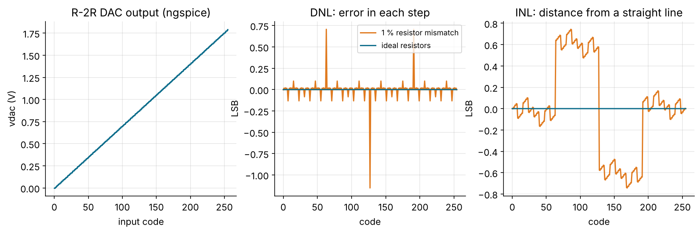

`make dac`: ideal resistors give perfect steps. With **1 % random mismatch**,
the 127 → 128 step is **−1.15 LSB**: the output goes *down*. Not monotonic.

---

## DNL, INL and matching

- **DNL**: each step minus 1 LSB. **DNL < −1** means non-monotonic.
- **INL**: distance from the straight line. Sets distortion.
- The **MSB transition** is worst: all 8 bits flip, so all the errors add up.

What analog layout does about it:

- build every R from **identical unit resistors** (2R = two in series)
- **common-centroid** placement: gradients cancel
- **dummy** devices at the edges, wide resistors, same orientation

Matching is to analog what timing closure is to digital.

---

## The ADC: a flash converter

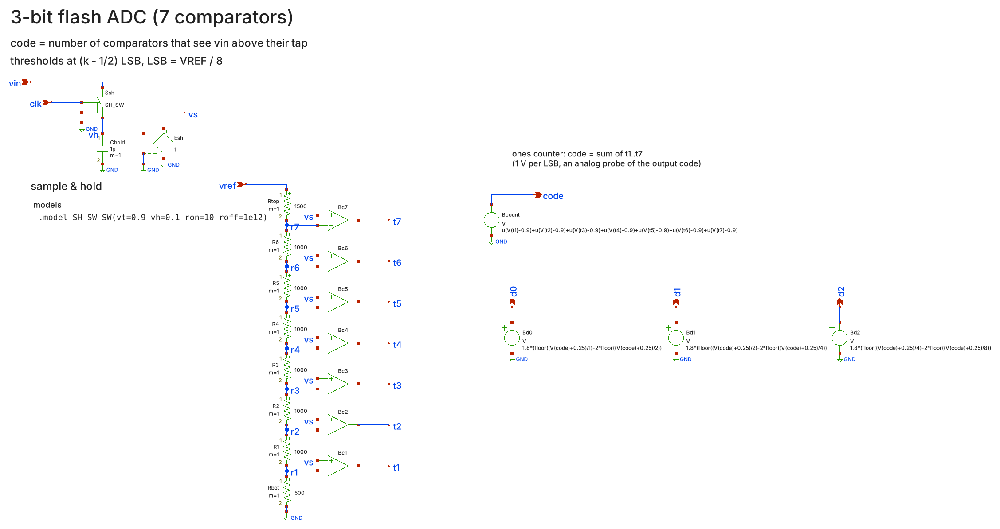

---

## Flash ADC, step by step

1. **Sample and hold:** the switch closes while `clk` is high and charges
   1 pF. Open, the capacitor holds the voltage still.
2. **Reference ladder:** ½R, R, …, R, 1½R puts thresholds at **(k − ½) LSB**.
3. **Comparators:** each asks "is vin above my tap?" → a **thermometer code**.
4. **Encoder:** count the ones → binary `d2..d0`.

```spice
Bc3 t3 0 V = 1.8 * (0.5 + 0.5 * tanh( 1e5 * (V( vs ) - V( r3 ))))
```

An **ideal comparator** as an ngspice B-source: gain 10⁵, so it switches in
10 µV, far below 1 LSB.

---

## Testing the ADC: a slow ramp

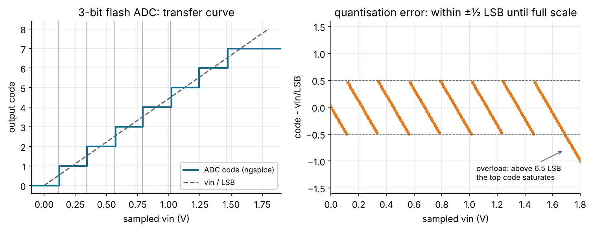

`make adc`: 200 samples, **0 wrong codes**, all 8 codes seen, monotonic.
Above 6.5 LSB the top code saturates: that is **overload**.

---

## Flash vs. SAR

<div class="cols">
<div>

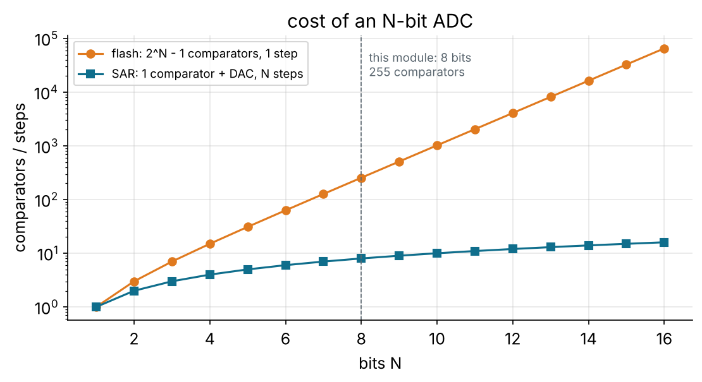

</div>
<div>

**Flash:** 2^N − 1 comparators, one clock per sample. Fastest, but 8 bits
already needs 255.

**SAR:** one comparator + **a DAC like ours**, a binary search over N clocks.
The most common ADC in microcontrollers.

**Σ-Δ:** 1 bit at a very high rate + a digital filter: audio.

</div>
</div>

---

## The chain: a real signal through `fir.v`

```
1 kHz + 15 kHz  ->  8-bit flash ADC  ->  designs/fir/rtl/fir.v  ->  R-2R DAC  ->  RC filter
                      (ngspice)            (Icarus Verilog)          (ngspice)
```

```python
q15 = (codes - 128) << 8                      # offset binary -> Q1.15
# ... iverilog tb/fir_chain_tb.v ../designs/fir/rtl/fir.v ...
dac_codes = np.clip(((y + 128) >> 8) + 128, 0, 255)   # Q1.15 -> 8 bits, rounded
```

- fs = **48 kS/s**, 288 samples, 6 ms
- the FIR's cut-off is 0.1 fs = **4.8 kHz**: 1 kHz passes, 15 kHz does not
- the Verilog is **unchanged** from Module 4, same handshake as its testbench

---

<!-- _class: small -->

## The chain, stage by stage

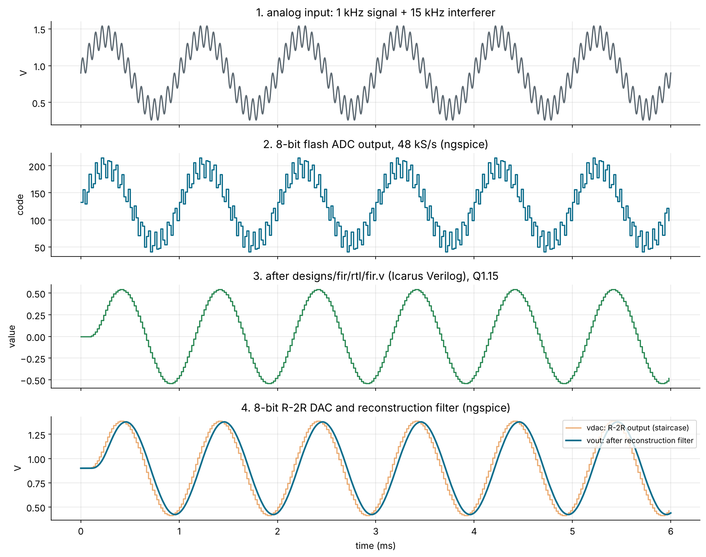

---

## The chain in 3D

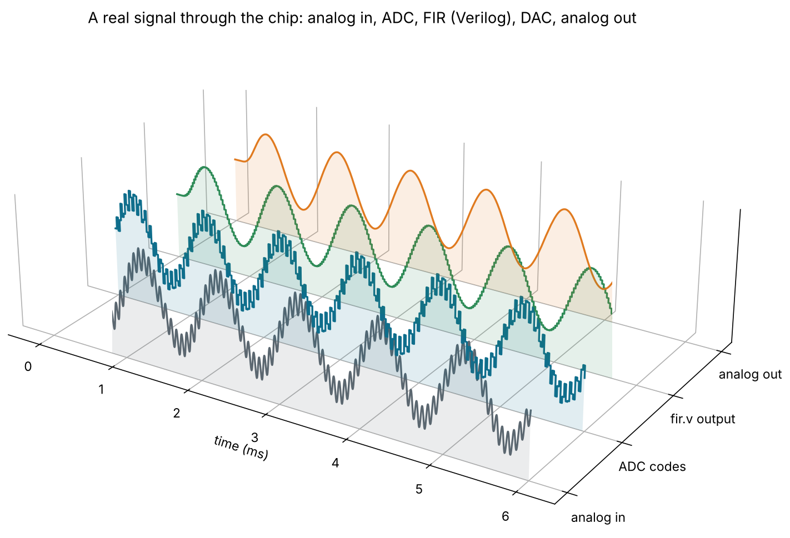

Note the FIR's **delay**: 7.5 samples, the centre of its 16 symmetric taps.

---

## Did it work? The spectrum

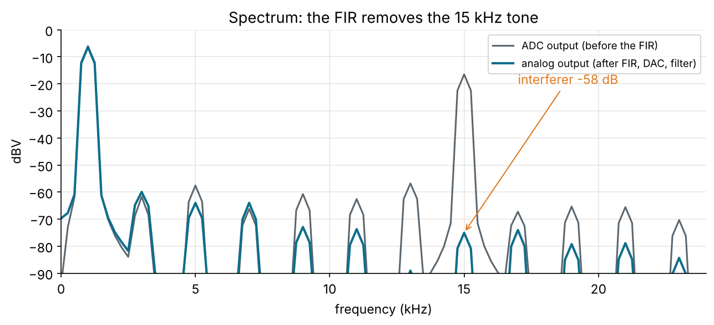

`make chain`: 1 kHz **−0.38 dB** (the two RC poles), 15 kHz **−58 dB**,
down to the 8-bit noise floor. `PASS`.

---

## Behavioural vs. transistor level

What we simulated is **architecture**: ideal comparators, buffers and
resistors. A real chip adds:

| Effect | Where it comes from |
| --- | --- |
| offset | transistor mismatch in the comparator |
| noise | kT/C on the hold capacitor, thermal noise |
| settling | finite op-amp bandwidth, ladder RC |
| power | static current in the ladder, comparator bias |

Next step: the **sky130 device models** from open_pdks, and transistor
comparators. Same Xschem + ngspice flow.

---

<!-- _class: exercise -->

## Exercises

1. **Matching.** Set `sigma` in `mismatched_lib()` to 0.1 % and 5 %. When
   does the DAC stop being monotonic? Why is the MSB step the worst?
2. **Aliasing.** Move the interferer to 40 kHz. Where does it land (hint:
   48 − 40), and why can no digital filter remove it?
3. **SAR ADC.** One comparator + `dac_r2r8` + SAR logic in Verilog. Clocks
   per sample? Comparators saved?
4. **Bits vs. noise.** Keep 6 of the 8 ADC bits (`codes >> 2 << 2`). How far
   does the noise floor rise? Compare with 6.02 N + 1.76 dB.
5. **Stretch:** run the chain through `designs/iir` instead. What happens to
   the phase?

---

## Key takeaways

- An ADC samples **time** and quantises **value**; filter above **fs/2** first.
- Each bit is worth **6 dB** of SNR and halves what the analog must get right.
- **R-2R:** binary weights from two resistor values; **matching** sets DNL/INL.
- **Flash** is fast but costs 2^N − 1 comparators; **SAR** trades time for area.
- Xschem + ngspice is the analog twin of Verilog + Icarus: **schematics are
  code too**, netlisted, simulated and checked in CI.
- Your Verilog FIR just filtered a **real signal**. Hardware is the new Software.
