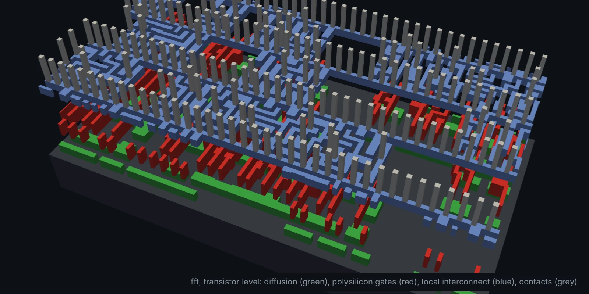
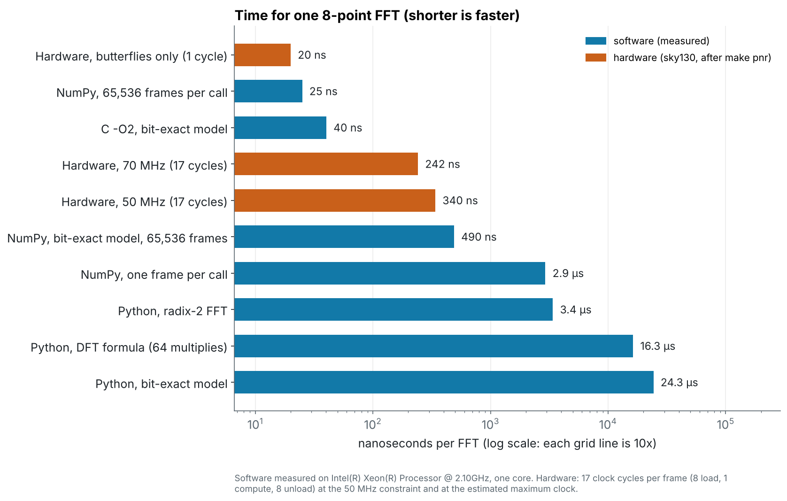
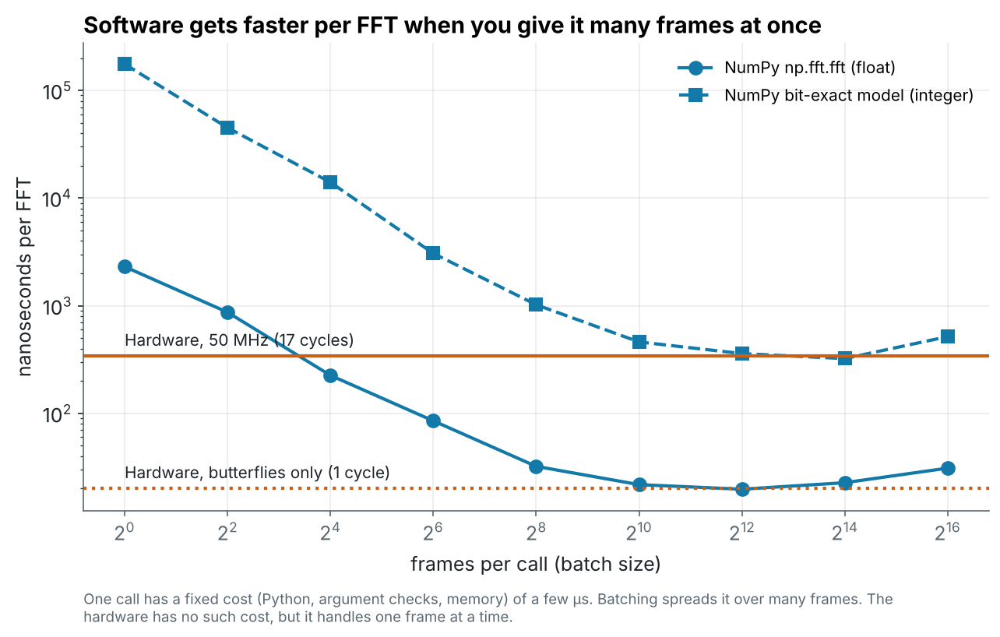
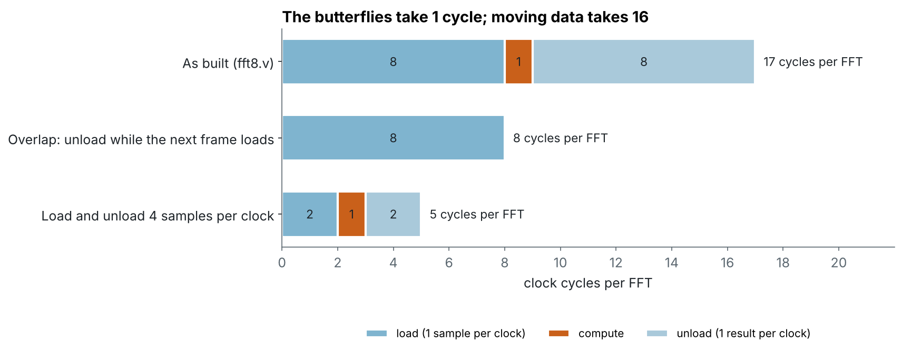
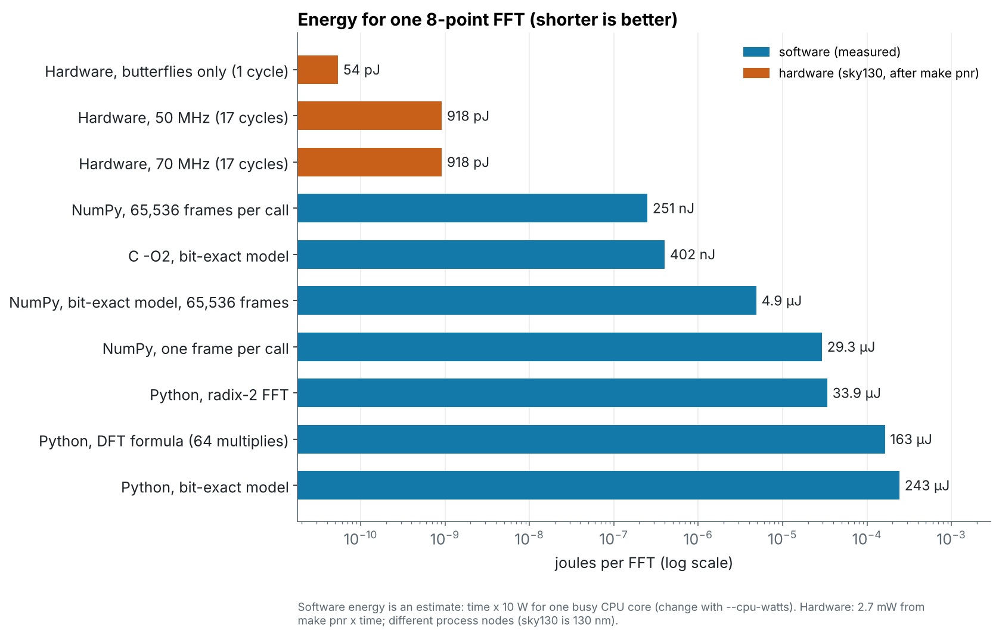
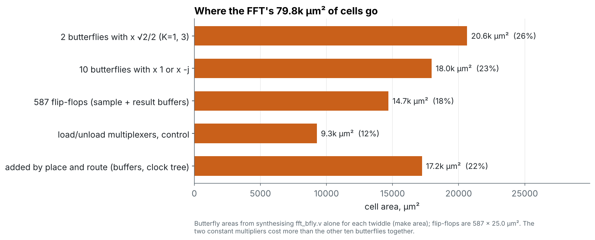

<!-- _class: lead -->
<!-- _paginate: false -->
<!-- _footer: '' -->



# Module 6b
## The FFT in software vs in hardware

**Hardware is the new Software**, so when should a job *be* hardware?

Design: `designs/fft` + `codesign/` · Level: advanced · 3 hours

---

## Goals

The same 8-point FFT, run as Python, NumPy, C and as the chip from Module 6.
Compare them on the three numbers every chip is judged by:

- **speed**: time per FFT, and what limits it
- **energy**: joules per FFT (power × time)
- **area**: what silicon the job needs, and where it goes

And learn the first tools of **co-design**: a bit-exact *golden model*, and
deciding what goes in hardware, what stays in software, and how they talk.

---

## Five software versions, one chip

| Version | File | Idea |
| --- | --- | --- |
| DFT formula | `fft_sw.py: dft_naive` | 64 complex multiplies, straight from the maths |
| radix-2 FFT | `fft_sw.py: fft_python` | 12 butterflies, plain Python floats |
| NumPy | `np.fft.fft` | optimised C library behind one Python call |
| bit-exact model | `fft_sw.py: fft8_fixed` | **same bits as the RTL**: widths, truncation, √2/2 = 23170/2¹⁵ |
| C, bit-exact | `fft8_fixed.c` | the model as firmware, `cc -O2` |
| **chip** | `designs/fft` | 9,073 sky130 cells, 50 MHz, 17 cycles per FFT |

```sh
cd codesign && make check && make bench
```

---

## The golden model

```python
def bfly_fixed(a_re, a_im, b_re, b_im, k):
    s  = _wrap(b_re + b_im, IW + 1)          # wire signed [IW:0] sum
    cs = _wrap((s * C) >> 15, IW + 1)        # c_sum[IW+15:15]
    ...
    y0 = (_wrap((a_re + t_re) >> 1, IW), ...)  # s0_re[IW:1]
```

Every line mirrors a line of `fft_bfly.v`. On the testbench inputs:

```
Bit-exact model vs RTL (designs/fft/build/fft8_out.csv):
  26 frames, 208 outputs, 0 mismatches
```

Now you can **change a width in Python in seconds** instead of RTL + PnR in
hours, generate test vectors, and run the algorithm with no chip at all.

---

## Speed



---

## Reading the speed chart

- **Python: 3–24 µs.** The interpreter, not the arithmetic.
- **NumPy, one frame per call: 2.9 µs.** The call itself costs microseconds.
- **NumPy batched / C: 25–40 ns.** A 2.1 GHz CPU with vector instructions
  beats our 50 MHz chip on throughput.
- **Chip: 340 ns**, of which the butterflies take **20 ns**.

> Hardware is not automatically faster. A 130 nm chip at 50 MHz loses on
> raw throughput to a modern CPU core, if the CPU gets big batches.

---

## Software needs big batches



---

## Latency vs throughput

A batch of 4,096 frames at 20 ns each is **82 µs** before the first answer
comes back, plus the time to collect 4,096 frames.

| Need | Winner |
| --- | --- |
| analyse a recorded file | software, batched |
| answer each Wi-Fi symbol within ~4 µs | hardware: fixed latency, every frame |
| hard real time (radar, motor control) | hardware: no OS, no cache misses |

The chip's 340 ns is the *same* 340 ns every frame. That determinism is
often worth more than the average speed.

---

## Where the chip's time goes



**16 of 17 cycles are data movement.** The interface sets the speed, in
hardware (one sample per clock) as in software (cost per call).

---

## Energy



---

## Energy: the chip's real win

| Version | Time | Energy | vs chip |
| --- | ---: | ---: | ---: |
| **chip, 50 MHz** | 340 ns | **0.92 nJ** | 1× |
| NumPy, batched | 25 ns | 250 nJ | ~270× |
| C, bit-exact | 40 ns | 400 nJ | ~440× |
| NumPy, one frame | 2.9 µs | 29 µJ | ~32,000× |

Software energy = time × 10 W per busy core (an estimate, `CPU_WATTS=`).
A CPU spends its energy fetching instructions and moving data through
caches; the chip only switches the gates that do the maths.

---

## Area



---

## Reading the area chart

- The chip is **0.08 mm²** of cells. It can only do an 8-point FFT.
- A CPU core with caches is far larger, but runs *any* program.
- Inside the chip, the **2 butterflies with ×√2/2 cost more than the other
  10 together**: ×1 and ×(−j) are just wiring and a negation.
- 587 flip-flops hold the input and output frames: 18%.
- Place and route adds 22% (timing buffers, the clock tree).

```sh
make area     # fft_bfly K=0: 1702 µm²   K=1: 10135   K=2: 2016   K=3: 10510
```

---

## When to use which

| Software when... | Hardware when... |
| --- | --- |
| the size or algorithm changes often | the job is fixed (a standard fixes N) |
| big batches, offline | every frame has a deadline |
| a CPU is already there and idle | battery or power budget |
| low volume (masks cost money) | high volume, or always on |

Real products do **both**: a CPU for control and rare cases, an
accelerator next to it for the FFT. Choosing the split and the interface
between them is **hardware/software co-design**.

---

## The co-design loop

1. Write the algorithm in **Python/NumPy**: get it right.
2. Write a **bit-exact fixed-point model**: choose widths and rounding.
3. Profile: which part takes the time and the energy?
4. Move *that* part to **RTL**; test it against the model, bit for bit.
5. Design the **interface**: how data gets in and out (it can dominate).
6. Measure the chip (`make pnr`) and go back to step 2 if needed.

This module did steps 1, 2, 4 and 6 for the FFT. Step 5 is the exercise.

---

<!-- _class: exercise -->

## Exercises

1. `make bench` on your laptop, with `CPU_WATTS` = your CPU's power ÷ cores.
2. At what batch size does NumPy beat the chip on your machine?
3. Golden model: try `W` = 12 and 20 bits. Which width gives 60 dB of
   dynamic range?
4. Replace `sum * C` with shift-and-add (23170 = 2¹⁴+2¹²+2¹¹+2⁹+2⁷+2¹).
   `make check`, then `make area`: how much smaller?
5. Double-buffer `fft8.v` so it unloads while the next frame loads:
   8 cycles per FFT. What does it cost in flip-flops?
6. **Battery sensor:** 8 kHz audio, one FFT per 8 samples. Power for the
   chip vs a 10 W core that can (or cannot) sleep between frames?

---

## Key takeaways

- A **bit-exact golden model** links software and hardware: 208/208 bits match.
- Hardware is not automatically **faster**: a modern CPU with big batches
  wins on throughput.
- Hardware wins on **energy** (270× to 30,000×) and on **fixed latency**.
- The **interface** often costs more than the maths: 16 of 17 cycles.
- Area goes to **multipliers** and **storage**; ×1 and ×(−j) need no
  multiplier at all.
- Next: Module 7, reading the reports for every design.
