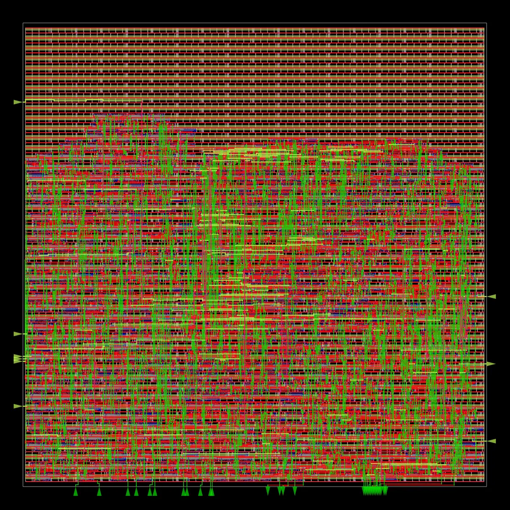
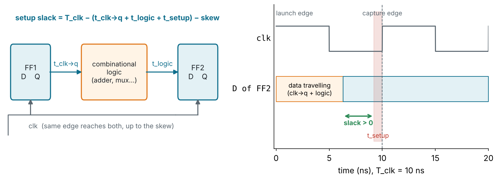
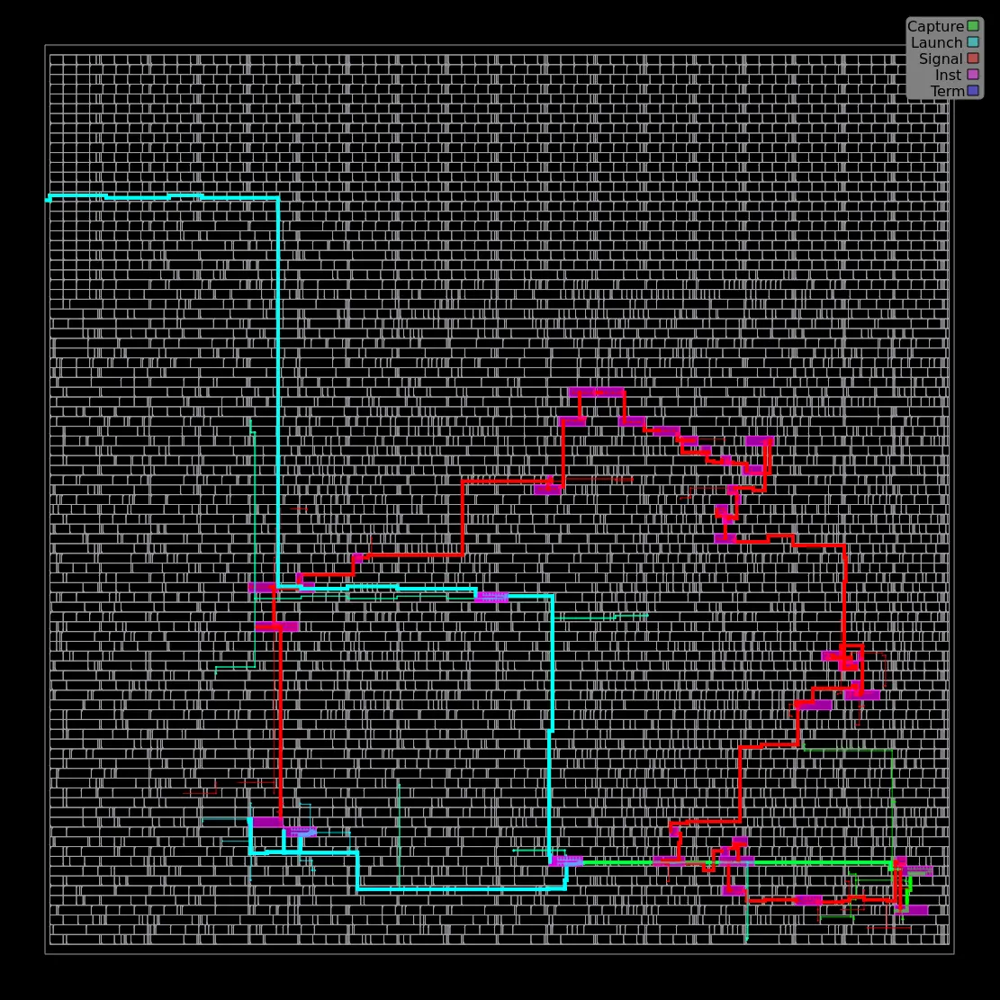
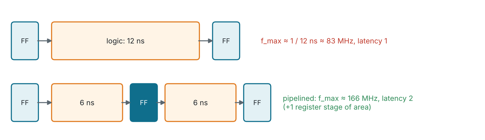
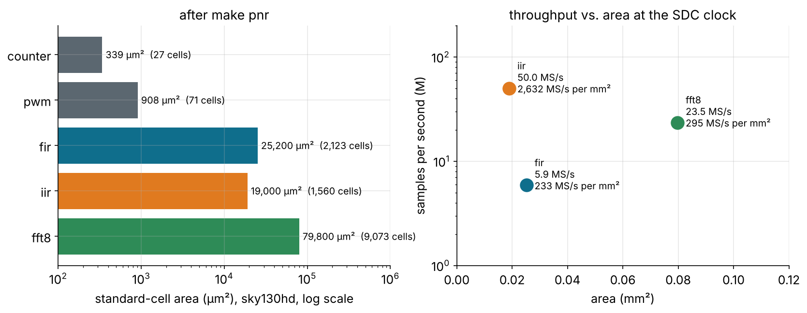
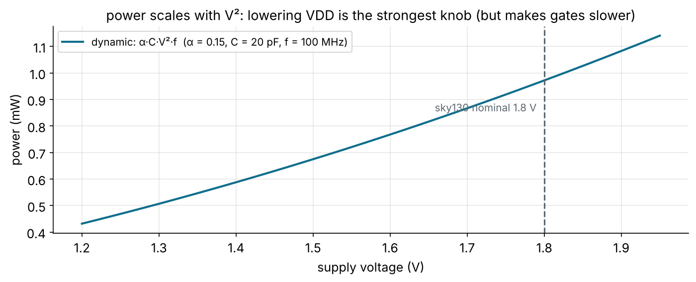

<!-- _class: lead -->
<!-- _paginate: false -->
<!-- _footer: '' -->



# Module 7
## Timing, area and power

**Hardware is the new Software**

All designs · Level: advanced · 4 hours

---

## Goals

Every chip is judged on **PPA**: performance, power, area. You now have five
designs through the full flow. This module teaches you to:

- read the ORFS **timing, area and power reports** like a designer
- find and explain a **critical path**
- estimate the **fastest clock** and the **sample rate** each design reaches
- compare architectures with one fair metric: **samples per second per mm²**
- know which knob to turn: architecture, pipelining, clock, voltage, density

---

## Where the numbers live

```
designs/<name>/build/orfs/
├── logs/sky130hd/<top>/base/        1_1_yosys.log ... 6_report.log
├── reports/sky130hd/<top>/base/
│   ├── synth_stat.txt               cells and area after synthesis
│   ├── 4_cts_final.rpt              timing after clock tree synthesis
│   ├── 5_route_drc.rpt              routing design-rule violations
│   ├── 6_finish.rpt                 final timing, power, slack histogram
│   └── final_*.webp                 pictures of each stage
└── results/sky130hd/<top>/base/
    ├── 6_final.gds                  the layout
    ├── 6_final.odb                  OpenROAD database (open in the GUI)
    └── 6_final.v, 6_final.sdc       netlist and constraints as implemented
```

---

## The scoreboard (sky130hd, typical corner)

| Design  | Cells | Cell area (µm²) | Die (µm) | Clock | Worst slack | Fastest clock | Power   |
| ------- | ----: | --------------: | -------: | ----: | ----------: | ------------: | ------: |
| counter |    27 |             339 |  60 × 60 | 10 ns |     5.24 ns |      ~210 MHz | 0.08 mW |
| pwm     |    71 |             908 |  60 × 60 | 10 ns |     6.15 ns |      ~260 MHz | 0.11 mW |
| fir     | 2,123 |          25,200 | 253 × 253 | 10 ns |    0.06 ns |      ~100 MHz | 4.9 mW  |
| iir     | 1,560 |          19,000 | 235 × 235 | 20 ns |    9.07 ns |       ~90 MHz | 1.3 mW  |
| fft     | 9,073 |          79,800 | 449 × 449 | 20 ns |    5.77 ns |       ~70 MHz | 2.7 mW  |

"Fastest clock" = 1 / (period − slack): a first estimate. The tools
re-optimise (bigger cells, buffering) when you tighten the constraint, so
the real limit is usually a little higher.

---

## Timing: what slack means



- **Setup slack > 0:** data arrives before (capture edge − setup time).
- **WNS** = worst slack of all paths; **TNS** = sum of all negative slack.
- **Hold slack:** data must not change too soon *after* the edge. It does not
  depend on the clock period; CTS repair fixes it with delay buffers.

---

## Reading a timing path

```
Startpoint: <register that launches the data>   (rising edge-triggered flip-flop clocked by core_clock)
Endpoint:   <register that captures it>         (rising edge-triggered flip-flop clocked by core_clock)

  Delay    Time   Description
--------------------------------------------------------------------------
   0.00    0.00   clock core_clock (rise edge)           <- launch edge
   d_clk   ...    clock network delay (propagated)       <- through the CTS buffers
   d_cq    ...  ^ <start reg>/Q (sky130_fd_sc_hd__dfrtp_*)
   d_1     ...  v <cell>/Y (...)                         <- one line per cell: ^ rise, v fall
   ...
           T_arr  data arrival time
  10.00   10.00   clock core_clock (rise edge)           <- capture edge, one period later
           ...    clock network delay, setup time, uncertainty
           T_req  data required time
--------------------------------------------------------------------------
           T_req - T_arr  slack (MET or VIOLATED)
```

Find the real one for each design in `6_finish.rpt` after `make pnr`.

---

## Seeing the worst path

<div class="cols">
<div>



</div>
<div>

The FIR's worst path, highlighted on the layout by ORFS.

Questions to ask of any critical path:

1. Where does it **start** and **end**? (which registers)
2. Is it **logic** delay or **wire** delay? Long wires mean placement.
3. Is it **inherent** (a feedback loop) or can a register split it?
4. Does it cross a **hierarchy** you could restructure?

</div>
</div>

---

## Knobs for timing

| Knob                         | Effect                                   | Cost                           |
| ---------------------------- | ---------------------------------------- | ------------------------------ |
| **pipelining**               | shorter paths, higher f_max              | latency, registers             |
| **retiming**                 | moves registers across logic to balance stages | tool support, harder to debug |
| **parallelism / unfolding**  | more work per clock at the same f_max    | area                           |
| **upsizing cells**           | `_1` → `_2`, `_4` drive strength: faster edges | area, power, input load  |
| **better floorplan**         | shorter wires                            | effort                         |
| **lower clock**              | always works                             | throughput                     |



---

## Area: what to count



- **Die area** adds routing space, power straps and pins to the **cell area**
  (`CORE_UTILIZATION` 35 to 40 %). A flip-flop is ~25 µm²; a 16 × 16 multiplier ~9,500 µm².

---

## The fair comparison: throughput per area

| Design | Area (mm²) | Clock    | Cycles / sample | MS/s | MS/s per mm² |
| ------ | ---------: | -------: | --------------: | ---: | -----------: |
| fir    | 0.0252     | 100 MHz  | 17              | 5.9  | ~233         |
| iir    | 0.0190     | 50 MHz   | 1               | 50   | ~2,630       |
| fft    | 0.0798     | 50 MHz   | 17/8            | 23.5 | ~295         |

(At the SDC clocks. Recompute at each design's fastest clock as an exercise.)

These do different jobs, so this is not "IIR wins". It is the habit: **always
normalise** by area (and power) before claiming one architecture is better.

---

## Power: where it goes

$$P = \underbrace{\alpha\, C\, V_{DD}^2\, f}_{\text{dynamic: switching}} + \underbrace{I_{sc} V_{DD}}_{\text{short-circuit}} + \underbrace{I_{leak} V_{DD}}_{\text{leakage}}$$



α = activity factor (fraction of nodes toggling per cycle), C = switched
capacitance (cells + wires), f = clock.

---

## Reading the power numbers

- ORFS reports power per group: **sequential**, **combinational**, **clock**,
  macro, pad; and per type: internal, switching, leakage.
- The **clock network** toggles every cycle (α = 1), so it is often a large
  share of dynamic power. Check the `clock` group in your own report.
- The default analysis assumes a fixed activity. For real numbers, simulate,
  dump a **VCD/SAIF**, and annotate actual switching activity.
- FIR at 4.9 mW vs. IIR at 1.3 mW: the FIR clocks 314 flip-flops at 100 MHz;
  the IIR clocks 65 at 50 MHz.

---

## Knobs for power

| Knob                       | Saves                    | How                                      |
| -------------------------- | ------------------------ | ---------------------------------------- |
| **clock gating**           | dynamic power of idle FFs | `ICG` cell turns off the clock to a register bank (`en` → gated clock) |
| **lower V_DD**             | V² on dynamic            | slower gates; needs timing margin        |
| **lower f + parallelism**  | same throughput, lower V possible | area                            |
| **operand isolation**      | glitching in idle datapaths | hold multiplier inputs when result unused |
| **memories instead of FFs** | area and clock load     | SRAM for long delay lines                |
| **power gating**           | leakage                  | switch off whole blocks (sky130 `lpflow_*` cells) |

---

## Corners: the typical case is not enough

| Corner (sky130 Liberty) | Process | Voltage | Temp  | Use                      |
| ----------------------- | ------- | ------- | ----- | ------------------------ |
| `tt_025C_1v80`          | typical | 1.80 V  | 25 °C | what this course reports  |
| `ss_100C_1v60`          | slow    | 1.60 V  | 100 °C | **setup** signoff: slowest |
| `ff_n40C_1v95`          | fast    | 1.95 V  | −40 °C | **hold** signoff: fastest  |

A real tapeout must meet setup at the slow corner and hold at the fast
corner. Expect f_max at `ss` to be well below `tt`.

---

<!-- _class: exercise -->

## Exercises

1. Run `make pnr` for each design and reproduce the scoreboard from
   `6_finish.rpt` and `synth_stat.txt`.
2. For each DSP design, lower `clk_period` in `orfs/constraint.sdc` until
   timing fails. What is the real f_max, and the max **sample rate**?
3. Recompute "MS/s per mm²" at each design's f_max. Does the ranking change?
4. Open the FIR's critical path in `6_finish.rpt`. List every cell on it.
   Which single register would you add to cut it in half?
5. **Stretch:** point ORFS at the `ss_100C_1v60` Liberty and re-run the FIR.
   How much slower is it?

---

## Key takeaways

- **PPA** is the scorecard; every report in `build/orfs/reports` feeds it.
- Slack is static: every path, every corner, no test vectors.
- f_max ≈ 1 / (period − slack) is an estimate; the tools re-optimise.
- Normalise: **throughput per area**, **energy per sample**.
- Power is mostly **α C V² f**: the clock tree and V_DD dominate.
- Next: Module 8, your own design, and what a real tapeout adds.

---

<!-- quiz: generated by slides/answers/make_quizzes.py on the quiz-answers branch -->
<!-- _class: quiz -->

## Quiz (1/2)

1. A design meets an 8 ns clock with +1.5 ns slack. Estimate f_max.
   <span class="opts">**A** ~125 MHz &nbsp;·&nbsp; **B** ~154 MHz &nbsp;·&nbsp; **C** ~210 MHz &nbsp;·&nbsp; **D** ~667 MHz</span>
2. You slow the clock from 10 ns to 20 ns. What happens to hold slack?
   <span class="opts">**A** it doubles &nbsp;·&nbsp; **B** it halves &nbsp;·&nbsp; **C** essentially nothing &nbsp;·&nbsp; **D** it becomes negative</span>
3. What is the difference between WNS and TNS? <span class="sa">*(short answer)*</span>
4. You lower VDD from 1.8 V to 1.6 V at the same frequency. Roughly how much dynamic power do you save?
   <span class="opts">**A** ~6 % &nbsp;·&nbsp; **B** ~11 % &nbsp;·&nbsp; **C** ~21 % &nbsp;·&nbsp; **D** ~50 %</span>

---


<!-- _class: quiz -->

## Quiz (2/2)

5. Which sky130 corner do you use for **setup** signoff?
   <span class="opts">**A** `tt_025C_1v80` &nbsp;·&nbsp; **B** `ss_100C_1v60` &nbsp;·&nbsp; **C** `ff_n40C_1v95` &nbsp;·&nbsp; **D** any, they give the same result</span>
6. A design uses 0.05 mm², runs at 100 MHz and takes 4 cycles per sample. What is its MS/s per mm²? <span class="sa">*(short answer)*</span>
7. Why is the clock network often a large share of dynamic power? <span class="sa">*(short answer)*</span>
8. Which knob reduces **leakage** power?
   <span class="opts">**A** clock gating &nbsp;·&nbsp; **B** operand isolation &nbsp;·&nbsp; **C** power gating &nbsp;·&nbsp; **D** upsizing cells</span>

> Answer on paper first, then check yourself against the answer key on the `quiz-answers` branch (`slides/answers/`).
