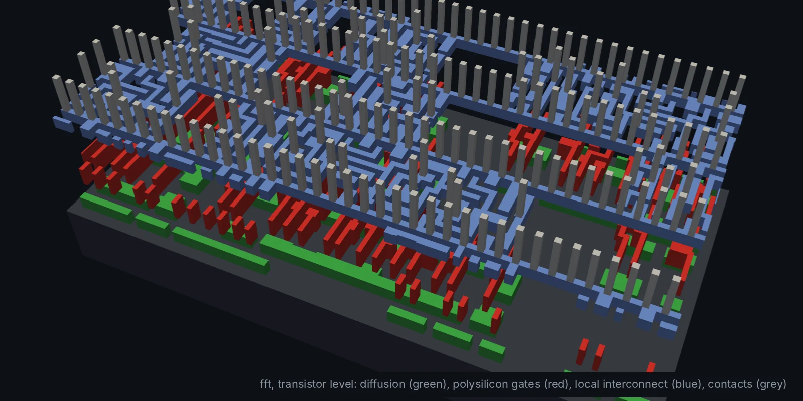
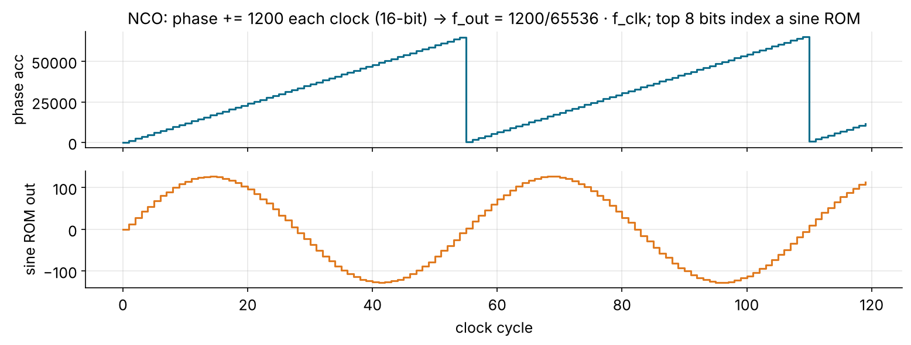
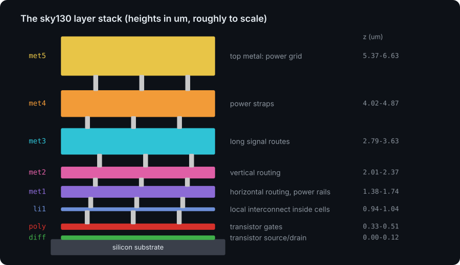
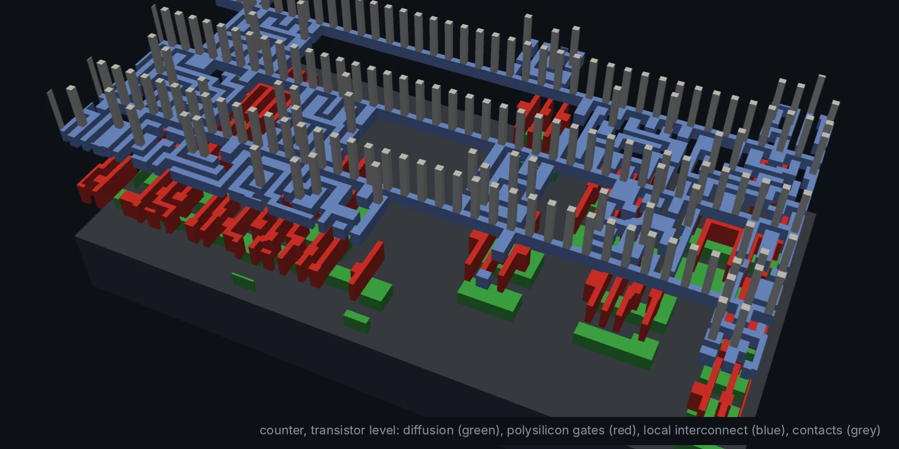

<!-- _class: lead -->
<!-- _paginate: false -->
<!-- _footer: '' -->



# Module 8
## Your own design and tapeout

**Hardware is the new Software**

Design: yours · Level: project · 1 to 2 weeks

---

## Goals

You have taken five designs from Verilog to GDS. Now you do it with **your
own** block, and learn what stands between a GDS and a chip in your hand:

- pick a project and write a **one-page spec** before any Verilog
- reuse the repo's skeleton: `designs/<name>`, `make check`, `make pnr`
- verify it properly: bit-exact model, known answers, edge cases
- understand **signoff**: DRC, LVS, antenna, timing corners
- understand the **harness**: pads, padframes, shuttles
- get it fabricated through **Tiny Tapeout**

---

## Step 1: write the spec first

A one-page spec answers, before you open an editor:

| Question                         | Example (NCO)                                       |
| -------------------------------- | --------------------------------------------------- |
| What does it do?                 | sine wave at a programmable frequency               |
| Interface (ports, handshake)     | `fcw[15:0]` in, `sine[7:0]` out, one sample/clock   |
| Number formats                   | phase: unsigned 16-bit; output: signed Q1.7         |
| Throughput and clock             | 1 sample per clock at 50 MHz                        |
| How will I know it works?        | FFT of the output: one peak at f_clk · fcw / 2¹⁶, spurs < −40 dB |
| Area / power budget              | fits a Tiny Tapeout tile                            |

If you cannot fill in the last two rows, you are not ready to write RTL.

---

## Project ideas (classic EE blocks)

| Project                     | Builds on        | What you learn                              |
| --------------------------- | ---------------- | ------------------------------------------- |
| **NCO / DDS** sine generator | counter, ROM     | phase accumulation, spurs, lookup tables    |
| **CORDIC** sin/cos/magnitude | fixed point      | shift-and-add iterations, pipelining        |
| **Sigma-delta DAC**          | PWM, IIR         | noise shaping, 1-bit outputs                |
| **CIC decimator**            | FIR              | multiplier-free filters, bit growth         |
| **UART / SPI** controller    | PWM, counters    | protocols, oversampling, FSMs               |
| **Goertzel** DTMF detector   | IIR, FFT         | single-bin DFT, real-world signals          |

Combine two: a UART that streams samples into your FIR, or an NCO feeding
the FFT.

---

## Example: the NCO in one picture



```verilog
always @(posedge clk) phase <= phase + fcw;          // phase accumulator
assign sine = sine_rom[phase[15:8]];                 // top 8 bits index a 256-entry ROM
```

f_out = f_clk · fcw / 2¹⁶. Phase truncation creates **spurs**; a quarter-wave
ROM plus symmetry cuts the table by 4×.

---

## Step 2: add it to the repo

```sh
cp -r designs/pwm designs/nco          # start from the closest example
cd designs/nco
# rename the module and files, then edit:
#   Makefile           TOP := nco, RTL := rtl/nco.v, TB := tb/nco_tb.v
#   orfs/config.mk     DESIGN_NAME, VERILOG_FILES, die size or CORE_UTILIZATION
#   orfs/constraint.sdc  current_design, clk_period
make sim lint synth                    # until PASS and no warnings
make synth-sky130 && make pnr          # then look at timing, area, power
cd ../.. && make check                 # CI runs this for every design
```

Optional: `python3 python/render_3d.py <6_final.gds> -o nco_3d.webp` for
your own 3D render.

---

## Step 3: verify like it is going to silicon

A respin costs months and money. Industry spends **more effort on
verification than on design**. At minimum:

1. **Known answers:** impulse, DC, a single tone, full-scale corners.
2. **Bit-exact model:** random stimulus vs. a model with identical arithmetic.
3. **Property checks:** "pwm_h & pwm_l is never 1", "count never jumps by 2".
4. **Reset and corner cases:** reset mid-operation, back-to-back valid, max values.
5. **Lint clean** with `-Wall`, and `make verilator` agrees with Icarus.

Next level: [cocotb](https://www.cocotb.org/) (Python testbenches) and
[SymbiYosys](https://symbiyosys.readthedocs.io/) (formal proofs of properties).

---

## Formal verification in one slide

```verilog
`ifdef FORMAL
    // The counter never jumps by more than 1
    always @(posedge clk)
        if (rst_n && $past(rst_n) && $past(en))
            assert (count == $past(count) + 1'b1);
`endif
```

```
[tasks]  prove
[options] prove: mode prove
[engines] smtbmc
[script]  read -formal counter.v ; prep -top counter
```

A simulation checks the cases you thought of. A **proof** checks every
possible input sequence, up to the depth you ask for, or by induction for all.

---

## Step 4: signoff, what `make pnr` does not prove

| Check        | Question it answers                                         | Tools                 |
| ------------ | ----------------------------------------------------------- | --------------------- |
| **DRC**      | Does every polygon obey the foundry's spacing/width rules?  | Magic, KLayout        |
| **LVS**      | Is the layout the same circuit as the netlist?              | Netgen                |
| **Antenna**  | Can long wires charge up and damage gates during etching?   | OpenROAD, Magic       |
| **STA, all corners** | Setup at slow corner, hold at fast corner           | OpenSTA               |
| **IR drop, EM** | Does the power grid deliver enough voltage and current?  | OpenROAD (PDNSim)     |

ORFS runs a subset of these; full flows like OpenLane add Magic DRC, Netgen
LVS and more. A shuttle will not accept a design that fails them.

---

## The physical layers you are signing off

<div class="cols">
<div>



</div>
<div>



DRC rules exist for every layer here: minimum width, spacing, enclosure of
vias, density. sky130 has hundreds of them; the PDK documents each.

</div>
</div>

---

## Step 5: the chip around your design

Your block is not a chip yet. It still needs:

- **I/O pads:** ESD protection, level shifting, drivers strong enough for a PCB
- a **padframe** that rings the die and connects pads to bond wires
- **power and ground** pads, and decoupling
- **clock** input, reset, maybe a PLL
- a way to **test** it: scan chains, a debug interface, or a simple mux

Shuttle programmes provide all of this as a **harness**: you deliver a block
with a fixed interface, they deliver the rest.

---

## Tiny Tapeout: the most accessible route

- Your design gets a **tile** on a shared chip with hundreds of other designs.
- Fixed interface: 8 inputs, 8 outputs, 8 bidirectional pins, clock, reset.
- Built on the **same open-source tools** as this course (Yosys, OpenROAD,
  a sky130-family PDK), with a GitHub template and CI that runs the flow.
- You receive a board with the chip and a microcontroller to talk to your
  design.

Every design in this course fits the idea: the counter, the PWM, even a
small FIR. Start at [tinytapeout.com](https://tinytapeout.com/).

---

## Mapping a course design to a Tiny Tapeout tile

```verilog
module tt_um_yourname_pwm (
    input  wire [7:0] ui_in,    // dedicated inputs   -> duty[7:0]
    output wire [7:0] uo_out,   // dedicated outputs  -> pwm_out, period_start
    input  wire [7:0] uio_in,   // bidirectional (unused here)
    output wire [7:0] uio_out,
    output wire [7:0] uio_oe,
    input  wire       ena,
    input  wire       clk,
    input  wire       rst_n
);
    wire pwm_out, period_start;
    pwm #(.WIDTH(8)) u_pwm (.clk(clk), .rst_n(rst_n), .duty(ui_in),
                            .pwm_out(pwm_out), .period_start(period_start));
    assign uo_out  = {6'b0, period_start, pwm_out};
    assign uio_out = 8'b0;
    assign uio_oe  = 8'b0;
endmodule
```

Check the current template for exact port names before you submit.
**Module 10** does all of this for the FIR: [11-tinytapeout.md](11-tinytapeout.md).

---

## Where to go next

| Topic                         | Resource                                           |
| ----------------------------- | -------------------------------------------------- |
| every open-source tool, by job | [docs/tools.md](../docs/tools.md)                 |
| Verilog fluency               | [HDLBits](https://hdlbits.01xz.net/)               |
| DSP architecture              | Parhi, *VLSI Digital Signal Processing Systems*    |
| practical FPGA/ASIC + formal  | [ZipCPU blog](https://zipcpu.com/)                 |
| flow variables and tuning     | [ORFS docs](https://openroad-flow-scripts.readthedocs.io/) |
| trainings and chip centres    | [kiip.ee](https://kiip.ee/en/trainings/)           |
| fabrication                   | [Tiny Tapeout](https://tinytapeout.com/)           |

---

<!-- _class: exercise -->

## The project

1. Write the one-page spec (slide 3). Get feedback before writing RTL.
2. Add `designs/<name>` with RTL, a self-checking testbench and a model.
3. `make check` passes: lint clean, `PASS`, synthesis without surprises.
4. `make pnr` passes with positive slack and 0 DRC violations. Add your
   numbers to the Module 7 scoreboard.
5. Write a README for your design: what it is, the interface, results, one
   picture.
6. **Stretch:** wrap it for Tiny Tapeout, run their CI, and submit
   (Module 10 walks through it with the FIR).

---

## Course takeaways

- **Hardware is the new Software:** text files, `make`, CI, open tools.
- The flow is always the same: **sim → lint → synth → P&R → signoff**.
- Architecture is a trade-off: **fold** for area, **parallelise** and
  **pipeline** for speed, **normalise** before you compare.
- Fixed point is a design decision for **every** signal.
- Verification is most of the work, and the only proof you have.
- You can now take a block from an idea to a GDS. **Go tape one out.**

---

<!-- quiz: generated by slides/answers/make_quizzes.py on the quiz-answers branch -->
<!-- _class: quiz -->

## Quiz (1/2)

1. Which signoff check answers "is the layout the same circuit as the netlist?"
   <span class="opts">**A** DRC &nbsp;·&nbsp; **B** LVS &nbsp;·&nbsp; **C** antenna &nbsp;·&nbsp; **D** STA</span>
2. What does the antenna check protect against? <span class="sa">*(short answer)*</span>
3. An NCO has a 16-bit phase accumulator at f_clk = 50 MHz. What fcw gives about 1 MHz out?
   <span class="opts">**A** 50 &nbsp;·&nbsp; **B** 656 &nbsp;·&nbsp; **C** 1311 &nbsp;·&nbsp; **D** 13107</span>
4. Why does a quarter-wave sine ROM make the table 4× smaller? <span class="sa">*(short answer)*</span>

---


<!-- _class: quiz -->

## Quiz (2/2)

5. A simulation passes. A formal proof of the same property also passes. What does the proof add? <span class="sa">*(short answer)*</span>
6. What is the fixed I/O of a Tiny Tapeout tile?
   <span class="opts">**A** 8 in, 8 out, 8 bidirectional, clk, rst_n &nbsp;·&nbsp; **B** 16 in, 16 out &nbsp;·&nbsp; **C** one SPI port &nbsp;·&nbsp; **D** 32 GPIO and a CPU bus</span>
7. In the `tt_um_yourname_pwm` wrapper, why is `uio_oe` set to `8'b0`? <span class="sa">*(short answer)*</span>
8. The spec rows "How will I know it works?" and "Area / power budget" are empty. What should you do?
   <span class="opts">**A** start the RTL anyway &nbsp;·&nbsp; **B** fill them in before writing RTL &nbsp;·&nbsp; **C** skip verification &nbsp;·&nbsp; **D** make the design bigger</span>

> Answer on paper first, then check yourself against the answer key on the `quiz-answers` branch (`slides/answers/`).
