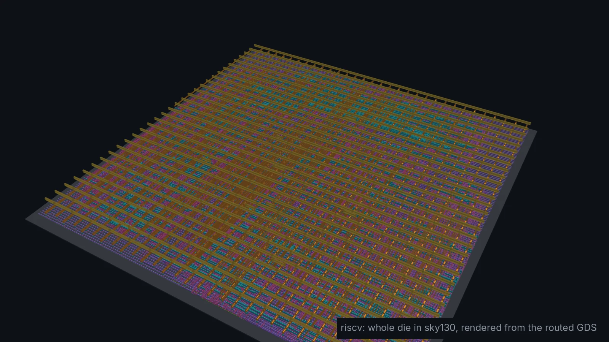
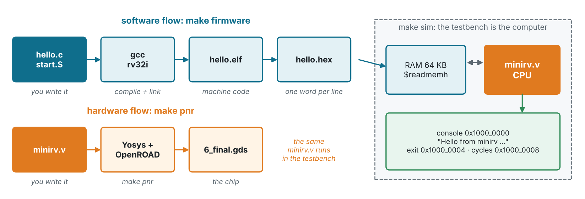
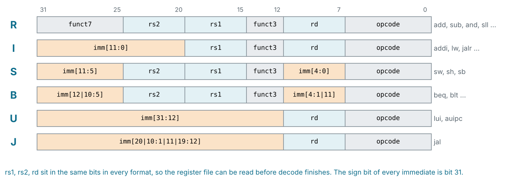
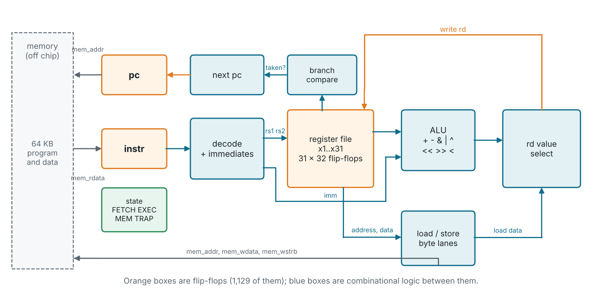
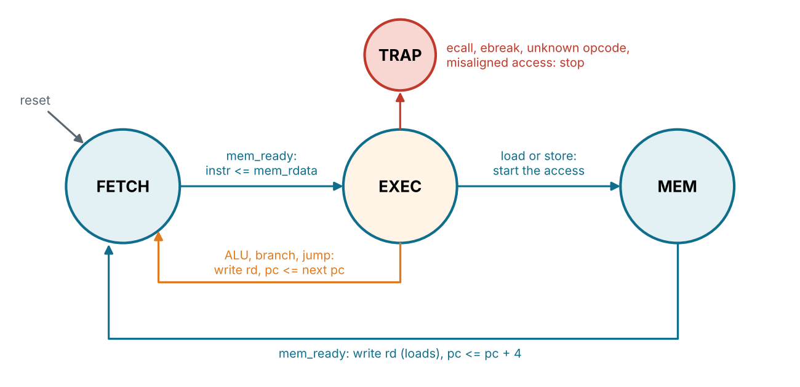
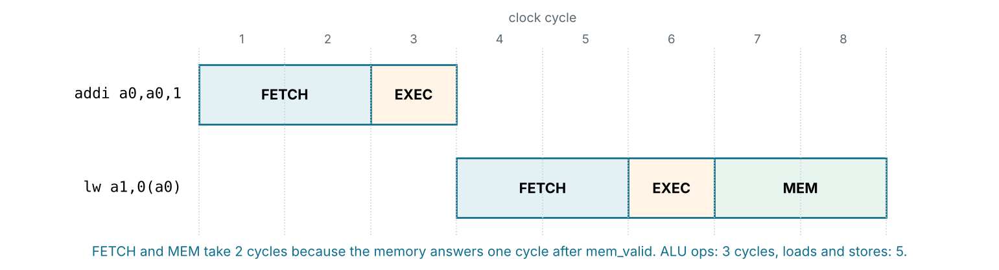
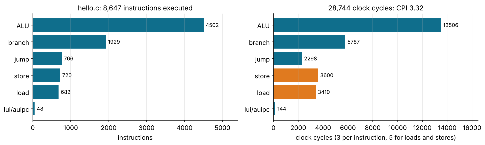
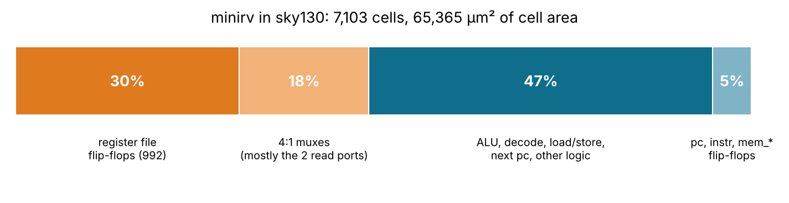
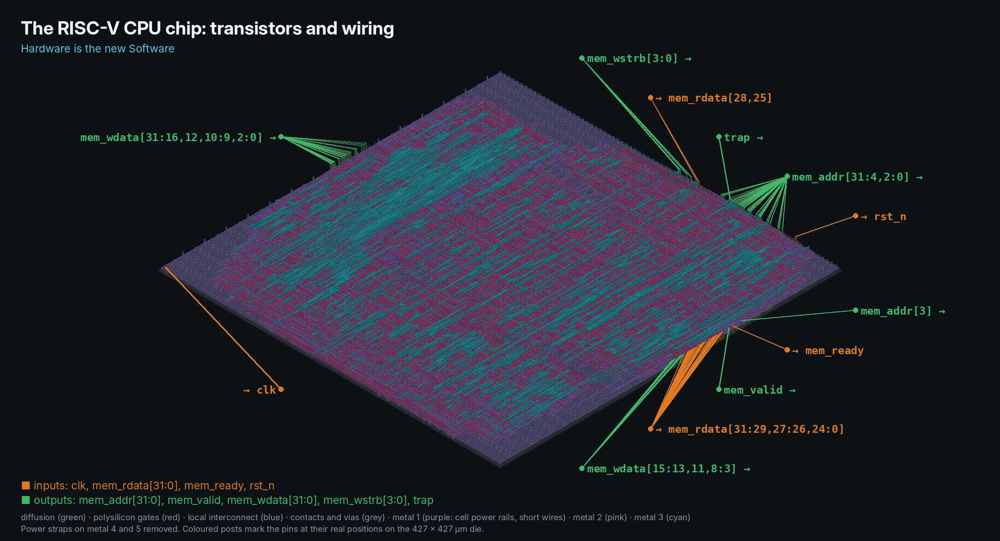
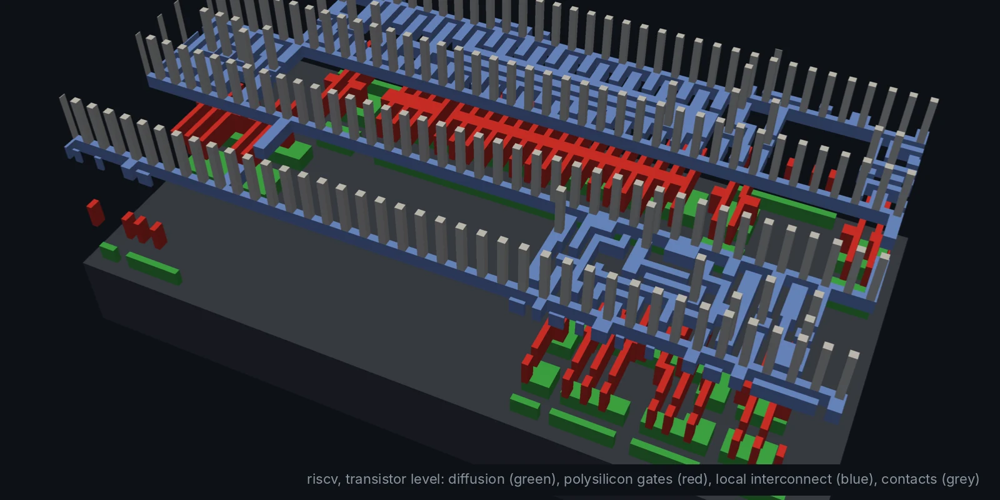

<!-- _class: lead -->
<!-- _paginate: false -->
<!-- _footer: '' -->



# Module 9
## A RISC-V CPU that runs C

**Hardware is the new Software**

Design: `designs/riscv` · Level: advanced · 6 to 8 hours

---

## Goals

Every design so far did one fixed job. A **CPU** does whatever the
software tells it to. In this module you:

- read a real instruction set (**RV32I**) and see how it maps to gates
- follow one instruction through a **multi-cycle** datapath, clock by clock
- compile **C with gcc** and run it on your own Verilog
- verify a CPU with **self-checking programs**, not waveforms
- take the CPU through **sky130 place and route**: 6,248 cells on a 427 × 427 µm die

---

## Hardware is the new Software, literally



Two compilers, one repo: `gcc` turns C into machine code, Yosys and
OpenROAD turn Verilog into a chip. `make sim` runs one on the other.

---

## Why RISC-V

- An **open** instruction set: anyone may build a RISC-V CPU, no licence
- Used from tiny microcontrollers (ESP32-C3, GD32V) to server chips
- **RV32I**, the base: 32 registers × 32 bits, 37 instructions a C compiler
  needs (+ `fence`, `ecall`, `ebreak`)
- Everything else is an optional extension: **M** (multiply/divide),
  **C** (16-bit compressed), **F/D** (floating point), **A** (atomics)

| Register | ABI name | Used for |
| --- | --- | --- |
| x0 | zero | always 0: writes are ignored |
| x1, x2 | ra, sp | return address, stack pointer |
| x10–x17 | a0–a7 | function arguments and return values |
| x5–x7, x28–x31 | t0–t6 | temporaries |

---

## Six instruction formats, one decoder



The register fields never move, and the immediate's sign bit is always
bit 31. RISC-V was designed to make *this* hardware small.

---

## Decoding in Verilog: just wires

```verilog
wire [6:0] opcode = instr[6:0];
wire [4:0] rd     = instr[11:7];
wire [2:0] funct3 = instr[14:12];
wire [4:0] rs1    = instr[19:15];
wire [4:0] rs2    = instr[24:20];

wire [31:0] imm_i = {{21{instr[31]}}, instr[30:20]};
wire [31:0] imm_s = {{21{instr[31]}}, instr[30:25], instr[11:7]};
wire [31:0] imm_b = {{20{instr[31]}}, instr[7], instr[30:25], instr[11:8], 1'b0};
wire [31:0] imm_u = {instr[31:12], 12'b0};
wire [31:0] imm_j = {{12{instr[31]}}, instr[19:12], instr[20], instr[30:21], 1'b0};
```

Slicing and sign extension cost **no gates at all**: they are routing.
The scrambled B and J bits are there so the hardware never has to move a bit.

---

## The datapath



---

## One instruction at a time: the state machine

<div class="cols"><div>



</div><div>

- **FETCH** waits for the memory to return the instruction
- **EXEC** does all the work of ALU, branch and jump instructions in one cycle
- **MEM** only for loads and stores
- **TRAP** stops the CPU: `ebreak`, unknown opcodes, misaligned accesses

Simple beats fast here: every signal is easy to follow in GTKWave.

</div></div>

---

## Clock by clock



- **CPI** (cycles per instruction) = 3 for most instructions, 5 for memory
- At 50 MHz that is about **15 million instructions per second**
- A 5-stage pipeline gets close to CPI 1, at the cost of more logic and hazard handling:
  see the exercises

---

## Register file and ALU (slightly simplified)

```verilog
reg  [31:0] regs [1:31];                       // x0 is not stored at all
wire [31:0] rs1_val = (rs1 == 5'd0) ? 32'd0 : regs[rs1];
wire [31:0] rs2_val = (rs2 == 5'd0) ? 32'd0 : regs[rs2];

wire [31:0] alu_b = is_reg ? rs2_val : imm_i;  // add or addi: same ALU
always @* case (funct3)
    3'b000: alu_out = (is_reg && alt) ? rs1_val - alu_b : rs1_val + alu_b;
    3'b001: alu_out = rs1_val << alu_b[4:0];
    3'b010: alu_out = {31'd0, $signed(rs1_val) < $signed(alu_b)};
    3'b011: alu_out = {31'd0, rs1_val < alu_b};
    3'b100: alu_out = rs1_val ^ alu_b;
    3'b101: alu_out = alt ? $signed(rs1_val) >>> alu_b[4:0] : rs1_val >> alu_b[4:0];
    3'b110: alu_out = rs1_val | alu_b;
    default: alu_out = rs1_val & alu_b;
endcase
```

`funct3` picks the operation for both `add` and `addi`. One ALU serves
19 instructions.

---

## Loads and stores: byte lanes

Memory is 32 bits wide. A byte or halfword lives in one **lane** of the
word, chosen by the low address bits:

```verilog
// sb x5, 2(x6): the byte goes to lane 2, only that byte is written
wire [31:0] st_data = (funct3[1:0] == 2'b00) ? {4{rs2_val[7:0]}}  :
                      (funct3[1:0] == 2'b01) ? {2{rs2_val[15:0]}} : rs2_val;
wire [3:0]  st_strb = (funct3[1:0] == 2'b00) ? (4'b0001 << ls_byte) :
                      (funct3[1:0] == 2'b01) ? (4'b0011 << ls_byte) : 4'b1111;

// lb / lbu: shift the lane down, then sign- or zero-extend
wire [31:0] ld_shift = mem_rdata >> {ls_byte, 3'b000};
```

The same idea, `wstrb` byte enables, is in AXI, AHB and most SRAMs.

---

## The memory interface and memory map

<div class="cols"><div>

**valid / ready**, the handshake from Module 4:

| Signal | Dir | |
| --- | --- | --- |
| `mem_valid` | out | an access is wanted |
| `mem_addr` | out | word address |
| `mem_wdata` | out | store data |
| `mem_wstrb` | out | byte enables, 0 = read |
| `mem_ready` | in | access done |
| `mem_rdata` | in | load data |

All outputs come straight from flip-flops.

</div><div>

The testbench builds a tiny "SoC":

| Address | |
| --- | --- |
| `0x0000_0000` | 64 KB RAM: code, data, stack |
| `0x1000_0000` | console: write a byte |
| `0x1000_0004` | exit code |
| `0x1000_0008` | cycle counter |

No operating system, no C library. `printf` is a store to an address.

</div></div>

---

## Bare-metal C: start-up code and a linker script

```asm
_start:
    la      sp, _stack_top          # stack pointer: top of RAM
    la      t0, _bss_start          # zero .bss (globals without an initial value)
    la      t1, _bss_end
1:  bgeu    t0, t1, 2f
    sw      zero, 0(t0)
    addi    t0, t0, 4
    j       1b
2:  call    main                    # a0 = main's return value
    li      t0, 0x10000004          # write it to the exit register
    sw      a0, 0(t0)
```

```sh
make firmware   # riscv64-unknown-elf-gcc -march=rv32i -mabi=ilp32 -Os
                #   -> hello.elf -> hello.hex (one word per line) + hello.lst
```

---

## hello.c running on minirv

```text
$ make sim
isa_test: exit 0 after 217 instructions, 686 cycles (CPI 3.16)

Hello from minirv, a RISC-V CPU written in Verilog!
Hardware is the new Software.

Fibonacci: 1 1 2 3 5 8 13 21 34 55 89 144

  ok    fib(30) = 832040
  ok    10! = 3628800 (software multiply)
  ok    1000000 / 7 = 142857 (software divide)
  ok    25 primes below 100
  ok    sort 10 numbers
  ok    crc32("Hardware is the new Software")

That took 25599 clock cycles.
hello: exit 0 after 8647 instructions, 28744 cycles (CPI 3.32)
PASS: isa_test, hello.c and ebreak, 0 errors
```

---

## No multiplier? Software does it

RV32I has no `mul`. gcc calls `__mulsi3` from libgcc, shift-and-add in
eight instructions (from `firmware/hello.lst`):

```text
0000048c <__mulsi3>:
 48c:  mv    a2,a0          # a2 = multiplicand
 490:  li    a0,0           # a0 = result
 494:  andi  a3,a1,1        # lowest bit of the multiplier set?
 498:  beqz  a3,4a0
 49c:  add   a0,a0,a2       #   then add
 4a0:  srli  a1,a1,0x1
 4a4:  slli  a2,a2,0x1
 4a8:  bnez  a1,494         # until no bits are left
 4ac:  ret
```

This is the **hardware/software trade-off**: a 32×32 multiplier costs
thousands of cells; the loop costs tens to hundreds of cycles per multiply. The M
extension exercise moves this loop into hardware.

---

## Verifying a CPU

Three programs, each one checks itself:

1. **`isa_test.S`**: every instruction against the RISC-V spec. `gp`
   counts the checks; the first mismatch exits with its number.
2. **`hello.c`**: real compiled code: calls, recursion, stack, globals,
   libgcc. `main` returns the number of failed checks.
3. **`ebreak`**: the CPU must stop with `trap` high.

Break the RTL on purpose and the test points at the bug:

```text
# make SRA do a logical shift instead
ERROR isa_test: exit code 16      <- check 16 in isa_test.lst: srai a2,a0,31
```

To debug, `vvp build/sim +trace` prints every instruction as it executes.

---

## What does C actually run?



Over half the instructions are ALU operations, and nearly 1 in 3 is a
branch or jump. Loads and stores are 16% of the instructions but 24% of the time.

---

## Synthesis: where the area goes



The **register file is about half the CPU**: 992 flip-flops plus two 32-way
read multiplexers. Real chips use an SRAM-style register file macro, and
RV32E (16 registers) exists to halve it.

---

## The CPU in sky130

<div class="cols"><div>



</div><div>

| | minirv |
| --- | --- |
| Cells | 6,248 |
| Die | 427 × 427 µm |
| Clock | 50 MHz |
| Worst slack | +9.43 ns |
| Power | 7.4 mW |
| DRC | 0 |

The 105 pins are mostly the memory bus: the RAM lives off chip.

</div></div>

---

## Down to the transistors



Every `add` your C program does goes through gates like these.

---

<!-- _class: exercise -->

## Exercises

1. Run `vvp build/sim +trace` and follow the first ten instructions of
   `isa_test` in `isa_test.lst`. Which state is the CPU in at each clock?
2. Write your own C program (blink a "LED" register, sum an array) and run it.
3. Add the **M extension** (`mul`, `mulh`, `div`, `rem`): compile with
   `-march=rv32im`, compare cycles and area with the software version.
4. Add a `rdcycle` CSR instruction and read it from C instead of the
   memory-mapped counter.
5. Answer the memory in the same cycle: what happens to CPI? To timing?
6. **Stretch:** a 3-stage pipeline (fetch / execute / memory). Handle
   branches by flushing; measure CPI on `hello.c` and the new fmax.

---

## Key takeaways

- A CPU is **a datapath plus a state machine**: the same building blocks
  as the FIR and the FFT, made general by an instruction register
- The **instruction set is an interface** between software and hardware:
  gcc and your Verilog only have to agree on it
- What you leave out of the hardware, software must do (`__mulsi3`)
- Verify CPUs with **self-checking programs**; a failing check number
  points at the broken instruction
- The register file dominates a small CPU's area

> **Hardware is the new Software.** Here they meet: C compiled by gcc,
> running on Verilog you wrote, laid out in sky130 by open-source tools.
