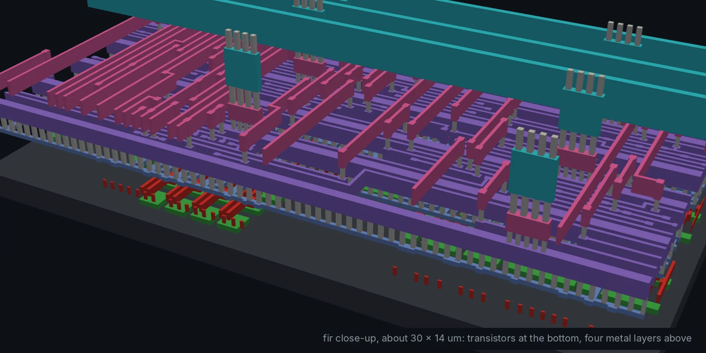
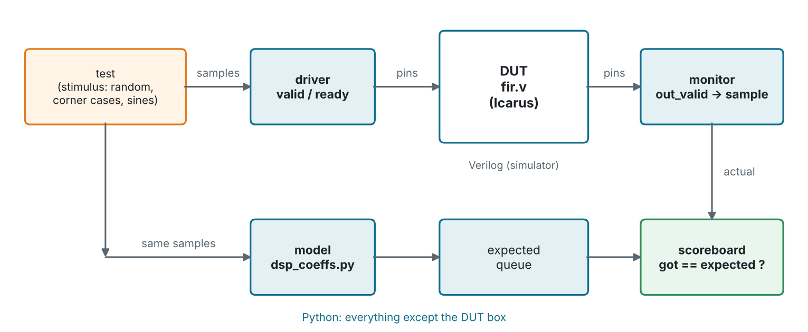
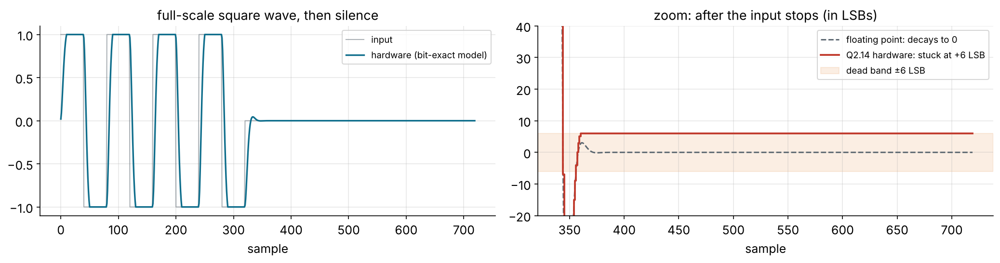
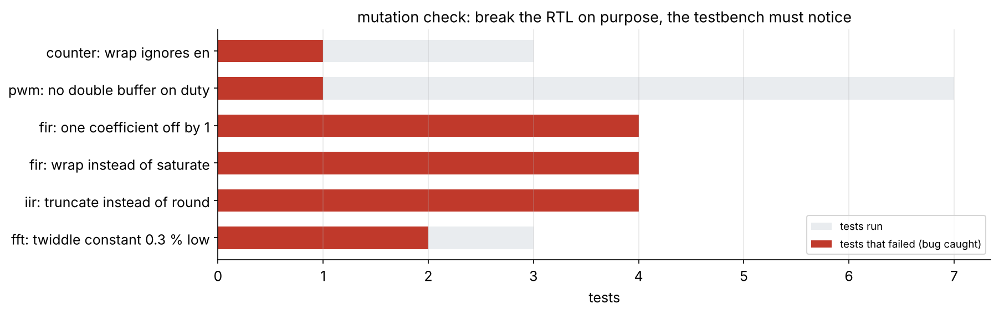

<!-- _class: lead -->
<!-- _paginate: false -->
<!-- _footer: '' -->



# Side module
## Verification with cocotb

**Hardware is the new Software**

Designs: all five · Level: core · 2 to 3 hours · best after Module 4

---

## Goals

Software is tested by scripts. So is hardware, and the script can be
**Python**.

- write testbenches for Verilog designs in Python with **cocotb**
- structure them the industrial way: **driver, monitor, model, scoreboard**
- reuse the filter-design code as the **golden model**
- random stimulus you can **replay** from a seed
- prove the testbench works by **breaking the RTL on purpose**
- run it all in **CI** on every push

---

## Why verification gets half the budget

- A respin of a chip costs months and, in advanced nodes, millions.
  There is no "patch it in the next release".
- In industry, **more engineers verify chips than design them**.
- A testbench that passes proves nothing until you know what it **would have
  caught**.

> The job is not to show that the design works. It is to find the input
> that makes it fail before the silicon does.

---

## What cocotb is

<div class="cols">
<div>

- An open-source Python library (cocotb 2.0)
- The **simulator** (Icarus) runs the Verilog
- cocotb attaches through VPI and runs **your Python coroutines** next to it
- Simulation time moves only while Python is `await`ing

</div>
<div>

```python
@cocotb.test()
async def test_reset(dut):
    dut.en.value = 0
    await start(dut)          # clock + reset
    await ClockCycles(dut.clk, 5)
    await ReadOnly()
    assert dut.count.value == 0
```

</div>
</div>

---

## Run it

```sh
pip install -r python/requirements-verif.txt     # cocotb + numpy
cd designs/fir
make cocotb                                      # every test in cocotb/test_fir.py
make cocotb COCOTB_TEST_FILTER=test_impulse      # one test
make cocotb COCOTB_RANDOM_SEED=1234              # replay a random run
make cocotb WAVES=1                              # waveform in build/cocotb/
make -C ../.. check-cocotb                       # all designs, what CI runs
```

```
** test_fir.test_impulse              PASS        3615.00   0.02 **
** test_fir.test_random_bit_exact     PASS       89595.00   0.51 **
** test_fir.test_saturation           PASS        8205.00   0.04 **
** test_fir.test_frequency_response   PASS      130645.00   0.73 **
** TESTS=4 PASS=4 FAIL=0 SKIP=0                 232060.00   1.31 **
```

---

## The shape of every testbench here



Only the DUT is Verilog. Everything that **decides pass or fail** is Python.

---

## Timing: when to drive, when to look

<div class="cols">
<div>

- **Drive** inputs on the **falling** edge: half a clock away from the
  rising edge where flip-flops sample them. No races.
- **Read** outputs after `await ReadOnly()`: every signal has settled for
  this time step.
- A **combinational** output (`wrap`) is checked *before* the edge; a
  **registered** one (`count`) *after* it.

</div>
<div>

```python
dut.en.value = int(en)        # after FallingEdge
await ReadOnly()
assert dut.wrap.value == (en and model == mask)

await RisingEdge(dut.clk)
if en:
    model = (model + 1) & mask
await ReadOnly()
assert dut.count.value == model
await FallingEdge(dut.clk)
```

</div>
</div>

---

## The driver: valid / ready in Python

```python
async def send(self, sample, gap=0):
    for _ in range(gap):                       # optional idle cycles
        await FallingEdge(dut.clk)
    while True:                                # wait until the FIR can take it
        await FallingEdge(dut.clk)
        if dut.in_ready.value == 1:
            break
    dut.in_sample.value = sample
    dut.in_valid.value = 1
    self.expected.append(self.model.push(sample))   # predict the answer now
    await FallingEdge(dut.clk)
    dut.in_valid.value = 0
```

Random gaps (`gap=random.choice([0, 0, 0, 3, 20])`) exercise the handshake
in ways a fixed testbench never does.

---

## The model *is* the design script

```python
import dsp_coeffs
H = [int(c) for c in dsp_coeffs.quantise_fir(dsp_coeffs.design_fir())]

class FirModel:
    def push(self, sample):
        self.x = [sample] + self.x[:-1]
        acc = sum(h * x for h, x in zip(H, self.x))
        return saturate((acc + (1 << 14)) >> 15)    # round, Q1.15, saturate
```

- Change the filter in `dsp_coeffs.py` and forget the ROM in `fir.v`:
  **the test fails**. The Verilog testbench had its own copy of the
  coefficients, so it would have passed.
- Python's `>>` on negative integers is arithmetic, exactly like `>>>`.

---

## Measuring |H(f)| on the hardware

```python
x = [q15(0.5 * np.sin(2 * np.pi * f * i)) for i in range(256)]
...                                   # send x, collect y from the monitor
basis = np.column_stack([np.sin(2*np.pi*f*t), np.cos(2*np.pi*f*t)])
gain = np.hypot(*np.linalg.lstsq(basis, y, rcond=None)[0]) / 0.5
```

| f (× fs) | FIR measured | ideal | IIR measured | ideal |
| -------: | -----------: | ----: | -----------: | ----: |
| 0.02 / 0.01 | 0.9804 | 0.9804 | 0.9992 | 0.9992 |
| 0.10 / 0.05 | 0.5118 (−5.8 dB) | 0.5118 | 0.7071 (−3.0 dB) | 0.7070 |
| 0.30 / 0.20 | 0.0009 (−60.5 dB) | 0.0009 | 0.0475 (−26.5 dB) | 0.0475 |

numpy does the signal processing; the simulator only provides the samples.

---

## A monitor that thinks in periods (PWM)

<div class="cols">
<div>

```python
class PeriodMonitor:
    async def _run(self):
        while True:
            await RisingEdge(dut.clk)
            duty_at_edge = int(dut.duty.value)
            await ReadOnly()
            high += int(dut.pwm_out.value)
            if dut.period_start.value == 1:
                self.periods.append((expected, high))
                expected, high = duty_at_edge, 0
```

</div>
<div>

- Runs in the background (`cocotb.start_soon`) for the whole test.
- Turns 256 pin values into **one transaction**: "high for N cycles,
  expected M".
- The test changes `duty` at **random moments, even mid-period**, and checks
  every period is exactly the latched value: no glitch.

</div>
</div>

---

## Parametrised tests

```python
@cocotb.test()
@cocotb.parametrize(duty=[0, 1, 64, 128, 200, 255])
async def test_duty(dut, duty):
    ...
```

```
** test_pwm.test_duty/duty=0      PASS **
** test_pwm.test_duty/duty=1      PASS **
** test_pwm.test_duty/duty=64     PASS **
...
** test_pwm.test_no_glitch        PASS **
```

One function, six tests, each reported separately. The corner cases
(0 and 255) are listed explicitly, not left to luck.

---

## Not bit-exact? Measure the error instead (FFT)

- The FFT truncates in each of its 3 stages, so it cannot match
  `numpy.fft.fft(x) / 8` bit for bit.
- The test accepts **≤ 3 LSB** per output, and measures quality the way a
  DSP engineer would: **signal-to-quantisation-noise ratio**.

```
200 frames: max error 1.98 LSB, SQNR 80.1 dB
```

- Every truncating stage adds noise and a small negative bias. Rounding
  instead (Module 6, Exercise 3) should raise the SQNR: this test measures it.

---

## A real finding: the IIR dead band



After overload and silence the biquad **never returns to 0**: it stops at
**+6 LSB** forever. Bit-exact with the model, so not an RTL bug.

---

## Why it sticks at 6

With x = 0 and a constant output y, the next output is

$$y' = \mathrm{round}\big((-a_1 - a_2)\,y\big) = \mathrm{round}(0.92\,y)$$

| y | 0.92 y | rounded | stuck? |
| -: | -----: | ------: | :----: |
| 6 | 5.52 | 6 | **yes** |
| 7 | 6.44 | 6 | no, drops to 6 |
| 12 | 11.04 | 11 | no |

A **granular limit cycle**. The test computes this dead band from the
coefficients and asserts the output ends inside it. Removing it is Exercise 3.

---

## Does the testbench catch bugs? Mutate the RTL



Only the random glitch test catches the PWM bug: constant-duty tests can
**never** see it.

---

## Verilog testbench or cocotb?

| | Verilog `tb/*.v` | cocotb `cocotb/*.py` |
| - | - | - |
| Reference model | rewritten in Verilog | reuse numpy and design scripts |
| Random stimulus | `$random` | `random`, seed printed, replayable |
| Speed | fastest | slower; fine for block tests |
| Simulators | any | Icarus, Verilator 5.036+, commercial |
| In industry | small blocks | open source, startups; UVM in big companies |

Use both. This repo runs both in CI.

---

## In CI, on every push

```yaml
cocotb:
  name: cocotb testbenches (Python)
  runs-on: ubuntu-24.04
  steps:
    - uses: actions/checkout@v4
    - uses: actions/setup-python@v5
      with: { python-version: "3.12" }
    - run: sudo apt-get install -y --no-install-recommends iverilog
    - run: pip install -r python/requirements-verif.txt
    - run: make check-cocotb
```

A pull request that breaks any test shows a red cross before anyone merges
it. All five designs run in about 10 seconds.

---

<!-- _class: exercise -->

## Exercises

1. **Mutate.** Make a one-character change to any RTL that you think is
   subtle. If `make cocotb` still passes, write the test that catches it.
2. **Coverage by hand.** In `test_counter.py`, count the cycles where the
   counter is at its maximum and `en` is low. How often does that happen?
   Bias the stimulus so it does.
3. **Kill the dead band.** In a copy of `iir.v`, round toward zero or keep
   2 extra fraction bits in the y state. Update `BiquadModel`, and make
   `test_overload_recovers` demand an exact 0.
4. **Parseval.** In `test_fft.py`, check that output energy equals input
   energy / 8 for a sine on every bin.
5. **Your design.** Add `cocotb/test_<name>.py` to your Module 8 design;
   `make check-cocotb` picks it up.

---

## Key takeaways

- cocotb: Verilog design, **Python testbench**, same simulator.
- Structure: **driver → DUT → monitor → scoreboard ← model**.
- The best model is the **code that designed the algorithm**.
- Random stimulus finds what you did not think of; the **seed** makes it
  repeatable.
- Bit-exact where you can, **measured error** (SQNR, |H(f)|) where you
  cannot.
- A testbench is only as good as the bugs it catches: **mutate** to find out.
