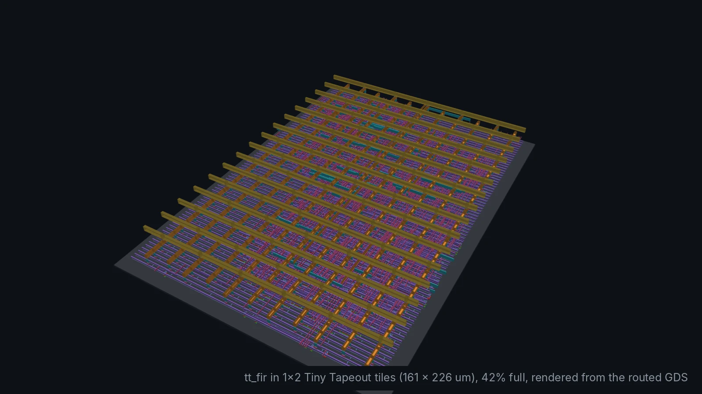
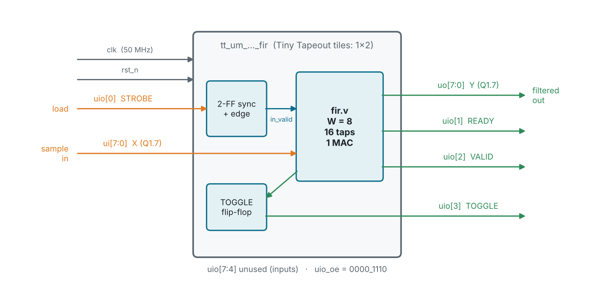
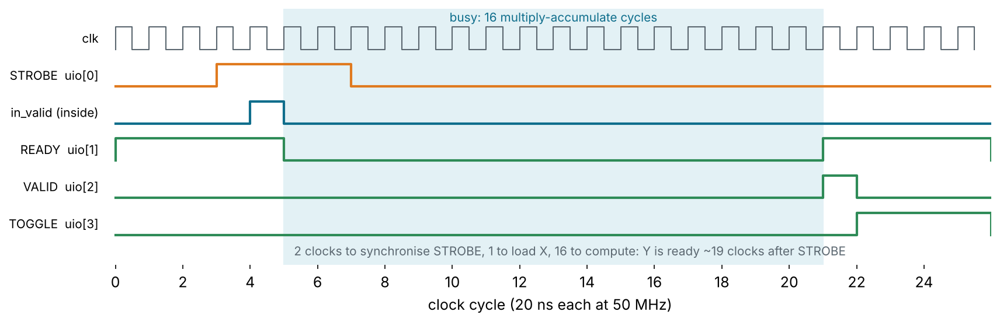
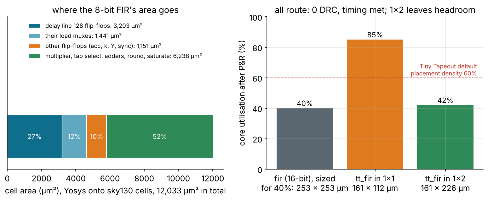
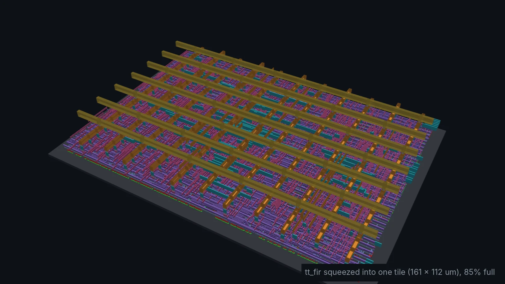

<!-- _class: lead -->
<!-- _paginate: false -->
<!-- _footer: '' -->



# Module 10
## Capstone: your FIR on a real chip

**Hardware is the new Software**

Design: `tt_fir` · Level: project · 1 week

---

## Goals

In Module 4 the FIR was a block with whatever ports it liked, on a die
sized to fit it. A chip on a shared shuttle gets neither. In this module you:

- fit a course design to a **fixed pinout**: 8 in, 8 out, 8 bidirectional
- bring a signal from the **outside world** safely into the clock domain
- make the design fit a **tile of fixed size**, and measure how full it is
- test it **only through its pins**, in Verilog and in Python (cocotb)
- package it as a **Tiny Tapeout project** and know what their CI checks

Everything is in `designs/tt_fir`. The filter core is `designs/fir/rtl/fir.v`,
unchanged.

---

## What Tiny Tapeout gives you

<div class="cols">
<div>

- Hundreds of designs share **one die**; each gets one or more **tiles**.
- A tile on sky130 is **161 × 111.5 µm**. You can buy 1x1, 1x2, 2x2 ... 8x2.
- A multiplexer on the chip connects **one design at a time** to the pins.
- The demo board has an RP2040 that drives the clock, reset and inputs and
  reads the outputs, plus DIP switches and a 7-segment display.
- A GitHub **template** and **Actions** run the whole flow for you.

</div>
<div>

| Pin | Count |
| --- | --- |
| `ui_in` | 8 inputs |
| `uo_out` | 8 outputs |
| `uio_*` | 8 bidirectional, each with an output enable |
| `clk`, `rst_n` | shared clock and active-low reset |
| `ena` | 1 while your design is selected |

</div>
</div>

---

## Problem 1: 16-bit samples, 8-bit pins

`fir.v` was written with a width parameter, so the cheapest fix is free:

```verilog
fir #(.W(8)) u_fir (            // Q1.7 samples instead of Q1.15
    .clk(clk), .rst_n(rst_n),
    .in_valid(strobe_rise), .in_ready(in_ready), .in_sample(ui_in),
    .out_valid(out_valid), .out_sample(out_sample));
```

| | 16-bit FIR | 8-bit FIR |
| --- | ---: | ---: |
| delay line | 256 flip-flops | 128 flip-flops |
| multiplier | 16 × 16 | 8 × 16 |
| accumulator | 36 bits | 28 bits |
| cell area | 25,200 µm² | 12,000 µm² |
| output noise floor | −90 dB | −42 dB |

The coefficients stay Q1.15. Only the samples lose bits.

---

## The pinout



Write it down in `info.yaml` too: the shuttle's datasheet is generated from it.

---

<!-- _class: small -->

## Problem 2: STROBE is asynchronous

A button or a microcontroller pin can change **at any time** relative to
`clk`. If it changes inside a flip-flop's setup/hold window, the flip-flop
can go **metastable**: neither 0 nor 1 for a while.

```verilog
reg [2:0] strobe_sync;          // [0],[1] synchroniser, [2] previous value
always @(posedge clk or negedge rst_n)
    if (!rst_n) strobe_sync <= 3'b000;
    else        strobe_sync <= {strobe_sync[1:0], uio_in[0]};

wire strobe_rise = strobe_sync[1] & ~strobe_sync[2];   // one clock wide
```

- The first flip-flop may go metastable; it has a **whole clock period** to
  settle before the second one samples it.
- The edge detector turns a long press into **exactly one** `in_valid`, so
  one press loads one sample.
- `ui_in` is not synchronised: the protocol says X is held steady while
  STROBE is high, so it is stable when it is loaded.

---

## The handshake, cycle by cycle



- The cycle numbers come from simulating the RTL.
- VALID is one clock (20 ns) wide: a microcontroller polling the pins will
  miss it. **TOGGLE** flips once per result, so the reader only has to see
  that it changed.

---

## The top module

```verilog
module tt_um_chipcourse_fir (
    input  wire [7:0] ui_in,   output wire [7:0] uo_out,
    input  wire [7:0] uio_in,  output wire [7:0] uio_out,  output wire [7:0] uio_oe,
    input  wire ena, input wire clk, input wire rst_n);
    ...
    assign uo_out  = out_sample;
    assign uio_out = {4'b0000, toggle, out_valid, in_ready, 1'b0};
    assign uio_oe  = 8'b0000_1110;          // uio[3:1] outputs, the rest inputs

    wire _unused = &{ena, uio_in[7:1], 1'b0};   // keep the linter quiet
endmodule
```

Rules from the template: the name starts with `tt_um_` and contains your
GitHub name, **every output is driven**, and unused inputs are listed so
the linter does not warn.

---

## Problem 3: does it fit?



The delay line (flip-flops plus the multiplexers that load them) is
almost 40% of the design.

---

<!-- _class: small -->

## One tile vs. two tiles

<div class="cols">
<div>



**1x1**, 161 × 112 µm: 85% full. Routes in ORFS with 0 DRC and +10 ns slack, but Tiny Tapeout's flow places at 60% density and reserves room for its own pins and power: too tight to rely on.

</div>
<div>


**1x2**, 161 × 226 µm: 42% full, the same timing. This is what `info.yaml` asks for. It costs two tiles.

</div>
</div>

---

## Check the fit yourself

```make
# designs/tt_fir/orfs/config.mk: a fixed die, not CORE_UTILIZATION,
# because the tile size is what you buy.
export DIE_AREA   = 0 0 161.00 225.76          # 1x2
export CORE_AREA  = 2.76 2.72 158.24 223.04
export PLACE_DENSITY = 0.60
```

```
$ make pnr
...
Design area 14320 um^2 42% utilization.
worst slack max 9.80                 # at 20 ns = 50 MHz
setup violation count 0
hold violation count 0
[INFO ANT-0002] Found 0 net violations.
```

Switch to the 1x1 numbers in the comment and run it again: the design
area barely changes, the utilisation doubles.

---

## Testing through the pins: Verilog

`tb/tt_fir_tb.v` (`make sim`) drives only `ui_in`, `uio_in`, `clk`, `rst_n`:

```verilog
task send(input integer x);
    while (!ready) @(negedge clk);
    last_toggle = toggle;
    ui_in = x[7:0];
    #3 uio_in[0] = 1'b1;                 // STROBE, deliberately not on a clock edge
    repeat (4) @(negedge clk);
    uio_in[0] = 1'b0;
    while (toggle == last_toggle) @(negedge clk);
    y = $signed(uo_out);
    if (y !== model_push(x)) errors = errors + 1;   // bit-exact model
endtask
```

Impulse, 300 random samples, two sine tones, and a STROBE sent while the
filter is busy (it must be ignored): `PASS: 720 samples bit-exact`.

---

## Testing through the pins: cocotb

Tiny Tapeout's CI runs `test/test.py`, a Python testbench
([cocotb](https://www.cocotb.org/)), on your RTL and later on the
gate-level netlist:

```python
async def send(dut, sample):
    while not (int(dut.uio_out.value) >> 1) & 1:        # READY
        await FallingEdge(dut.clk)
    toggle = (int(dut.uio_out.value) >> 3) & 1
    dut.ui_in.value = sample & 0xFF
    dut.uio_in.value = 1                                  # STROBE
    await ClockCycles(dut.clk, 4)
    dut.uio_in.value = 0
    while (int(dut.uio_out.value) >> 3) & 1 == toggle:   # wait for TOGGLE
        await FallingEdge(dut.clk)
    return signed8(dut.uo_out.value)
```

The model is 6 lines of Python. `make tt-test`: `TESTS=1 PASS=1`.

---

## From this repo to the shuttle

```sh
# 1. GitHub: "Use this template" on TinyTapeout/ttsky-verilog-template
# 2. copy the project into your clone
cd designs/tt_fir
make tt-export TT_REPO=../../../my-tt-fir
# 3. rename tt_um_chipcourse_fir -> tt_um_<github name>_fir
#    (src/project.v, info.yaml, test/tb.v), fill in author in info.yaml
# 4. push: the Actions run test, gds, precheck, gl_test, viewer
# 5. submit the repo on app.tinytapeout.com
```

| Action | What it proves |
| --- | --- |
| `test` | your cocotb test passes on the RTL |
| `gds` | LibreLane hardens the design in your tiles, timing met |
| `precheck` | DRC, pins, tile size: what the shuttle requires |
| `gl_test` | the same cocotb test passes on the routed netlist |

---

## What the GDS action adds over `make pnr`

| | Course `make pnr` | Tiny Tapeout `gds` action |
| --- | --- | --- |
| Flow | OpenROAD-flow-scripts | LibreLane (also OpenROAD inside) |
| Die | `DIE_AREA` you set | exactly your tiles |
| Pins | placed by the tool | fixed positions on the tile edge |
| Power | ORFS grid | stripes that join the shuttle's grid |
| Signoff | OpenROAD DRC, antenna | + Magic DRC, KLayout, Netgen LVS |
| Gate-level sim | no | yes (`gl_test`) |

Same idea, stricter rules. A local `make pnr` is a quick fit check; the
GDS action decides.

---

<!-- _class: exercise -->

## Exercises

1. **Bring-up plan:** write the RP2040 MicroPython (or C) loop that sends a
   step of 100 and prints Y. What should it print? (Hint: DC gain is 1.)
2. **Fit it in 1x1.** The delay line is the biggest part. Ideas: a delay
   line without reset (smaller flip-flops), 8 taps instead of 16, 8-bit
   coefficients. Measure each with `make synth-sky130`, keep the bit-exact
   test passing, then run `make pnr` at 1x1. What happens to the stop band?
3. **Use the spare pins:** put a coefficient set selector on `uio[5:4]`
   (low-pass, high-pass, band-pass, bypass).
4. **Faster input:** the STROBE path costs 2 clocks per sample. Why is it
   still needed even if the RP2040 drives `clk` too?
5. **Your own block:** take your Module 8 design through the same steps.

---

## Takeaways

- A real chip has a **contract with the outside**: fixed pins, fixed
  area, a clock and reset it does not own.
- Anything from outside the clock domain goes through a **synchroniser**.
- Write width **parameters** from day one: the 16-bit FIR became an 8-bit
  tile with one line.
- Measure the fit with the tools; **utilisation** and headroom matter, not
  just "it routed".
- Test through the **pins**, with the same tests the shuttle's CI runs.
- **Hardware is the new Software:** `git push` builds your chip.
