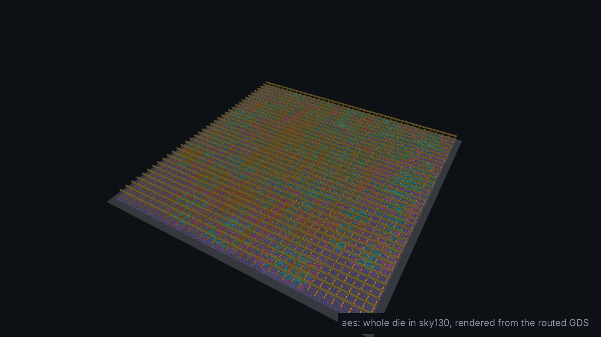
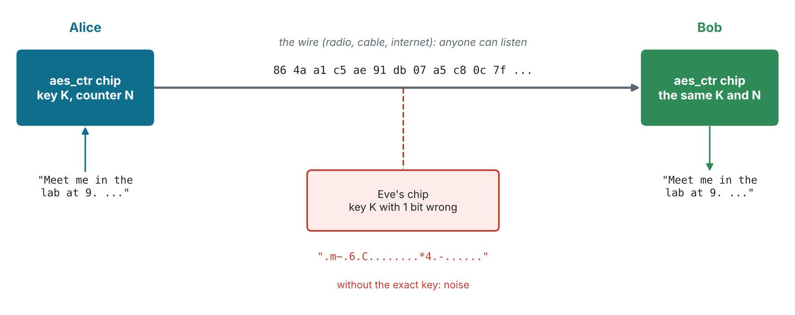
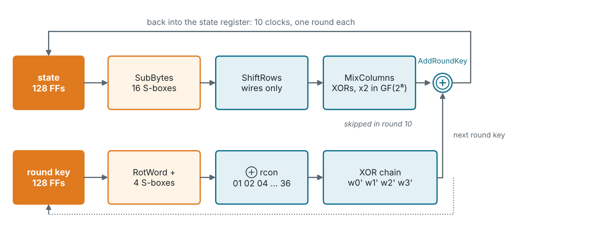
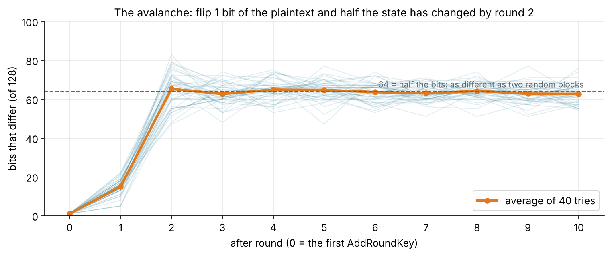
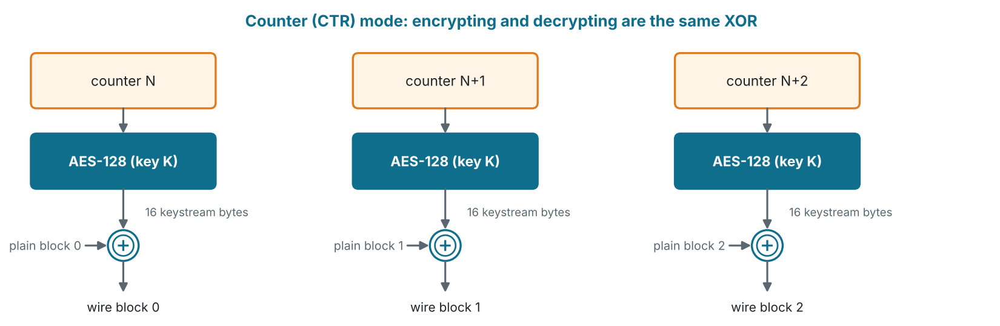
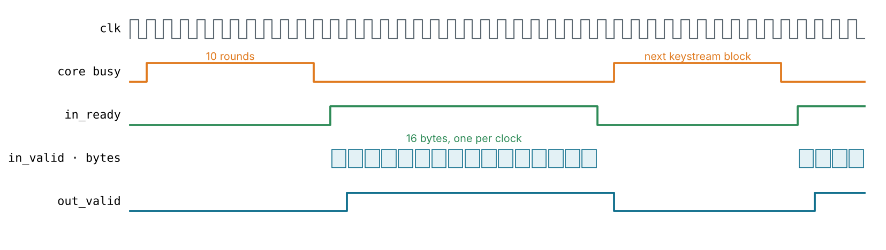
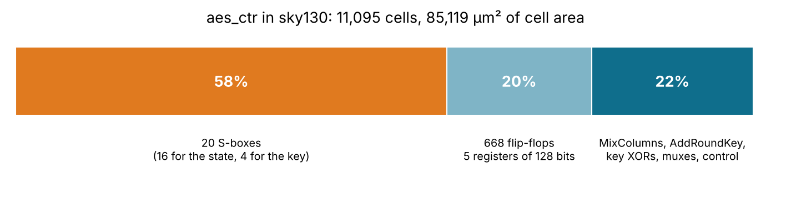
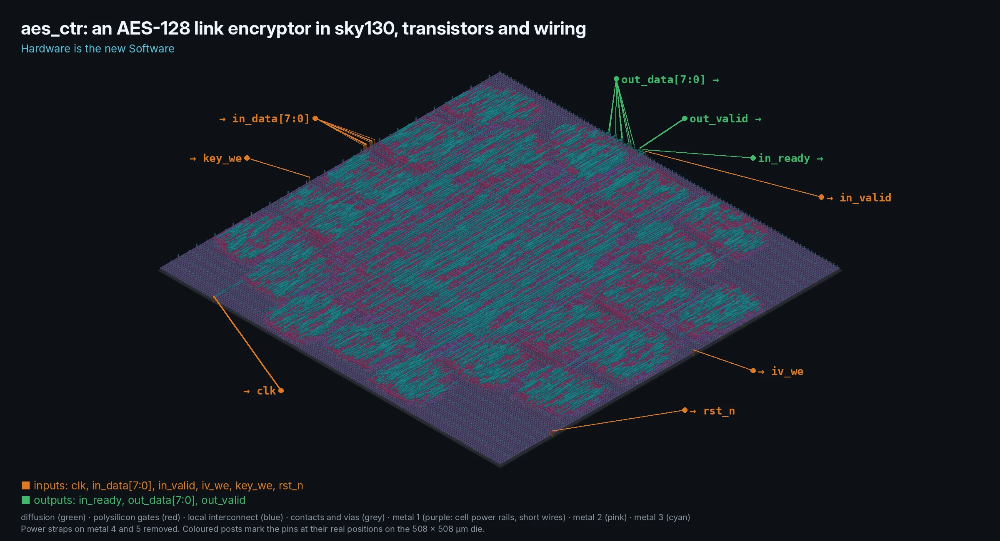
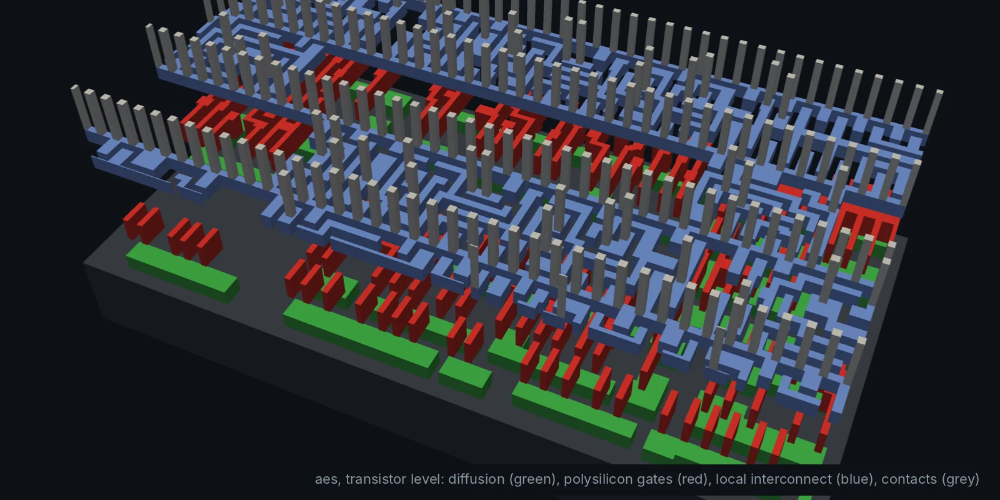

<!-- _class: lead -->
<!-- _paginate: false -->
<!-- _footer: '' -->



# Module 11
## An encryption chip for private communication

**Hardware is the new Software**

Design: `designs/aes` · Level: advanced · 5 to 6 hours

---

## Goals

Every bit you send over a radio, a cable or the internet can be read by
someone else. In this module you build the chip that stops that:

- read a real standard, **AES-128 (FIPS-197)**, and turn it into Verilog
- build an **iterative** core: one AES round per clock, ten rounds per block
- turn a block cipher into a **private link** with counter (CTR) mode
- verify it against the **official test vectors** and a Python model
- take it through **sky130 place and route**: 11,095 cells on a 508 × 508 µm die
- learn what a cipher alone does **not** protect you from

---

## The problem: a wire anyone can listen to



Alice and Bob share a 128-bit **key**. Eve sees every byte on the wire but
not the key. With one key bit wrong she reads only noise.

---

## Encryption is already hardware

| Where | Cipher | Why in hardware |
| --- | --- | --- |
| Wi-Fi (WPA2, WPA3) | AES-CCMP | every packet, at full radio speed |
| HTTPS, VPNs | AES-GCM | CPUs have AES instructions (AES-NI, ARMv8 Crypto) |
| Bluetooth Low Energy | AES-CCM | a coin cell cannot afford a CPU doing it |
| SSDs, phones | AES-XTS | self-encrypting drives: every byte at disk speed |
| Smart cards, passports | AES, 3DES | secure element chips, built to resist probing |

A software AES costs tens of clock cycles per byte on a small CPU. A
hardware core does a whole 16-byte block in a few clocks, for microwatts.

---

## AES in one slide

<div class="cols"><div>

- A **block cipher**: 128-bit block in, 128-bit block out, under a key
- AES-128: a 128-bit key and **10 rounds**
- The block is a 4 × 4 grid of bytes, the **state**, filled column by column
- Each round mixes the state with a **round key** made from the key
- Standardised by NIST in 2001 (**FIPS-197**), from the Rijndael design by
  Daemen and Rijmen. No practical attack on full AES is known.

</div><div>

| | AES-128 |
| --- | --- |
| Block | 128 bits (16 bytes) |
| Key | 128 bits |
| Rounds | 10 |
| Steps per round | 4 |
| Round keys | 11 (the key + 10) |

Byte 0 of the state is row 0, column 0; byte 4 is row 0, column 1.

</div></div>

---

## One round, four steps

| Step | What it does | In hardware |
| --- | --- | --- |
| **SubBytes** | every byte through the S-box, a fixed 256-entry table | 16 copies of a block of logic |
| **ShiftRows** | row r rotates left by r bytes | only wires: **free** |
| **MixColumns** | each column times a fixed matrix in GF(2⁸) | XOR gates |
| **AddRoundKey** | XOR with the round key | 128 XOR gates |

Before round 1 there is one AddRoundKey with the key itself. Round 10
leaves out MixColumns.

SubBytes is the only **non-linear** step: without it, AES would be a big
system of XOR equations that anyone could solve.

---

<!-- _class: small -->

## The S-box: arithmetic in GF(2⁸)

<div class="cols"><div>

Bytes are polynomials over GF(2), multiplied modulo x⁸ + x⁴ + x³ + x + 1.
The S-box is the **multiplicative inverse** in that field, then an affine
transform. `python/aes_model.py` computes it in a few lines:

```python
def _sbox_entry(a):
    b = ginv(a)          # a^254 = 1/a in GF(2^8)
    s = 0x63
    for i in range(8):   # affine transform
        bit = ((b >> i) ^ (b >> (i+4) % 8)
             ^ (b >> (i+5) % 8) ^ (b >> (i+6) % 8)
             ^ (b >> (i+7) % 8)) & 1
        s ^= bit << i
    return s
```

</div><div>

and writes it out as Verilog:

```verilog
module aes_sbox (input  wire [7:0] a,
                 output reg  [7:0] y);
  always @* case (a)
    8'h00: y = 8'h63; 8'h01: y = 8'h7c;
    8'h02: y = 8'h77; 8'h03: y = 8'h7b;
    // ... 252 more
  endcase
endmodule
```

Yosys turns the table into about **380 gates**. No memory, no clock.
Software writing hardware: *Hardware is the new Software*.

</div></div>

---

## MixColumns: multiply by 2 is a shift and an XOR

```verilog
// x2 in GF(2^8): shift left; if a bit fell off, XOR the polynomial back in
function automatic [7:0] xtime(input [7:0] b);
    xtime = {b[6:0], 1'b0} ^ (b[7] ? 8'h1b : 8'h00);
endfunction

// One column times [2 3 1 1; 1 2 3 1; 1 1 2 3; 3 1 1 2].  3·a = 2·a ^ a
function automatic [31:0] mix_col(input [31:0] c);
    reg [7:0] a0, a1, a2, a3;
    begin
        {a0, a1, a2, a3} = c;
        mix_col = {xtime(a0) ^ xtime(a1) ^ a1 ^ a2 ^ a3,
                   a0 ^ xtime(a1) ^ xtime(a2) ^ a2 ^ a3,
                   a0 ^ a1 ^ xtime(a2) ^ xtime(a3) ^ a3,
                   xtime(a0) ^ a0 ^ a1 ^ a2 ^ xtime(a3)};
    end
endfunction
```

A "multiply" in this field is **wires and XOR gates**: no adders, no carries.
Compare with the Q1.15 multipliers of the FIR.

---

## The iterative core: one round per clock



The round logic is built **once** and used ten times. The round key for the
next round is made in the same clock, next to the data path, so there is no
key memory.

---

## Key expansion, on the fly

```verilog
// t = SubWord(RotWord(w3)) ^ {rcon, 0, 0, 0}
aes_sbox u_ks0 (.a(w3[23:16]), .y(sw[31:24]));   // RotWord: bytes 1, 2, 3, 0
aes_sbox u_ks1 (.a(w3[15:8]),  .y(sw[23:16]));
aes_sbox u_ks2 (.a(w3[7:0]),   .y(sw[15:8]));
aes_sbox u_ks3 (.a(w3[31:24]), .y(sw[7:0]));
wire [31:0] n0 = w0 ^ sw ^ {rcon, 24'h0};
wire [31:0] n1 = w1 ^ n0;      // a chain: each word needs the one before
wire [31:0] n2 = w2 ^ n1;
wire [31:0] n3 = w3 ^ n2;
```

`rcon` is a register that doubles every round with `xtime`:
01, 02, 04, 08, 10, 20, 40, 80, **1b**, **36**. The last two wrapped
around the field polynomial.

---

## The control: a round counter (slightly simplified)

```verilog
always @(posedge clk or negedge rst_n) begin
    ...
    done <= 1'b0;
    if (start && !busy) begin
        state <= block ^ key;           // round 0: AddRoundKey only
        rkey  <= key;
        rcon  <= 8'h01;
        round <= 4'd1;
    end else if (busy) begin
        state <= last ? (sr ^ next_key) : (mc ^ next_key);
        rkey  <= next_key;
        rcon  <= xtime(rcon);
        if (last) begin done <= 1'b1; round <= 4'd0; end
        else      round <= round + 4'd1;
    end
end
```

**10 clocks per block.** 128 bits every 10 clocks at 50 MHz is 640 Mbit/s,
from one round of logic.

---

## The avalanche



Flip one input bit: after two rounds about **half** the 128 bits have
changed. Ten rounds is a wide safety margin.

---

## From a block cipher to a private link: CTR mode



- The chip encrypts a **counter**, not the data, and XORs the result in.
- Decrypting is the **same** operation: Bob's chip is Alice's chip.
- So the link needs **no decryption core**: half the area of a full AES.
- The low 32 bits of the counter count up per block (NIST SP 800-38A).

---

## The chip: `aes_ctr`, a byte-stream link encryptor

<div class="cols"><div>

| Pin | Dir | |
| --- | --- | --- |
| `in_data[7:0]` | in | key, counter or data byte |
| `key_we` | in | shift a key byte in |
| `iv_we` | in | shift a counter byte in |
| `in_valid` | in | a data byte |
| `in_ready` | out | keystream ready |
| `out_data[7:0]` | out | data ⊕ keystream |
| `out_valid` | out | one clock later |

22 pins: the 128-bit key goes in **one byte at a time**.

</div><div>

- Writing the key or counter **drops** the keystream in hand and starts again,
  even while the core is busy (a `stale` flag throws the old block away).
- `in_ready` falls for 12 clocks every 16 bytes: the core makes the next block.
- 16 bytes per 28 clocks: **229 Mbit/s** at 50 MHz.

</div></div>

---

## The byte stream, clock by clock



The core runs 10 rounds, then `in_ready` opens for 16 bytes, one per clock;
each comes back XORed one clock later. The 12-clock gap is what exercise 5
removes.

---

## Verification: known answers first

A crypto core that is "almost right" gives garbage, so the test starts from
the published vectors, then runs a real conversation:

```text
$ make sim
AES-128 core, known answers:
  ok    FIPS-197 appendix B    3925841d02dc09fbdc118597196a0b32  (10 clocks)
  ok    FIPS-197 C.1           69c4e0d86a7b0430d8cdb78070b4c55a  (10 clocks)
  ok    SP 800-38A ECB #1      3ad77bb40d7a3660a89ecaf32466ef97  (10 clocks)
  ...
  ok    SP 800-38A F.5.1 CTR-AES128, 64 bytes, 48 stall clocks

Alice sends: Meet me in the lab at 9. Hardware is the new Software. Bring GDS
On the wire: 86 4a a1 c5 ae 91 db 07 a5 c8 0c 7f a2 48 f5 1a 8d 71 82 8b 62 04 4f 0b ...
Bob reads:   Meet me in the lab at 9. Hardware is the new Software. Bring GDS
Eve reads:   ......$.2.Qc.zl...;.......HK.8.9;..J......z..H..R}.x!.x....Q..8H

PASS: 6 core known answers, SP 800-38A CTR, Alice -> Bob over a private link, 0 errors
```

---

## cocotb: a Python model for everything else

`python/aes_model.py` is AES-128 in plain Python, one function per step,
checked against the same vectors. `make cocotb` runs:

| Test | Checks |
| --- | --- |
| `test_fips197` | FIPS-197 through the chip: counter = plaintext, data = zeros |
| `test_sp800_38a_ctr` | the CTR vectors, then decrypts them back |
| `test_random_messages` | random keys, counters (with the 32-bit wrap), lengths and gaps |
| `test_rekey_mid_block` | a new key or counter while the core is busy: no old keystream leaks |
| `test_alice_bob` | the round trip, and one wrong key bit gives unrelated bytes |

`test_rekey_mid_block` fails if you delete the `stale` flag: the bug only
shows when a short counter write lands while the core is running.

---

## Where the area goes



The **S-boxes are more than half the chip**. That is why research on
small AES hardware is mostly research on small S-boxes (a composite-field
S-box is about a third the size of a table).

---

## The encryption chip in sky130

<div class="cols"><div>



</div><div>

| | aes_ctr |
| --- | --- |
| Cells (synthesis) | 11,095 |
| Die | 508 × 508 µm |
| Clock | 50 MHz |
| Worst slack | +10.07 ns |
| Power | 11.5 mW |
| DRC | 0 |

The biggest design in the course: 668 flip-flops and 20 S-boxes. Timing has 10 ns to spare, so it would run at about 100 MHz.

</div></div>

---

## Down to the transistors



Every one of these gates switches with your secret key in it.

---

## What this chip does not protect

- **Never reuse a key with the same counter.** Two messages under the same
  keystream: `wire1 ⊕ wire2 = plain1 ⊕ plain2`, and the key is not needed.
- **CTR hides data, it does not prove who sent it.** Eve can flip a bit on
  the wire and the same bit flips in Bob's plaintext. Real links add a
  MAC: AES-GCM and AES-CCM do both.
- **Key exchange is a separate problem.** Here the key is loaded by hand.
  Real systems agree on it with public-key crypto (Diffie-Hellman, ECDH).
- **Side channels.** The chip's power draw depends on the data in the
  S-boxes. Measuring it (power analysis) can reveal the key. Secure chips
  add masking and noise; this teaching chip does not.

> A teaching chip, not a product: use a reviewed, certified implementation for real secrets.

---

<!-- _class: exercise -->

## Exercises

1. Change one byte of the key in `tb/aes_ctr_tb.v`. How many bytes of Eve's
   output match the message? Why not zero?
2. Draw `make waves`: follow `round`, `rcon` and `state` through one block.
   Check round 1 against FIPS-197 appendix B.
3. **Smaller:** a 32-bit datapath with 4 S-boxes (one column per clock,
   about 44 clocks per block). Compare area and Mbit/s with `make synth-sky130`.
4. **Faster:** unroll two rounds per clock. What happens to fmax and area?
5. **No stalls:** keep two keystream blocks so `in_ready` never drops.
6. **Stretch:** add the inverse cipher (InvSubBytes, InvMixColumns) for ECB
   decryption, or a GHASH multiplier for AES-GCM.

---

## Key takeaways

- A standard (FIPS-197) is a **specification you can compile**: the Python
  model and the Verilog follow the same steps, and the test vectors check both
- **Iterative** hardware builds one round and reuses it: area for speed,
  the same trade as the FIR's shared multiplier
- In GF(2⁸), multiplication is **XOR gates**; the S-box is the expensive part
- **Modes matter:** CTR turns one encryption core into a full-duplex private
  link, with no decryption logic
- A correct cipher is only one part of security: counters, integrity,
  key exchange and side channels are the rest

> **Hardware is the new Software.** The same algorithm runs as Python in the
> test and as 20 S-boxes in sky130, and `make` checks they agree.

---

<!-- quiz: generated by slides/answers/make_quizzes.py on the quiz-answers branch -->
<!-- _class: quiz -->

## Quiz (1/2)

1. How many clock cycles does the `aes128` core take for one block, from `start` to `done`?
   <span class="opts">**A** 1 &nbsp;·&nbsp; **B** 4 &nbsp;·&nbsp; **C** 10 &nbsp;·&nbsp; **D** 16</span>
2. Which AES step costs no gates at all in hardware?
   <span class="opts">**A** SubBytes &nbsp;·&nbsp; **B** ShiftRows &nbsp;·&nbsp; **C** MixColumns &nbsp;·&nbsp; **D** AddRoundKey</span>
3. In GF(2⁸), `xtime(8'h80)` (multiply 0x80 by 2) is:
   <span class="opts">**A** 0x00 &nbsp;·&nbsp; **B** 0x100 &nbsp;·&nbsp; **C** 0x1b &nbsp;·&nbsp; **D** 0x40</span>
4. Why does the `aes_ctr` link chip need no AES decryption logic? <span class="sa">*(short answer)*</span>

---


<!-- _class: quiz -->

## Quiz (2/2)

5. How many S-boxes does the iterative core have, and what are they for?
   <span class="opts">**A** 1, shared &nbsp;·&nbsp; **B** 16, state only &nbsp;·&nbsp; **C** 20: 16 for the state, 4 for the key &nbsp;·&nbsp; **D** 160, one per round and byte</span>
6. Two messages were sent with the same key and the same starting counter. What can Eve learn from the two wires? <span class="sa">*(short answer)*</span>
7. Eve flips bit 3 of byte 10 on the wire. What does Bob's chip output?
   <span class="opts">**A** garbage for the whole block &nbsp;·&nbsp; **B** an error flag &nbsp;·&nbsp; **C** the message with bit 3 of byte 10 flipped &nbsp;·&nbsp; **D** the message, unchanged</span>
8. Exercise 5 keeps a second keystream block so `in_ready` never drops. What throughput does the link reach at 50 MHz, in Mbit/s? <span class="sa">*(short answer)*</span>

> Answer on paper first, then check yourself against the answer key on the `quiz-answers` branch (`slides/answers/`).
